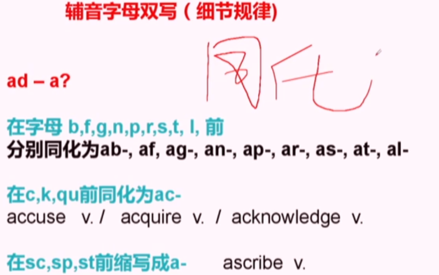

## 词汇
### 总概
记：词汇记法+多元化方式
联想法：
谐音： robust adj.强壮的，坚定的 （乐百氏）
拆分：crystal n.
图形联想：myopia n.近视 op=eye -ia名词后缀，表示某种疾病。acrophobia n.恐高症失眠  ac-A    insomnia  n. 失眠
构词法：
拼缀法：web（网；万维网） +log（日志；记录）=Blog（博客） Brexit英国脱欧
合成法：blackboard n.（黑板）  land-dwelling adj. 合成特点：n. + v.-ing

词根词缀 prefix（前缀）+root（词根）+suffix（后缀）
bound root 黏附词根 free root 自由词根

音变现象：
元音音变 a/e/i/o/u 
spect-spic=to see inspect（检查；视察）/respect（尊重；尊敬）/expect（预期；期待）/prospect（前景；可能性） conspicuous adj.（显眼的；引人注目的）
nov-new（新的） newbie（新手）-novice（新手；初学者） novel adj./n.（新颖的；小说） innovation（创新；革新）
or-er-ar professor（教授）/teacher（教师）/scholar（学者）  projector（投影仪）/cooker（炊具；炉灶）/calendar

辅音音变
**v-b-f/ph**  move（移动；搬动）-mobile（可移动的；流动的） belied（掩饰；与……不符（belie的过去式及过去分词））-believe（相信） 
**c/k-g**  
**ac-ag**尖  acute（急性的；敏锐的；尖锐的）/acerbic（尖刻的；辛辣的）/acupuncture针灸 angle（角；角度）/eagle（鹰）
**cogn-kn** recognitive v.  cognitive adj. 认知的，感知的，认识的
**c-h** unicorn（独角兽） corn（玉米）-horn（角；号角） horticulture（园艺） hort-court（庭院；法庭；球场） **cult（狂热崇拜；异教团体）**
 **d-t**
 ed-eat（吃） inedible（不能食用的） uneatable（不能吃的；难以下咽的）
 sid-sit（坐） president assiduous adj. 勤奋的
 u-连字符 arduous adj.艰难的 graduate v./n.（毕业；毕业生）
**m-n**
 con/com competition n.（竞争；比赛） commemorate v.（纪念） communication（交流；沟通） combine 
 当词根或单词首字母是b/p/m时前缀con就变身为com
辅音字母双写
aggravate adventure（冒险；冒险经历） advocate（提倡；拥护；倡导者）
illuminate addict（成瘾者；入迷的人） accumulate
 元音字母开头，后面两个辅音字母
 从两个辅音字母中间划开，前面是前缀(表示强调一而再再而三)后面是词根，词根后可能会有后缀
aggravate v. 加重，激怒 ag=gravity n.重力	grave adj. 重大的，严重 n.坟墓
illuminate v. 照亮，阐明，解释
accumulate v.累积，积聚

*辅音字母双写与 ad- 前缀同化：课堂截图。*

尾辅音变化
各种尾辅音都向齿龈爆破音[t]变化
describe（描述） description（描述；说明） scrib - script（文字；剧本；脚本）
absorb（吸收；使专注） absorption（吸收；专注） sorb-sorpt
eligible（符合条件的；有资格的） elect lig-lect
pigment（色素；颜料） picture（图片；照片） pig-pict
indicate（表明；指示）-predict（预测） dic-dict
reduce reduction（减少；降低） duc-duct
move（移动；搬动） motion（运动；移动） mov-mot
solve（解决）-solution（解决办法；溶液） solv-solut
consume（消耗；消费） consumption（消耗；消费） sum-sumpt
redeem（赎回；兑换；弥补） redemption（赎回；兑换；救赎） em-empt

背 一词多义  并联spot 串联price
用 高能语言状态 Diction（措辞；用词） + Syntax（句法） + Rhetorical devices（修辞手法）
### 前缀
说明：以下为常见含义和构词作用，不能仅凭字母相同就认定含有该词缀；具体含义需结合整个单词。  例词前缀加绿，后缀加蓝。
#### 向上系列
##### super-/sur-
super-/sur- （在……上方；超过、超出；sur-是super-在部分词中的变体）  
超过、超出：superhuman adj. 超人的；超出常人能力的  
在上方：surface n.表面  v.显露 on the surface从表面上看 ｜ 在上方：surmount v.克服，解决，成功应对，居于...之上  
##### over-
over- （在……上方；越过；过度、过量）  
越过：overpass n. 跨线桥；天桥  
overall adv.总体上 adj.总体的 ｜ overcome v.克服，解决 ｜ 在上方：overlook v.俯瞰，看漏，忽视  
过度、过量：overestimate v.高估  
#### 向下系列
##### de- 
de-（向下；离开、去除；使相反、降低）  
去除：dehydrate v. 使脱水 ｜ 使相反：deactivate v. 使停止运作  
向下、降低：decline v.下降，衰落，衰退，谢绝 ｜ 向下、降低：decrease n./v.减少 ｜ depend v. 取决于，依靠  
##### sub- 
sub-（在……下面；次一级；接近、略低于）  
次一级：subcommittee n. 小组委员会 ｜ 略低于：substandard adj. 低于标准的  
在下面：subway n.（地铁） ｜ suburb n.郊区 ｜ 在下面：submarine n.潜水艇  
接近、略低于：subtropical adj.亚热带  
**sub- → suc-/suf-**
sub-suc-/suf- （sub-的同化形式：c前变suc-，f前变suf-；基本义为“在下面、从下方”，部分词中表示“随后”）  
随后、接着：succeed v.继续，继承，成功 ｜ successive  adj.（连续的；接连的） ｜ successor n.（继任者；接替者）  
在下面：suffer v.遭受，变差  
构成：[succeed](https://www.etymonline.com/word/succeed)：suc-（随后）+ ceed（走）→ 接着走 → 继承；[suffer](https://www.etymonline.com/word/suffer)：suf-（在下）+ fer（承担）→ 承受 → 遭受。  
**sub- → sus-**
sub-sus-（sub-的变体，表示“在下面、从下方向上”）  
从下方支撑：sustain v.维持，使...持续，支撑 ｜ sustainable adj.可持续的  
构成：[sustain](https://www.etymonline.com/word/sustain)：sus-（从下方）+ tain（握住、保持）→ 托住 → 支撑、维持。  
##### under-
under- （在……下面；不足；低于）  
不足：underestimate v. 低估 ｜ 低于：underage adj. 未到法定年龄的  
在下面：underground adj. 地下的n.地铁 ｜ 在下面：underwear n. 内衣 ｜ 在下面：underline v. 在...下面划线，强调  
#### 趋向系列
##### ad-/ac- 
ad-/ac-（向、朝；ac-是ad-在c前的同化形式）  
向、朝：accept v. 接受。  
##### ob-/of-
ob-/of-（朝向；对着、挡在前面；of-是ob-在f前的同化形式）  
朝向：offer v. 提供（拿到面前） ｜ 挡在前面：obstacle n. 障碍  
#### 向内系列
##### in-/im- 
in-/im- （向内、进入；另有同形的否定前缀，表示“不、非”，如incorrect、impossible）  
向内、进入：include v. 包括 ｜ 向内、进入：income n. 收入 ｜ 向内、进入：interiorn.内部，内陆，内政(Minister of the Interior) adj.内地的  
向内、进入：innermost adj.隐秘的，内心深处的  
当词根或单词首字母是b/p/m 时前缀in-就变身为im-  
向内、进入：import（进口；引进） ｜ 向内、进入：immigrate（移民；移居入境） ｜ 向内、进入：imprison（监禁）  
##### en-/em-
en-/em-（向内、使进入；使成为、使处于某状态；em-常用于b、p、m前）  
使进入：encase v. 把……装入套、盒中  
使成为：enlarge v. 扩大 ｜ 使具有：empower v. 授权；使有能力  
#### 向外系列
##### ex-/e- 
ex-\e-（向外、离开；ex-也可表示“前任的”，如ex-president）  
前任的：ex-president n. 前总统  
向外、离开：exit n.出口 ｜ 向外、离开：express v.表达 n. 快递，快线 ｜ exploit n.  英雄业绩v.开发，利用(充分)，剥削  
向外、离开：elect v.选举，选择elect to do sth.  **必学词根:lect-lig-选** ｜ collect v.（收集；聚集） /  
select v.（选择；挑选）/ ｜ eligible adj.（符合条件的；有资格的）  
向外、离开：emigrate v. 移居国外  He emigrated to Australia as a young man.  
##### out-
out-（向外；超过、胜过）  
向外：outflow n. 流出 ｜ 超过：outperform v. 表现优于  
#### “前”系列
##### pre- 
pre-（在……之前；预先）  
预先：preheat v. 预热  
在前、预先：president n. 总统，主席sid-sit（坐） ｜ 在前、预先：prejudice n.偏见  
在前、预先：prescription n. 处方,药方 音变之script（文字；剧本；脚本）-scrib  
##### pro- 
pro-（向前；支持、赞成；某些词中表示代替）  
支持、赞成：pro-democracy adj. 支持民主的 ｜ 代替：proconsul n. （古罗马）代行执政官职权的行省总督  
向前：prolong v. 延长，拉长 ｜ 向前：promote v.促进，促销，晋升 ｜ proliferate v.激增，扩散 
向前：prominent min=突起 突出的，显著的，著名的 ｜ eminent adj.（杰出的；著名的） being  
famous（著名的）,important, and respected  
##### fore-
fore-（在前面；事先、预先）  
在前、预先：before（在……之前；以前） ｜ 在前、预先：former adj. 前者的  
在前、预先：foremost adj.最前面的，最重要的adv. first and foremost = initially（起初；最初） = in the first place（首先；起初）  
在前、预先：forecast v./n.预报，预测weather forecast(er) ｜ 在前、预先：foretell v.预言  
在前、预先：foresee v.预见unforeseen benefits（意想不到的益处） (R)  
#### “后”系列
##### post-
post-（在……之后；后于）  
在……之后：post- war adj.战后的(尤指二战后) ｜ 在……之后：postgraduate n. 研究生 ｜ 在……之后：postpone v.延迟，延期  
##### re- 
re-（再、重新；向后、返回；在部分词中起加强作用）  
再、重新：rewrite v. 重写 ｜ 加强：research n./v. 研究（词源中re-可能起加强作用，不直接译为“再次”）  
返回：return（返回；归还） ｜ 返回：rejectv.拒绝，回绝 ｜ reduce v. 减少,降低 reduce to reduce by  
“起起伏伏”的学问  
rocket v.（急剧上升；猛涨） 90 plummet v.（骤降；暴跌）  
soar（猛增；高飞）   60 slump（大幅下降；暴跌）  
surge（激增；涌动） 45 subside（减弱；平息；回落）  
boom（繁荣；迅速发展） 30 ebb（衰退；退潮）  
creep up（缓慢上升） <10 creep down（缓慢下降）  
重新：rejuvenate v.使恢复年轻，返老还童 ｜ 返回：reverberate v.起回声，回响，反射 ｜ resent 对...愤恨不满  
resentful adj.（愤恨的；不满的）  sent 每个单词都是记忆词汇的线索  
sentence n./v.（句子；判决；宣判） ｜ consent 同意 ｜ consensus n.（共识；一致意见）  
说明：下面的涨跌词及sent词族保留作联想复习，不都含re-前缀。  
#### 向中间系列
##### inter-
inter-（在……之间；相互）  
相互：interact v.互动，相互作用 ｜ 在……之间：interval n.间隔，间歇 ｜ 在……之间：interfere v. 干涉 (with)  
##### mid-
mid-（中间；中部）  
(middle) ｜ 中间、中部：midday n. 中午，正午 ｜ 中间、中部：midnight n.午夜  
immediately adv.（立即；马上）  
说明：middle用于联想；immediately不含表示“中间”的mid-前缀。  
#### 否定与错误系列
##### un-
un-（不、非；也可表示取消或逆转某动作，如untie（解开））  
取消、逆转动作：untie v. 解开  
不、非：unfair（不公平的） ｜ 不、非：uncomfortable（不舒服的；不自在的）  
##### in-/im-/il-/ir-
in-/im-/il-/ir-（不、非；同一个否定前缀的不同形式，与表示“向内”的in-区分）  
不、非：inaccurate adj. 不准确的； ｜ 不、非：impossible adj. 不可能的； ｜ 不、非：illegal adj. 非法的；  
不、非：irregular adj. 不规则的  
同化提示：否定前缀in-在l前常变为il-，在r前常变为ir-，在b、p、m前常变为im-。  
##### non-
non-（非、不；表示不属于某类）  
不、非：nonverbal adj. 非言语的  
##### dis- 
dis-（不、相反；分开；去除、取消）  
分开：disperse v. 分散 ｜ 取消：disconnect v. 断开连接  
不、非：disappear（消失） ｜ 去除：disclose（披露；揭露） ｜ 不、非：disadvantage（不利条件；劣势）  
##### mis-
mis-（错误地、不当地）  
错误、不当：misunderstand v. 误解； ｜ 错误、不当：misleading adj. 误导的  
#### 共同系列
##### con- 
con-（共同、一起；部分词中起加强作用）  
加强：confirm v. 确认；证实（词源可联系“使牢固”理解）  
共同、一起：consist（由……组成（consist of）；在于（consist in）） ｜ 共同、一起：concentrate（集中注意力；浓缩）  
##### com- 
com-（con-的同化变体，常表示共同、一起）  
共同、一起：combat v.与...战斗  
说明：combat可联系“一起战斗、交战”理解，整词表示与……战斗。  
##### col-
col-（con-在l前的同化变体，常表示共同、一起）  
共同、一起：collaborate v.合作,协作,通敌(with)  
##### cor-
cor-（con-在r前的同化变体，常表示共同、一起）  
加强：corroborate v.证实  
说明：corroborate中的cor-主要起加强作用，不宜硬译为“共同”。  
##### co- 
co-（共同、一起）  
共同、一起：coexist v. 共存； ｜ 共同、一起：coauthor n. 合著者  
#### 反对与对抗系列
##### anti-
anti-（反对；抵抗）  
反对：antiwar adj. 反战的； ｜ 抵抗：antibacterial adj. 抗菌的  
##### counter-
counter-（相反；对抗）  
相反：counterclockwise adj./adv. 逆时针的；逆时针地  
对抗：counterargument n. 反驳的论点  
#### 跨越与范围系列
##### circum-
circum-（周围、环绕）  
周围：circumscribe v. 限定范围（画出周界） ｜ circumstance n. 环境；情形  
##### per- 
per-（穿过；完全、彻底）  
穿过：permeate v. 渗透；弥漫  
完全、彻底：perceive v. 察觉、理解；此处取“完全、彻底”的含义。  
##### trans- 
trans-（横跨；穿过；转变）  
穿过：transdermal adj. 经皮的；透过皮肤的  
横跨：transcontinental adj. 横贯大陆的； ｜ 转变：transform v. 使转变  
##### extra-
extra-（在……之外；超出）  
超出：extraordinary adj. 非凡的；超出寻常的  
在……之外：extracurricular adj. 课外的  
#### 数量与规模系列
##### semi-
semi-（半；部分、一定程度）  
半：semicircle n. 半圆 ｜ 部分：semi-independent adj. 半独立的  
##### bi-/multi-
bi-/multi-（bi-表示二、双；multi-表示多）  
二、双：bilingual adj. 双语的； ｜ 多：multicultural adj. 多元文化的  
##### micro-/macro-
micro-/macro-（micro-表示微小；macro-表示宏观、大规模）  
微小：microorganism n. 微生物； ｜ 宏观、大规模：macroeconomic adj. 宏观经济的
### 后缀
区分词性  
**名词后缀**  
表人与物 
-er/-or/-ar（名词后缀：常表示从事某活动的人或具有某作用的物；并非所有以这些字母结尾的词都能这样拆分） singer（歌手） ｜ cooker（炊具；炉灶） ｜ actor（演员） ｜ ruler（尺子；统治者） ｜ scholar（学者） ｜ consumer（消费者） ｜ radar（雷达） ｜ elevator  
元音音变 ride（骑；乘坐）-road（道路）-raid（突袭；搜查）  
-ee（常表示动作的承受者，也可表示处于某种状态的人） employee n. 雇员； ｜ trainee n. 受训者  
-an/-ian（名词或形容词后缀：表示某地的人、某领域的人，或“与……有关的”） american（美国人；美国的）  
-ist（名词后缀：表示从业者、专家、某种活动的参与者或某种主张的支持者） dentist（牙医） ｜ tourist（游客）  
-ant（名词后缀：表示执行某动作的人或事物） assistant（助手；助理） ｜ servant（仆人） ｜ applicant  
表性质状态与行为  
-ance/-ancy/-ency/-ence/-cy（名词后缀：常表示行为、性质、状态或程度） appearance（外貌；出现） ｜ emergency（紧急情况） ｜ emergence（出现；兴起） ｜ privacy（隐私）  
-ity/-ty（名词后缀：表示性质、状态） ability（能力） ｜ safety（安全） ｜ security（安全；保障） ｜ certainty n. 确定性  
-ness（表示性质、状态） awareness n. 意识； ｜ weakness n. 弱点  
-ment（名词后缀：表示行为、过程、结果或状态） development（发展；开发）  
-ion（名词后缀：表示行为、过程、状态或结果，常见形式包括-tion、-sion） action（行动；行为） ｜ communication（交流；沟通） ｜ description（描述；说明）  
-ure（名词后缀：表示行为、结果或状态） capture n. 捕获 ｜ failure n. 失败  
-age（名词后缀：可表示行为、状态、集合或费用，具体含义随单词变化） marriage（婚姻） ｜ shortage（短缺） ｜ package（包裹；包装）  
-ship（名词后缀：表示身份、地位、关系、性质或技能） friendship（友谊） ｜ relationship（关系）  
-hood（表示时期、身份或群体） childhood n. 童年； ｜ neighborhood n. 街区  
-ism（表示思想、制度或某种现象） capitalism n. 资本主义； ｜ tourism n. 旅游业  
-ary/-ery/-ory（名词中可表示场所、相关事物或集合；-ary、-ory也可构成形容词，表示“与……有关的”） factory（工厂） ｜ dictionary（词典） ｜ bakery（面包店）  
-um/-ium（拉丁语来源词中常见的名词词尾；-ium也常用于化学元素名称，不宜统一解释为某一种具体事物） museum（博物馆） ｜ auditorium（礼堂；观众厅） ｜ millennium（一千年；千禧年） ｜ aluminum（铝）  
**形容词后缀**  
-able/-ible（形容词后缀：可……的；能够被……的；有时表示具有某种性质） reasonable（合理的） ｜ acceptable（可接受的） ｜ incredible（难以置信的） ｜ quantifiable（可量化的）  
-ive（形容词后缀：具有……性质、倾向或作用的） creative（有创造力的） ｜ impressive（令人印象深刻的） ｜ massive（巨大的；大量的）  
-ant/-ent（形容词后缀：处于某种状态的；具有某种性质或作用的） significant（重要的；显著的）  
-ic/-ical/-al（形容词后缀：与……有关的；具有……性质的；同一词根的不同后缀形式可能存在词义差别） economic（经济的；经济上的） ｜ economical（节约的；经济实惠的） ｜ historical  
词汇小知识n.+-al=adj. v.+-al=n.  
-ous（形容词后缀：具有……性质的；充满……的） famous（著名的） ｜ dangerous（危险的） ｜ enormous（巨大的）  
-ful（充满……的；具有……的） useful adj. 有用的； ｜ harmful adj. 有害的  
-less（没有……的；缺乏……的） harmless adj. 无害的； ｜ countless adj. 无数的  
-ish（形容词后缀：具有……特点的；略微、有点） childish adj. 幼稚的 ｜ greenish adj. 略带绿色的  
-y（具有某种特征的） rainy adj. 多雨的； ｜ risky adj. 有风险的  
-en（形容词后缀：由某种材料制成的；有时表示颜色或引申性质） wooden adj. 木制的 ｜ golden adj. 金制的；金色的  
**动词后缀**  
-ate（动词后缀：使成为、使具有某种性质，或进行某种动作；-ate也可见于名词和形容词） graduate（毕业；毕业生）  
-ize/-ise（动词后缀：使……化；使成为；按某种方式处理；两种拼写的使用取决于地区及具体单词） realize（意识到；实现） ｜ modernize（使现代化） ｜ globalize（使全球化）  
-fy/-ify（动词后缀：使成为；使具有某种性质） purify（净化） ｜ clarify（澄清；阐明） ｜ gratify（使满意；使高兴）  
-en（动词后缀：使变得……；变得……） deepen（加深） ｜ widen（拓宽） ｜ lengthen（延长） ｜ weaken（削弱）  
**副词后缀**  
-ly（常构成副词，表示方式、程度等） rapidly adv. 迅速地； ｜ largely adv. 在很大程度上  
注意：并非所有以-ly结尾的词都是副词，例如friendly是形容词，表示“友好的”。  
-wise（副词后缀：以……方式；朝……方向） clockwise adv. 顺时针地 ｜ likewise adv. 同样地  
**方向后缀**  
-ward/-wards（表示朝向某个方向，常构成形容词或副词；具体词形和词性需结合单词判断） downward adj./adv. 向下的；向下地； ｜ backwards adv. 向后  
参考：[Cambridge Dictionary：Suffixes](https://dictionary.cambridge.org/grammar/british-grammar/suffixes)、[University of Wisconsin：Prefixes and Suffixes](https://courses.dcs.wisc.edu/wp/grammar/category/prefixes-and-suffixes/)。  
### 词根
#### ceive / cept / cip / capt = 拿、取、接受
词根含义：take / seize（拿、取、抓住）；引申为接受、把握。

**接收与接受**
构成：[receive](https://www.etymonline.com/word/receive) = [re-](#note-prefix-re)（回、向自己）+ ceive（取）→ 接收到自己这里 → 收到、接收；此处[re-](#note-prefix-re)不按“再次”理解。
构成：[accept](https://www.etymonline.com/word/accept) = [ac-](#note-prefix-ad-ac)（[ad-](#note-prefix-ad-ac)的同化形式，向、朝）+ cept（取）→ 接过来 → 接受。
- receive v. 收到；接到；接待。
- reception n. 接待；接收；招待会。
- receptionist n. 接待员；前台工作人员。
- receptive adj. 乐于接受的；善于接受的。常用：be receptive to sth.（乐于接受某事物）。
- accept v. 接受；认可。
词族：receive → reception → receptive（接收 → 接待、接收 → 乐于接受的）。
补充：accept → acceptance n. 接受、认可 → acceptable adj. 可接受的。

**察觉与理解**
构成：[perceive](https://www.etymonline.com/word/perceive) = [per-](#note-prefix-per)（完全、彻底）+ ceive（取、把握）→ 充分把握，在头脑中领会 → 察觉、理解。
- perceive v. 察觉；理解；认为。常用：perceive A as B（将A看作B）。
- perception n. 感知；看法；认识。
- perceptive adj. 洞察力强的；敏锐的。

**欺骗**
构成：[deceive](https://www.etymonline.com/word/deceive) = [de-](#note-prefix-de)（离开；在此也有贬义解释）+ ceive（取）→ 词源义为诱捕、蒙骗 → 欺骗；不宜机械译成“向下拿”。
- deceive v. 欺骗。 deceive sb. into doing sth.：欺骗某人做某事。
- deception n. 欺骗；骗局。
- deceptive adj. 有欺骗性的；容易使人产生错觉的。

**构想与概念**
构成：[conceive](https://www.etymonline.com/word/conceive) = [con-](#note-prefix-con)（在此可能起加强作用）+ ceive（取、容纳）→ 接纳并容纳 → 怀孕；引申为在头脑中形成想法 → 构想。
- conceive v. 构想；设想；怀孕。
- conception n. 构想；概念；受孕。
- misconception n. 错误认识；误解。
- concept n. 概念；观念。

**捕获与解放**
构成：[capture](https://www.etymonline.com/word/capture) 可按 capt（抓、取）+ -ure（名词词尾）辅助记忆 → 捕获这一行为；英语中先有名词，再用作动词，并非前缀＋词根结构。
构成：[emancipate](https://www.etymonline.com/word/emancipate) 可按 [e-](#note-prefix-ex-e)（[ex-](#note-prefix-ex-e)的变体，向外）+ man（手）+ cip（取、掌握）+ -ate（动词词尾）辅助记忆 → 从他人的掌控中释放出来 → 解放。
- capture v. 捕获；夺取；吸引。n. 捕获。 capture one's attention：吸引某人的注意力。
- emancipate v. 解放；使摆脱束缚。常用：emancipate sb. from sth.（使某人摆脱某种束缚）。

#### fer = 携带、带来、承受
词根含义：carry / bear（携带、带来、承受）。

**提供与提及**
构成：[offer](https://www.etymonline.com/word/offer) = of-（ob-的同化形式，朝向）+ fer（带来）→ 拿到面前 → 提供。
构成：[refer](https://www.etymonline.com/word/refer) = [re-](#note-prefix-re)（回）+ fer（带）→ 带回、指向 → 提及、查阅。
- offer v. 提供；主动提出。n. 提议；报价。offer sb. sth.：向某人提供某物。
- refer v. 提及；指向。refer to：提到；查阅；指的是。
- reference n. 提及；参考；推荐信。
- referee n. 裁判；推荐人。
记忆口诀：-er“攻”、-ee“受”，常表示动作发出者／承受者。
- interviewer / interviewee：面试官／应聘者；采访者／受访者。
- employer / employee：雇主／雇员。
- trainer / trainee：培训者／受训者。

**延期与尊重**
构成：[defer](https://www.etymonline.com/word/defer)（延期）与differ同源，可联系“把事情移开、往后放”理解；defer to（听从）源于de-（向下）+ fer（带）。
- defer v. 推迟。defer doing sth.：推迟做某事。 defer to sb.：听从、尊重某人的判断。
- deference n. 尊重；顺从。
- deferment n. 延期；推迟。

**偏爱与差异**
构成：[prefer](https://www.etymonline.com/word/prefer) = [pre-](#note-prefix-pre)（在前）+ fer（带）→ 放在前面 → 更喜欢。
构成：[differ](https://www.etymonline.com/word/differ) = dif-（[dis-](#note-prefix-dis)的同化形式，分开）+ fer（带）→ 分开 → 不同。
- prefer v. 更喜欢。prefer A to B：比起B更喜欢A。
- preferable adj. 更可取的。A be preferable to B：A比B更可取。
- preferential adj. 优惠的；优先的。
- differ v. 不同。differ from：与……不同。
- different adj. 不同的。
- difference n. 差异；不同。
- differentiate v. 区分。differentiate A from B：区分A与B。

**承受与推断**
构成：[suffer](https://www.etymonline.com/word/suffer) = suf-（[sub-](#note-prefix-sub)的同化形式，在下面）+ fer（承受）→ 承受痛苦 → 遭受。
构成：[infer](https://www.etymonline.com/word/infer) = [in-](#note-prefix-in-im)（向内）+ fer（带）→ 引入结论 → 推断。
- suffer v. 遭受；受苦。suffer from：患有；因……受苦。
- suffering n. 痛苦；苦难。
- infer v. 推断。infer A from B：从B推断出A。
- imply v. 暗示。speaker → imply；listener → infer：说者暗示，听者推断。

**联想词**
- interfere v. 干涉；妨碍。interfere with：干扰、妨碍。此词不属于“携带”的fer词根。
- interference n. 干涉；干扰。
- transplant v. 移植。[trans-](#note-prefix-trans)（转移）+ plant（种植）→ 移植。
- transform v. 改变；使转变。[trans-](#note-prefix-trans)（转变）+ form（形态）→ 改变形态。

#### miss / mit / mis = 发送、放出
词根含义：send / let go（发送、放出）；mis是此词族中的变体，与“错误”的前缀mis-区分。

**发出与承诺**
构成：[emit](https://www.etymonline.com/word/emit) = [e-](#note-prefix-ex-e)（向外）+ mit（发送）→ 发出。
构成：[promise](https://www.etymonline.com/word/promise) 源于[pro-](#note-prefix-pro)（向前、预先）+ mittere（发送）→ 预先作出保证 → 承诺。
- missile n. 导弹；投射物。
- emit v. 发出；排放。
- emission n. 排放；排放物。
- promise n./v. 承诺；答应。promise to do sth.：承诺做某事。

**准入与承认**
构成：[admit](https://www.etymonline.com/word/admit) = [ad-](#note-prefix-ad-ac)（向）+ mit（发送）→ 让进入 → 准入；引申为承认。
- admit v. 承认；准许进入。admit doing sth.：承认做过某事。 be admitted to / into：获准进入；被录取。 admit of sth.：容许某种可能（正式）。
- admission n. 承认；准入；入场费。

**投入与承诺**
构成：[commit](https://www.etymonline.com/word/commit) = [com-](#note-prefix-com)（一起）+ mit（发送）→ 交付；引申为投入、承诺。
- commit v. 承诺；投入；犯下。commit a crime：犯罪。 commit yourself to (doing) sth. / sb.：承诺、致力于某事；对某人作出承诺。
- commitment n. 承诺；投入；责任。

**遣散与省略**
构成：[dismiss](https://www.etymonline.com/word/dismiss) = [dis-](#note-prefix-dis)（分开）+ miss（发送）→ 送走 → 解雇、不予考虑。
构成：[omit](https://www.etymonline.com/word/omit) = o-（ob-的变体）+ mit（放出）→ 放掉、搁置 → 省略、遗漏。
- dismiss v. 解雇；不予考虑。dismiss A as B：认为A是B而不予考虑。
- omit v. 省略；遗漏。omit sth. from sth.：从……中省略某项。 omit to do sth.：未做、疏忽做某事。
- omission n. 省略；遗漏。

**提交与屈服**
构成：[submit](https://www.etymonline.com/word/submit) = [sub-](#note-prefix-sub)（在下）+ mit（发送）→ 置于他人权威之下 → 提交、服从。
- submit v. 提交；屈服。submit an application：提交申请。 submit to sb. / sth.：服从、屈服于……。
- submission n. 提交；提交物；屈服。

#### scrib / scribe / script = 写
词根含义：write（写）；引申为记录、描述。

**描述与文字**
构成：[describe](https://www.etymonline.com/word/describe) = [de-](#note-prefix-de)（向下）+ scribe（写）→ 写下来 → 描述。
- describe v. 描述。describe A as B：将A描述为B。
- description n. 描述；说明。
- script n. 文字；剧本；脚本。

**归因**
构成：[ascribe](https://www.etymonline.com/word/ascribe) = a-（[ad-](#note-prefix-ad-ac)的变体，向）+ scribe（写）→ 记在某人或某事名下 → 归因。
- ascribe v. 归因；认为是……所作。ascribe A to B：把A归因于B。

**订阅与赞同**
构成：[subscribe](https://www.etymonline.com/word/subscribe) = [sub-](#note-prefix-sub)（在下面）+ scribe（写）→ 在文件下方签名 → 赞同、认购、订阅。
- subscribe v. 订阅；赞同。subscribe to a journal：订阅期刊；subscribe to a view：赞同某观点。
- subscription n. 订阅；订阅费。

**划定范围**
构成：[circumscribe](https://www.etymonline.com/word/circumscribe) = circum-（周围）+ scribe（写、画）→ 画出周界 → 限制范围。
- circumscribe v. 限制；限定范围。

#### sist / st / stitut = 站立、设立
词根含义：stand / set（站立、放置）；引申为坚持、存在、建立。

**坚持**
构成：[insist](https://www.etymonline.com/word/insist) = [in-](#note-prefix-in-im)（在……上）+ sist（站）→ 坚持立场 → 坚持要求。
构成：[persist](https://www.etymonline.com/word/persist) = [per-](#note-prefix-per)（始终、彻底）+ sist（站）→ 始终站住 → 坚持不懈。
- insist v. 坚持说；坚持要求。insist on doing sth.：坚持要求做某事。
- persist v. 坚持；持续存在。persist in doing sth.：坚持不懈地做某事。 persist in one's ambition：坚持自己的志向。
- persistent adj. 坚持不懈的；持续的。
辨析：insist侧重坚持观点或要求；persist侧重持续、不放弃，不仅指动作重复。

**存在**
构成：[exist](https://www.etymonline.com/word/exist) = [ex-](#note-prefix-ex-e)（向外）+ ist（站，sist的变体）→ 显现出来 → 存在。
- exist v. 存在。
- existence n. 存在；生活。
- existing adj. 现有的；现存的。
- coexist v. 共存。[co-](#note-prefix-co)（共同）+ exist（存在）。

**抵抗**
构成：[resist](https://www.etymonline.com/word/resist) = [re-](#note-prefix-re)（反向、对着）+ sist（站）→ 站在对立面 → 抵抗。
- resist v. 抵抗；忍住。cannot resist doing sth.：忍不住做某事。
- resistant adj. 有抵抗力的。be resistant to：对……有抵抗力；抗拒……。

**组成与建立**
构成：[consist](https://www.etymonline.com/word/consist) = [con-](#note-prefix-con)（一起）+ sist（站）→ 共同构成整体 → 组成。
构成：[constitute](https://www.etymonline.com/word/constitute) = [con-](#note-prefix-con)（加强）+ stitut（设立）+ -e（词尾）→ 设立、组成。
- consist v. 组成；在于。consist of：由……组成；consist in：在于。
- constitute v. 构成；组成；建立。
- constitution n. 宪法；构成；体质。
- institute n. 研究所；学院。v. 建立；实行。

**稳定与确立**
构成：[stabilize](https://www.etymonline.com/word/stabilize) 可联系stable（稳定的）+ -ize（使……化）→ 使稳定。
- stable adj. 稳定的。
- stabilize v. 使稳定；变稳定。
- establish v. 建立；确立。与stable同源。

**对比**
构成：[contrast](https://www.etymonline.com/word/contrast) 源于contra-（相对）+ st（站）→ 相对而立 → 对比。
- contrast n./v. 对比；差异。in contrast：相比之下。 contrast A with B：把A与B对比。

**障碍与环境**
构成：[obstacle](https://www.etymonline.com/word/obstacle) 源于ob-（对着、在前）+ sta（站）→ 挡在前面 → 障碍。
构成：[circumstance](https://www.etymonline.com/word/circumstance) 可按circum-（周围）+ stance（站立、状态）理解 → 周围的情况 → 环境、情形。
- obstacle n. 障碍；阻碍。obstacle race：障碍赛跑。
- circumstance n. 情况；环境；条件。常用复数circumstances。
