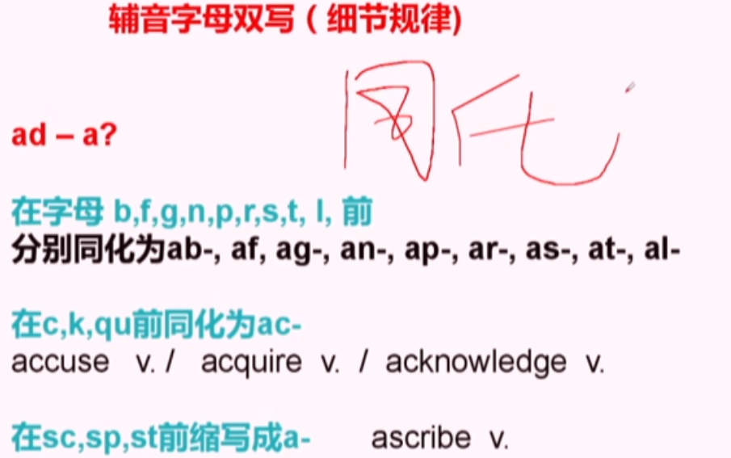

## 词汇
[托福词汇讲义 PDF](./files/toefl-vocabulary-handout.pdf)
### 总概
记：词汇记法+多元化方式
联想法：
谐音： robust adj.强壮的，坚定的 （乐百氏）
拆分：crystal n.
图形联想：myopia n.近视 op=eye -ia名词后缀，表示某种疾病。acrophobia n.恐高症失眠  ac-A    insomnia  n. 失眠
构词法：
拼缀法：web（网；万维网） +log（日志；记录）=Blog（博客） Brexit英国脱欧
合成法：blackboard n.（黑板）  land-dwelling adj. 合成特点：n. + v.-ing

词根词缀 prefix（前缀）+root（词根）+suffix（后缀）
bound root 黏附词根 free root 自由词根

音变现象：
元音音变 a/e/i/o/u
spect-spic=to see inspect（检查；视察）/respect（尊重；尊敬）/expect（预期；期待）/prospect（前景；可能性） conspicuous adj.（显眼的；引人注目的）
nov-new（新的） newbie（新手）-novice（新手；初学者） novel adj./n.（新颖的；小说） innovation（创新；革新）
or-er-ar professor（教授）/teacher（教师）/scholar（学者）  projector（投影仪）/cooker（炊具；炉灶）/calendar

辅音音变
**v-b-f/ph**  move（移动；搬动）-mobile（可移动的；流动的） belied（掩饰；与……不符（belie的过去式及过去分词））-believe（相信）
**c/k-g**
**ac-ag**尖  acute（急性的；敏锐的；尖锐的）/acerbic（尖刻的；辛辣的）/acupuncture针灸 angle（角；角度）/eagle（鹰）
**cogn-kn** recognitive v.  cognitive adj. 认知的，感知的，认识的
**c-h** unicorn（独角兽） corn（玉米）-horn（角；号角） horticulture（园艺） hort-court（庭院；法庭；球场） **cult（狂热崇拜；异教团体）**
**d-t**
ed-eat（吃） inedible（不能食用的） uneatable（不能吃的；难以下咽的）
sid-sit（坐） president assiduous adj. 勤奋的
u-连字符 arduous adj.艰难的 graduate v./n.（毕业；毕业生）
**m-n**
con/com competition n.（竞争；比赛） commemorate v.（纪念） communication（交流；沟通） combine
当词根或单词首字母是b/p/m时前缀con就变身为com
辅音字母双写
aggravate adventure（冒险；冒险经历） advocate（提倡；拥护；倡导者）
illuminate addict（成瘾者；入迷的人） accumulate
元音字母开头，后面两个辅音字母
从两个辅音字母中间划开，前面是前缀(表示强调一而再再而三)后面是词根，词根后可能会有后缀
aggravate v. 加重，激怒 ag=gravity n.重力	grave adj. 重大的，严重 n.坟墓
illuminate v. 照亮，阐明，解释
accumulate v.累积，积聚

*辅音字母双写与 ad- 前缀同化：课堂截图。*

尾辅音变化
各种尾辅音都向齿龈爆破音[t]变化
describe（描述） description（描述；说明） scrib - script（文字；剧本；脚本）
absorb（吸收；使专注） absorption（吸收；专注） sorb-sorpt
eligible（符合条件的；有资格的） elect lig-lect
pigment（色素；颜料） picture（图片；照片） pig-pict
indicate（表明；指示）-predict（预测） dic-dict
reduce reduction（减少；降低） duc-duct
move（移动；搬动） motion（运动；移动） mov-mot
solve（解决）-solution（解决办法；溶液） solv-solut
consume（消耗；消费） consumption（消耗；消费） sum-sumpt
redeem（赎回；兑换；弥补） redemption（赎回；兑换；救赎） em-empt

背 一词多义  并联spot 串联price
用 高能语言状态 Diction（措辞；用词） + Syntax（句法） + Rhetorical devices（修辞手法）
### 前缀
说明：以下为常见含义和构词作用，不能仅凭字母相同就认定含有该词缀；具体含义需结合整个单词。  例词前缀加绿，后缀加蓝。
#### 向上系列
##### super-/sur- 
super-/sur- （在……上方；超过、超出；sur-是super-在部分词中的变体）
超过、超出：superhuman adj. 超人的；超出常人能力的
在上方：surface n.表面  v.显露 on the surface从表面上看 ｜ 在上方：surmount v.克服，解决，成功应对，居于...之上
##### over- 
over- （在……上方；越过；过度、过量）
越过：overpass n. 跨线桥；天桥
overall adv.总体上 adj.总体的 ｜ overcome v.克服，解决 ｜ 在上方：overlook v.俯瞰，看漏，忽视
过度、过量：overestimate v.高估
#### 向下系列
##### de- 
de-（向下；离开、去除；使相反、降低）
去除：dehydrate v. 使脱水 ｜ 使相反：deactivate v. 使停止运作
向下、降低：decline v.下降，衰落，衰退，谢绝 ｜ 向下、降低：decrease n./v.减少 ｜ depend v. 取决于，依靠
##### sub- 
sub-（在……下面；次一级；接近、略低于）
次一级：subcommittee n. 小组委员会 ｜ 略低于：substandard adj. 低于标准的
在下面：subway n.（地铁） ｜ suburb n.郊区 ｜ 在下面：submarine n.潜水艇
接近、略低于：subtropical adj.亚热带
**sub- → suc-/suf-**
sub-suc-/suf- （sub-的同化形式：c前变suc-，f前变suf-；基本义为“在下面、从下方”，部分词中表示“随后”）
随后、接着：succeed v.继续，继承，成功 ｜ successive  adj.（连续的；接连的） ｜ successor n.（继任者；接替者）
在下面：suffer v.遭受，变差
构成：[succeed](https://www.etymonline.com/word/succeed)：suc-（随后）+ ceed（走）→ 接着走 → 继承；[suffer](https://www.etymonline.com/word/suffer)：suf-（在下）+ fer（承担）→ 承受 → 遭受。
**sub- → sus-**
sub-sus-（sub-的变体，表示“在下面、从下方向上”）
从下方支撑：sustain v.维持，使...持续，支撑 ｜ sustainable adj.可持续的
构成：[sustain](https://www.etymonline.com/word/sustain)：sus-（从下方）+ tain（握住、保持）→ 托住 → 支撑、维持。
##### under-
under- （在……下面；不足；低于）
不足：underestimate v. 低估 ｜ 低于：underage adj. 未到法定年龄的
在下面：underground adj. 地下的n.地铁 ｜ 在下面：underwear n. 内衣 ｜ 在下面：underline v. 在...下面划线，强调
#### 趋向系列
##### ad-/ac- 
ad-/ac-（向、朝；ac-是ad-在c前的同化形式）
向、朝：accept v. 接受。
##### ob-/of- 
ob-/of-（朝向；对着、挡在前面；of-是ob-在f前的同化形式）
朝向：offer v. 提供（拿到面前） ｜ 挡在前面：obstacle n. 障碍
#### 向内系列
##### in-/im- 
in-/im- （向内、进入；另有同形的否定前缀，表示“不、非”，如incorrect、impossible）
向内、进入：include v. 包括 ｜ 向内、进入：income n. 收入 ｜ 向内、进入：interiorn.内部，内陆，内政(Minister of the Interior) adj.内地的
向内、进入：innermost adj.隐秘的，内心深处的
当词根或单词首字母是b/p/m 时前缀in-就变身为im-
向内、进入：import（进口；引进） ｜ 向内、进入：immigrate（移民；移居入境） ｜ 向内、进入：imprison（监禁）
##### en-/em- 
en-/em-（向内、使进入；使成为、使处于某状态；em-常用于b、p、m前）
使进入：encase v. 把……装入套、盒中
使成为：enlarge v. 扩大 ｜ 使具有：empower v. 授权；使有能力
#### 向外系列
##### ex-/e- 
ex-\e-（向外、离开；ex-也可表示“前任的”，如ex-president）
前任的：ex-president n. 前总统
向外、离开：exit n.出口 ｜ 向外、离开：express v.表达 n. 快递，快线 ｜ exploit n.  英雄业绩v.开发，利用(充分)，剥削
向外、离开：elect v.选举，选择elect to do sth.  **必学词根:lect-lig-选** ｜ collect v.（收集；聚集） /
select v.（选择；挑选）/ ｜ eligible adj.（符合条件的；有资格的）
向外、离开：emigrate v. 移居国外  He emigrated to Australia as a young man.
##### out-
out-（向外；超过、胜过）
向外：outflow n. 流出 ｜ 超过：outperform v. 表现优于
#### “前”系列
##### pre- 
pre-（在……之前；预先）
预先：preheat v. 预热
在前、预先：president n. 总统，主席sid-sit（坐） ｜ 在前、预先：prejudice n.偏见
在前、预先：prescription n. 处方,药方 音变之script（文字；剧本；脚本）-scrib
##### pro- 
pro-（向前；支持、赞成；某些词中表示代替）
支持、赞成：pro-democracy adj. 支持民主的 ｜ 代替：proconsul n. （古罗马）代行执政官职权的行省总督
向前：prolong v. 延长，拉长 ｜ 向前：promote v.促进，促销，晋升 ｜ proliferate v.激增，扩散
向前：prominent min=突起 突出的，显著的，著名的 ｜ eminent adj.（杰出的；著名的） being
famous（著名的）,important, and respected
##### fore-
fore-（在前面；事先、预先）
在前、预先：before（在……之前；以前） ｜ 在前、预先：former adj. 前者的
在前、预先：foremost adj.最前面的，最重要的adv. first and foremost = initially（起初；最初） = in the first place（首先；起初）
在前、预先：forecast v./n.预报，预测weather forecast(er) ｜ 在前、预先：foretell v.预言
在前、预先：foresee v.预见unforeseen benefits（意想不到的益处） (R)
#### “后”系列
##### post- 
post-（在……之后；后于）
在……之后：post- war adj.战后的(尤指二战后) ｜ 在……之后：postgraduate n. 研究生 ｜ 在……之后：postpone v.延迟，延期
##### re- 
re-（再、重新；向后、返回；在部分词中起加强作用）
再、重新：rewrite v. 重写 ｜ 加强：research n./v. 研究（词源中re-可能起加强作用，不直接译为“再次”）
返回：return（返回；归还） ｜ 返回：rejectv.拒绝，回绝 ｜ reduce v. 减少,降低 reduce to reduce by
“起起伏伏”的学问
rocket v.（急剧上升；猛涨） 90 plummet v.（骤降；暴跌）
soar（猛增；高飞）   60 slump（大幅下降；暴跌）
surge（激增；涌动） 45 subside（减弱；平息；回落）
boom（繁荣；迅速发展） 30 ebb（衰退；退潮）
creep up（缓慢上升） <10 creep down（缓慢下降）
重新：rejuvenate v.使恢复年轻，返老还童 ｜ 返回：reverberate v.起回声，回响，反射 ｜ resent 对...愤恨不满
resentful adj.（愤恨的；不满的）  sent 每个单词都是记忆词汇的线索
sentence n./v.（句子；判决；宣判） ｜ consent 同意 ｜ consensus n.（共识；一致意见）
说明：下面的涨跌词及sent词族保留作联想复习，不都含re-前缀。
#### 向中间系列
##### inter- 
inter-（在……之间；相互）
相互：interact v.互动，相互作用 ｜ 在……之间：interval n.间隔，间歇 ｜ 在……之间：interfere v. 干涉 (with)
##### mid-
mid-（中间；中部）
(middle) ｜ 中间、中部：midday n. 中午，正午 ｜ 中间、中部：midnight n.午夜
immediately adv.（立即；马上）
说明：middle用于联想；immediately不含表示“中间”的mid-前缀。
#### 否定与错误系列
##### un- 
un-（不、非；也可表示取消或逆转某动作，如untie（解开））
取消、逆转动作：untie v. 解开
不、非：unfair（不公平的） ｜ 不、非：uncomfortable（不舒服的；不自在的）
##### in-/im-/il-/ir- 
in-/im-/il-/ir-（不、非；同一个否定前缀的不同形式，与表示“向内”的in-区分）
不、非：inaccurate adj. 不准确的； ｜ 不、非：impossible adj. 不可能的； ｜ 不、非：illegal adj. 非法的；
不、非：irregular adj. 不规则的
同化提示：否定前缀in-在l前常变为il-，在r前常变为ir-，在b、p、m前常变为im-。
##### non- 
non-（非、不；表示不属于某类）
不、非：nonverbal adj. 非言语的
##### dis- 
dis-（不、相反；分开；去除、取消）
分开：disperse v. 分散 ｜ 取消：disconnect v. 断开连接
不、非：disappear（消失） ｜ 去除：disclose（披露；揭露） ｜ 不、非：disadvantage（不利条件；劣势）
##### mis-
mis-（错误地、不当地）
错误、不当：misunderstand v. 误解； ｜ 错误、不当：misleading adj. 误导的
#### 共同系列
##### con- 
con-（共同、一起；部分词中起加强作用）
加强：confirm v. 确认；证实（词源可联系“使牢固”理解）
共同、一起：consist（由……组成（consist of）；在于（consist in）） ｜ 共同、一起：concentrate（集中注意力；浓缩）
##### com- 
com-（con-的同化变体，常表示共同、一起）
共同、一起：combat v.与...战斗
说明：combat可联系“一起战斗、交战”理解，整词表示与……战斗。
##### col-
col-（con-在l前的同化变体，常表示共同、一起）
共同、一起：collaborate v.合作,协作,通敌(with)
##### cor-
cor-（con-在r前的同化变体，常表示共同、一起）
加强：corroborate v.证实
说明：corroborate中的cor-主要起加强作用，不宜硬译为“共同”。
##### co- 
co-（共同、一起）
共同、一起：coexist v. 共存； ｜ 共同、一起：coauthor n. 合著者
#### 反对与对抗系列
##### anti- 
anti-（反对；抵抗）
反对：antiwar adj. 反战的； ｜ 抵抗：antibacterial adj. 抗菌的
##### counter-
counter-（相反；对抗）
相反：counterclockwise adj./adv. 逆时针的；逆时针地
对抗：counterargument n. 反驳的论点
#### 跨越与范围系列
##### circum- 
circum-（周围、环绕）
周围：circumscribe v. 限定范围（画出周界） ｜ circumstance n. 环境；情形
##### per- 
per-（穿过；完全、彻底）
穿过：permeate v. 渗透；弥漫
完全、彻底：perceive v. 察觉、理解；此处取“完全、彻底”的含义。
##### trans- 
trans-（横跨；穿过；转变）
穿过：transdermal adj. 经皮的；透过皮肤的
横跨：transcontinental adj. 横贯大陆的； ｜ 转变：transform v. 使转变
##### extra- 
extra-（在……之外；超出）
超出：extraordinary adj. 非凡的；超出寻常的
在……之外：extracurricular adj. 课外的
#### 数量与规模系列
##### semi- 
semi-（半；部分、一定程度）
半：semicircle n. 半圆 ｜ 部分：semi-independent adj. 半独立的
##### bi-/multi-
bi-/multi-（bi-表示二、双；multi-表示多）
二、双：bilingual adj. 双语的； ｜ 多：multicultural adj. 多元文化的
##### micro-/macro-
micro-/macro-（micro-表示微小；macro-表示宏观、大规模）
微小：microorganism n. 微生物； ｜ 宏观、大规模：macroeconomic adj. 宏观经济的
### 后缀
区分词性
**名词后缀**
表人与物
-er/-or/-ar（名词后缀：常表示从事某活动的人或具有某作用的物；并非所有以这些字母结尾的词都能这样拆分） singer（歌手） ｜ cooker（炊具；炉灶） ｜ actor（演员） ｜ ruler（尺子；统治者） ｜ scholar（学者） ｜ consumer（消费者） ｜ radar（雷达） ｜ elevator
元音音变 ride（骑；乘坐）-road（道路）-raid（突袭；搜查）
-ee（常表示动作的承受者，也可表示处于某种状态的人） employee n. 雇员； ｜ trainee n. 受训者
-an/-ian（名词或形容词后缀：表示某地的人、某领域的人，或“与……有关的”） american（美国人；美国的）
-ist（名词后缀：表示从业者、专家、某种活动的参与者或某种主张的支持者） dentist（牙医） ｜ tourist（游客）
-ant（名词后缀：表示执行某动作的人或事物） assistant（助手；助理） ｜ servant（仆人） ｜ applicant
表性质状态与行为
-ance/-ancy/-ency/-ence/-cy（名词后缀：常表示行为、性质、状态或程度） appearance（外貌；出现） ｜ emergency（紧急情况） ｜ emergence（出现；兴起） ｜ privacy（隐私）
-ity/-ty（名词后缀：表示性质、状态） ability（能力） ｜ safety（安全） ｜ security（安全；保障） ｜ certainty n. 确定性
-ness（表示性质、状态） awareness n. 意识； ｜ weakness n. 弱点
-ment（名词后缀：表示行为、过程、结果或状态） development（发展；开发）
-ion（名词后缀：表示行为、过程、状态或结果，常见形式包括-tion、-sion） action（行动；行为） ｜ communication（交流；沟通） ｜ description（描述；说明）
-ure（名词后缀：表示行为、结果或状态） capture n. 捕获 ｜ failure n. 失败
-age（名词后缀：可表示行为、状态、集合或费用，具体含义随单词变化） marriage（婚姻） ｜ shortage（短缺） ｜ package（包裹；包装）
-ship（名词后缀：表示身份、地位、关系、性质或技能） friendship（友谊） ｜ relationship（关系）
-hood（表示时期、身份或群体） childhood n. 童年； ｜ neighborhood n. 街区
-ism（表示思想、制度或某种现象） capitalism n. 资本主义； ｜ tourism n. 旅游业
-ary/-ery/-ory（名词中可表示场所、相关事物或集合；-ary、-ory也可构成形容词，表示“与……有关的”） factory（工厂） ｜ dictionary（词典） ｜ bakery（面包店）
-um/-ium（拉丁语来源词中常见的名词词尾；-ium也常用于化学元素名称，不宜统一解释为某一种具体事物） museum（博物馆） ｜ auditorium（礼堂；观众厅） ｜ millennium（一千年；千禧年） ｜ aluminum（铝）
**形容词后缀**
-able/-ible（形容词后缀：可……的；能够被……的；有时表示具有某种性质） reasonable（合理的） ｜ acceptable（可接受的） ｜ incredible（难以置信的） ｜ quantifiable（可量化的）
-ive（形容词后缀：具有……性质、倾向或作用的） creative（有创造力的） ｜ impressive（令人印象深刻的） ｜ massive（巨大的；大量的）
-ant/-ent（形容词后缀：处于某种状态的；具有某种性质或作用的） significant（重要的；显著的）
-ic/-ical/-al（形容词后缀：与……有关的；具有……性质的；同一词根的不同后缀形式可能存在词义差别） economic（经济的；经济上的） ｜ economical（节约的；经济实惠的） ｜ historical
词汇小知识n.+-al=adj. v.+-al=n.  
-ous（形容词后缀：具有……性质的；充满……的） famous（著名的） ｜ dangerous（危险的） ｜ enormous（巨大的）
-ful（充满……的；具有……的） useful adj. 有用的； ｜ harmful adj. 有害的
-less（没有……的；缺乏……的） harmless adj. 无害的； ｜ countless adj. 无数的
-ish（形容词后缀：具有……特点的；略微、有点） childish adj. 幼稚的 ｜ greenish adj. 略带绿色的
-y（具有某种特征的） rainy adj. 多雨的； ｜ risky adj. 有风险的
-en（形容词后缀：由某种材料制成的；有时表示颜色或引申性质） wooden adj. 木制的 ｜ golden adj. 金制的；金色的
**动词后缀**
-ate（动词后缀：使成为、使具有某种性质，或进行某种动作；-ate也可见于名词和形容词） graduate（毕业；毕业生）
-ize/-ise（动词后缀：使……化；使成为；按某种方式处理；两种拼写的使用取决于地区及具体单词） realize（意识到；实现） ｜ modernize（使现代化） ｜ globalize（使全球化）
-fy/-ify（动词后缀：使成为；使具有某种性质） purify（净化） ｜ clarify（澄清；阐明） ｜ gratify（使满意；使高兴）
-en（动词后缀：使变得……；变得……） deepen（加深） ｜ widen（拓宽） ｜ lengthen（延长） ｜ weaken（削弱）
**副词后缀**
-ly（常构成副词，表示方式、程度等） rapidly adv. 迅速地； ｜ largely adv. 在很大程度上
注意：并非所有以-ly结尾的词都是副词，例如friendly是形容词，表示“友好的”。
-wise（副词后缀：以……方式；朝……方向） clockwise adv. 顺时针地 ｜ likewise adv. 同样地
**方向后缀**
-ward/-wards（表示朝向某个方向，常构成形容词或副词；具体词形和词性需结合单词判断） downward adj./adv. 向下的；向下地； ｜ backwards adv. 向后
参考：[Cambridge Dictionary：Suffixes](https://dictionary.cambridge.org/grammar/british-grammar/suffixes)、[University of Wisconsin：Prefixes and Suffixes](https://courses.dcs.wisc.edu/wp/grammar/category/prefixes-and-suffixes/)。

### 词根
#### 基础词根
#### ceive / cept / cip / capt / cap = 拿、取、接受
词根含义：take / seize（拿、取、抓住）；引申为接受、把握。
**receive：接收**
构成：[re<u>ceive</u>](https://www.etymonline.com/word/receive) = [re-](#note-prefix-re)（回、向自己）+ ceive（取）→ 接收到自己这里 → 收到、接收；此处[re-](#note-prefix-re)不按“再次”理解。
- re<u>ceive</u> v. 收到；接到；接待。
- re<u>cept</u>ion n. 接待；接收；招待会。
- re<u>cept</u>ionist n. 接待员；前台工作人员。
- re<u>cept</u>ive adj. 乐于接受的；善于接受的。常用：be re<u>cept</u>ive to sth.（乐于接受某事物）。
- re<u>ceiv</u>er n. 接收者；接收器。
- re<u>cip</u>ient n. 接收者；受益者。re<u>cip</u>ient of sth.：某物的接受者。
- re<u>ceipt</u> n. 收据；收到。on re<u>ceipt</u> of sth.：收到某物时。p不发音。
词族：re<u>ceive</u> → re<u>cept</u>ion → re<u>cept</u>ive（接收 → 接待、接收 → 乐于接受的）。
**accept：接受**
构成：[ac<u>cept</u>](https://www.etymonline.com/word/accept) = [ac-](#note-prefix-ad-ac)（[ad-](#note-prefix-ad-ac)的同化形式，向、朝）+ cept（取）→ 接过来 → 接受。
- ac<u>cept</u> v. 接受；认可。
- ac<u>cept</u>ance n. 接受；认可。
- ac<u>cept</u>able adj. 可接受的。
- unac<u>cept</u>able adj. 不可接受的。
辨析：re<u>ceive</u>侧重“收到”，不一定同意；ac<u>cept</u>侧重“接受、认可”。
**except：除外**
构成：[ex<u>cept</u>](https://www.etymonline.com/word/except) = [ex-](#note-prefix-ex-e)（向外）+ cept（取）→ 取出去 → 排除。
- ex<u>cept</u> prep. 除……之外（不包括）。v. 排除。
- ex<u>cept</u>ion n. 例外。with the ex<u>cept</u>ion of：除……以外；make an ex<u>cept</u>ion for sb. / sth.：对某人／某事破例。
- ex<u>cept</u>ional adj. 杰出的；非同寻常的。
**precept：准则、训诫**
构成：[pre<u>cept</u>](https://www.etymonline.com/word/precept) = [pre-](#note-prefix-pre)（预先）+ cept（取）→ 预先给出的指示 → 行为准则、训诫。
- pre<u>cept</u> n. 准则；训诫。moral precepts：道德准则。
**intercept：拦截**
构成：[inter<u>cept</u>](https://www.etymonline.com/word/intercept) = [inter-](#note-prefix-inter)（在……之间）+ cept（取）→ 中途截取 → 拦截。
- inter<u>cept</u> v. 拦截；截获。inter<u>cept</u> a message：截获消息。
- inter<u>cept</u>ion n. 拦截；截获。
**perceive：察觉、理解**
构成：[per<u>ceive</u>](https://www.etymonline.com/word/perceive) = [per-](#note-prefix-per)（完全、彻底）+ ceive（取、把握）→ 充分把握，在头脑中领会 → 察觉、理解。
- per<u>ceive</u> v. 察觉；理解；认为。常用：per<u>ceive</u> A as B（将A看作B）。 per<u>ceive</u> sb. / sth. to be ...：认为某人／某事物是……。
- per<u>cept</u>ion n. 感知；看法；认识。 public per<u>cept</u>ion：公众看法；per<u>cept</u>ion of risk：风险认知。
- per<u>cept</u>ive adj. 洞察力强的；敏锐的。
- per<u>cept</u>ible adj. 可察觉的。per<u>cept</u>ible to sb.：某人可以察觉的。
- imper<u>cept</u>ible adj. 难以察觉的；细微的。
**conceive：构想**
构成：[con<u>ceive</u>](https://www.etymonline.com/word/conceive) = [con-](#note-prefix-con)（在此可能起加强作用）+ ceive（取、容纳）→ 接纳并容纳 → 怀孕；引申为在头脑中形成想法 → 构想。
- con<u>ceive</u> v. 构想；设想；怀孕。 con<u>ceive</u> of sth. / doing sth.：想象某事物／做某事。
- con<u>cept</u>ion n. 构想；概念；受孕。
- miscon<u>cept</u>ion n. 错误认识；误解。
- con<u>cept</u> n. 概念；观念。
- con<u>cept</u>ual adj. 概念的。a con<u>cept</u>ual framework：概念框架。
- con<u>ceiv</u>able adj. 可想象的；可理解的。
- incon<u>ceiv</u>able adj. 难以想象的；不可思议的。
**inception：开始、创立**
构成：[in<u>cept</u>ion](https://www.etymonline.com/word/inception) 源于[in-](#note-prefix-in-im)（着手、进入）+ cept（取）+ -ion → 着手进行 → 开始、创立；与incipient同源。
- in<u>cept</u>ion n. 开始；创立。since its in<u>cept</u>ion：自其创立以来。
- in<u>cip</u>ient adj. 初期的；刚开始的。in<u>cip</u>ient stages：初始阶段。
**anticipate：预期、预先应对**
构成：[anti<u>cip</u>ate](https://www.etymonline.com/word/anticipate) = anti-（ante-的古形式，预先）+ cip（取）+ -ate → 提前拿到、处理 → 预期、预先应对；此处anti-不是“反对”。
- anti<u>cip</u>ate v. 预期；预料并作准备。anti<u>cip</u>ate doing sth.：预期会做某事。
- anti<u>cip</u>ation n. 预期；期待。in anti<u>cip</u>ation of sth.：预料到某事并提前准备。
**deceive：欺骗**
构成：[de<u>ceive</u>](https://www.etymonline.com/word/deceive) = [de-](#note-prefix-de)（离开；在此也有贬义解释）+ ceive（取）→ 词源义为诱捕、蒙骗 → 欺骗；不宜机械译成“向下拿”。
- de<u>ceive</u> v. 欺骗。 de<u>ceive</u> sb. into doing sth.：欺骗某人做某事。
- de<u>cept</u>ion n. 欺骗；骗局。
- de<u>cept</u>ive adj. 有欺骗性的；容易使人产生错觉的。
**participate：参与**
构成：[parti<u>cip</u>ate](https://www.etymonline.com/word/participate) = parti（部分）+ cip（取）+ -ate → 分享一部分 → 参与。
- parti<u>cip</u>ate v. 参与；参加。parti<u>cip</u>ate in sth.：参与某事。
- parti<u>cip</u>ation n. 参与；参加。parti<u>cip</u>ation in sth.：对某事的参与。
- parti<u>cip</u>ant n. 参与者；参加者。
**capture：捕获**
构成：[<u>capt</u>ure](https://www.etymonline.com/word/capture) 可按 capt（抓、取）+ -ure（名词词尾）辅助记忆 → 捕获这一行为；英语中先有名词，再用作动词，并非前缀＋词根结构。
- <u>capt</u>ure v. 捕获；夺取；吸引。n. 捕获。 <u>capt</u>ure one's attention：吸引某人的注意力。
- <u>capt</u>ive n. 俘虏。adj. 被俘的；受控制的。hold sb. <u>capt</u>ive：囚禁某人。
- <u>capt</u>ivity n. 囚禁；圈养。in <u>capt</u>ivity：被囚禁；在圈养条件下。
- <u>capt</u>ivate v. 迷住；使着迷。
**emancipate：解放**
构成：[eman<u>cip</u>ate](https://www.etymonline.com/word/emancipate) 可按 [e-](#note-prefix-ex-e)（[ex-](#note-prefix-ex-e)的变体，向外）+ man（手）+ cip（取、掌握）+ -ate（动词词尾）辅助记忆 → 从他人的掌控中释放出来 → 解放。
- eman<u>cip</u>ate v. 解放；使摆脱束缚。常用：eman<u>cip</u>ate sb. from sth.（使某人摆脱某种束缚）。
- eman<u>cip</u>ation n. 解放；摆脱束缚。
**capable：有能力的**
构成：[<u>cap</u>able](https://www.etymonline.com/word/capable) 与capere（拿、容纳）同源 → 能容纳、能把握 → 有能力的。
- <u>cap</u>able adj. 有能力的。be <u>cap</u>able of (doing) sth.：有能力做某事。
- in<u>cap</u>able adj. 无能力的；不能的。be in<u>cap</u>able of (doing) sth.：不能做某事。
- <u>cap</u>ability n. 能力；性能。
- <u>cap</u>acity n. 容量；能力；产能。<u>cap</u>acity for sth.：……的能力；<u>cap</u>acity to do sth.：做某事的能力。 at full <u>cap</u>acity：满负荷；carrying <u>cap</u>acity：承载能力（生态学）。
**susceptible：易受影响的**
构成：[sus<u>cept</u>ible](https://www.etymonline.com/word/susceptible) = sus-（[sub-](#note-prefix-sub)的变体，从下方）+ cept（接受）+ -ible（能……的）→ 能承受、接受 → 易受影响的。
- sus<u>cept</u>ible adj. 易受影响的；易患……的。be sus<u>cept</u>ible to sth.：易受某事物影响。 sus<u>cept</u>ible to erosion / disease：易受侵蚀／易患病。
- sus<u>cept</u>ibility n. 易感性；易受影响的倾向。sus<u>cept</u>ibility to sth.：对某事物的易感性。
#### fer = 携带、带来、承受
词根含义：carry / bear（携带、带来、承受）。
**offer：提供**
构成：[of<u>fer</u>](https://www.etymonline.com/word/offer) = of-（[ob-](#note-prefix-ob-of)的同化形式，朝向）+ fer（带来）→ 拿到面前 → 提供。
- of<u>fer</u> v. 提供；主动提出。n. 提议；报价。of<u>fer</u> sb. sth.：向某人提供某物。 of<u>fer</u> to do sth.：主动提出做某事。
- of<u>fer</u>ing n. 提供的产品、服务；供品。
**confer：商议、授予**
构成：[con<u>fer</u>](https://www.etymonline.com/word/confer) = [con-](#note-prefix-con)（一起）+ fer（带）→ 带到一起 → 商议；引申为授予。
- con<u>fer</u> v. 商议；授予。con<u>fer</u> with sb.：与某人商议；con<u>fer</u> sth. on sb.：把某物授予某人。
- con<u>fer</u>ence n. 会议；研讨会。
**transfer：转移**
构成：[trans<u>fer</u>](https://www.etymonline.com/word/transfer) = [trans-](#note-prefix-trans)（横跨、转移）+ fer（带）→ 带到另一处 → 转移。
- trans<u>fer</u> v. 转移；调动；转学；转账。n. 转移；调动。trans<u>fer</u> A from B to C把A从B转到C。 heat trans<u>fer</u>：热传递；trans<u>fer</u> credits：转学分。
- trans<u>fer</u>able adj. 可转移的；可迁移的。trans<u>fer</u>able skills：可迁移技能。
- trans<u>fer</u>ence n. 转移；传递。
**refer：提及、查阅**
构成：[re<u>fer</u>](https://www.etymonline.com/word/refer) = [re-](#note-prefix-re)（回）+ fer（带）→ 带回、指向 → 提及、查阅。
- re<u>fer</u> v. 提及；指向。re<u>fer</u> to：提到；查阅；指的是。 re<u>fer</u> A to B：将A转交给B处理；re<u>fer</u> to A as B：把A称作B。
- re<u>fer</u>ence n. 提及；参考；推荐信。 re<u>fer</u>ence materials：参考资料；with re<u>fer</u>ence to sth.：关于某事。
- re<u>fer</u>ee n. 裁判；推荐人。
- re<u>fer</u>ral n. 转介；推荐。re<u>fer</u>ral to a specialist：转介给专科医生。
**infer：推断**
构成：[in<u>fer</u>](https://www.etymonline.com/word/infer) = [in-](#note-prefix-in-im)（向内）+ fer（带）→ 引入结论 → 推断。
- in<u>fer</u> v. 推断。in<u>fer</u> A from B：从B推断出A。
- in<u>fer</u>ence n. 推断；推论。draw an in<u>fer</u>ence from sth.：根据某事作出推断。
- in<u>fer</u>ential adj. 推论的。in<u>fer</u>ential reasoning：推理。
- imply v. 暗示。speaker → imply；listener → in<u>fer</u>：说者暗示，听者推断。
**prefer：更喜欢**
构成：[pre<u>fer</u>](https://www.etymonline.com/word/prefer) = [pre-](#note-prefix-pre)（在前）+ fer（带）→ 放在前面 → 更喜欢。
- pre<u>fer</u> v. 更喜欢。pre<u>fer</u> A to B：比起B更喜欢A。 pre<u>fer</u> doing A to doing B：比起做B更喜欢做A；pre<u>fer</u> to do A rather than do B：宁愿做A而不愿做B。
- pre<u>fer</u>ence n. 偏爱；偏好。pre<u>fer</u>ence for A over B：比起B更偏爱A。
- pre<u>fer</u>able adj. 更可取的。A be pre<u>fer</u>able to B：A比B更可取。
- pre<u>fer</u>ential adj. 优惠的；优先的。
**differ：不同**
构成：[dif<u>fer</u>](https://www.etymonline.com/word/differ) = dif-（[dis-](#note-prefix-dis)的同化形式，分开）+ fer（带）→ 分开 → 不同。
- dif<u>fer</u> v. 不同。dif<u>fer</u> from：与……不同。 dif<u>fer</u> in sth.：在某方面不同；dif<u>fer</u> with sb. on / about sth.：与某人在某事上意见不同。
- dif<u>fer</u>ent adj. 不同的。
- dif<u>fer</u>ence n. 差异；不同。
- dif<u>fer</u>entiate v. 区分。dif<u>fer</u>entiate A from B：区分A与B。
- dif<u>fer</u>entiation n. 区分；分化。
**defer：延期、听从**
构成：[de<u>fer</u>](https://www.etymonline.com/word/defer)（延期）与dif<u>fer</u>同源，可联系“把事情移开、往后放”理解；de<u>fer</u> to（听从）源于de-（向下）+ fer（带）。
- de<u>fer</u> v. 推迟。de<u>fer</u> doing sth.：推迟做某事。 de<u>fer</u> to sb.：听从、尊重某人的判断。
- de<u>fer</u>ence n. 尊重；顺从。
- de<u>fer</u>ment n. 延期；推迟。
- de<u>fer</u>ral n. 延期；推迟。
**suffer：遭受**
构成：[suf<u>fer</u>](https://www.etymonline.com/word/suffer) = suf-（[sub-](#note-prefix-sub)的同化形式，在下面）+ fer（承受）→ 承受痛苦 → 遭受。
- suf<u>fer</u> v. 遭受；受苦。suf<u>fer</u> from：患有；因……受苦。
- suf<u>fer</u>ing n. 痛苦；苦难。
- suf<u>fer</u>er n. 受苦者；患者。
**fertile：肥沃的、能繁殖的**
构成：[<u>fer</u>tile](https://www.etymonline.com/word/fertile) 与ferre（承载、孕育）同源 → 能产出的 → 肥沃的、能繁殖的。
- <u>fer</u>tile adj. 肥沃的；能繁殖的；富有创造力的。<u>fer</u>tile soil：肥沃的土壤。
- <u>fer</u>tility n. 肥力；生育能力。 soil <u>fer</u>tility：土壤肥力；<u>fer</u>tility rate：生育率。
- in<u>fer</u>tile adj. 不肥沃的；不能生育的。
- <u>fer</u>tilize v. 施肥；使受精。
- <u>fer</u>tilizer n. 肥料。
**aquifer：含水层**
构成：[aqui<u>fer</u>](https://www.etymonline.com/word/aquifer) = aqui（水）+ fer（承载）→ 储存、传导地下水的岩层 → 含水层；aqui是词根，不是前缀。
- aqui<u>fer</u> n. 含水层。groundwater in an aqui<u>fer</u>：含水层中的地下水。
**conifer：针叶树**
构成：[coni<u>fer</u>](https://www.etymonline.com/word/conifer) = coni（球果）+ fer（生、承载）→ 结球果的树 → 针叶树；coni不是“共同”的con-。
- coni<u>fer</u> n. 针叶树。
- coni<u>fer</u>ous adj. 针叶树的。coni<u>fer</u>ous forests：针叶林。
**联想词与词缀对照**
记忆口诀：-er“攻”、-ee“受”，常表示动作发出者／承受者。
- interviewer / interviewee：面试官／应聘者；采访者／受访者。
- employer / employee：雇主／雇员。
- trainer / trainee：培训者／受训者。
- interfere v. 干涉；妨碍。interfere with：干扰、妨碍。此词不属于“携带”的fer词根。
- interference n. 干涉；干扰。
- transplant v. 移植。[trans-](#note-prefix-trans)（转移）+ plant（种植）→ 移植。
- transform v. 改变；使转变。[trans-](#note-prefix-trans)（转变）+ form（形态）→ 改变形态。
#### miss / mit / mis = 发送、放出
词根含义：send / let go（发送、放出）；mis是此词族中的变体，与“错误”的前缀mis-区分。
**mission：派遣、任务**
构成：[<u>miss</u>ion](https://www.etymonline.com/word/mission) = miss（发送）+ -ion（名词后缀）→ 派遣；引申为任务。
- <u>miss</u>ion n. 任务；使命；代表团。on a <u>miss</u>ion：执行任务。
- <u>miss</u>ionary n. 传教士。adj. 传教的。
**missile：导弹、投射物**
构成：[<u>miss</u>ile](https://www.etymonline.com/word/missile) 源于miss（投射、发送）→ 可投射的东西 → 投射物、导弹。
- <u>miss</u>ile n. 导弹；投射物。
**emit：发出**
构成：[e<u>mit</u>](https://www.etymonline.com/word/emit) = [e-](#note-prefix-ex-e)（向外）+ mit（发送）→ 发出。
- e<u>mit</u> v. 发出；排放。 e<u>mit</u> light / heat / gases：发光／放热／排放气体。
- e<u>miss</u>ion n. 排放；排放物。 carbon emissions：碳排放。
**transmit：传送**
构成：[trans<u>mit</u>](https://www.etymonline.com/word/transmit) = [trans-](#note-prefix-trans)（跨越）+ mit（发送）→ 送到另一处 → 传送。
- trans<u>mit</u> v. 传送；传播；发射。trans<u>mit</u> A to B：把A传送给B。
- trans<u>miss</u>ion n. 传送；传播；变速器。 disease trans<u>miss</u>ion：疾病传播；trans<u>miss</u>ion of knowledge：知识传播。
- trans<u>mitt</u>er n. 发射机；发送器。
**intermittent：间歇的**
构成：[inter<u>mit</u>tent](https://www.etymonline.com/word/intermittent) 源于[inter-](#note-prefix-inter)（在……之间）+ mittere（放开、中止）→ 留出间隔 → 间歇的；intermittent中的mitt与mit同源。
- inter<u>mit</u>tent adj. 间歇的；断断续续的。inter<u>mit</u>tent rainfall：间歇性降雨。
- inter<u>mit</u>tently adv. 间歇地；断断续续地。
- inter<u>miss</u>ion n. 幕间休息；中间休息。
**remit：汇款、减免**
构成：[re<u>mit</u>](https://www.etymonline.com/word/remit) = [re-](#note-prefix-re)（回）+ mit（发送、放出）→ 送回、放松 → 汇款、减免。
- re<u>mit</u> v. 汇款；减免。re<u>mit</u> money to sb.：给某人汇款。
- re<u>mitt</u>ance n. 汇款；汇款额。
- re<u>miss</u>ion n. 减免；缓解。
**admit：承认、准许进入**
构成：[ad<u>mit</u>](https://www.etymonline.com/word/admit) = [ad-](#note-prefix-ad-ac)（向）+ mit（发送）→ 让进入 → 准入；引申为承认。
- ad<u>mit</u> v. 承认；准许进入。ad<u>mit</u> doing sth.：承认做过某事。 be ad<u>mitt</u>ed to / into：获准进入；被录取。 ad<u>mit</u> of sth.：容许某种可能（正式）。 ad<u>mit</u> to doing sth.也表示“承认做过某事”，这里to为介词。
- ad<u>miss</u>ion n. 承认；准入；入场费。 ad<u>miss</u>ion requirements：入学要求；apply for ad<u>miss</u>ion：申请入学。
- ad<u>mitt</u>ance n. 准入；进入许可。No ad<u>mitt</u>ance：禁止入内。
- ad<u>miss</u>ible adj. 可接受的；可采纳的。
**permit：允许**
构成：[per<u>mit</u>](https://www.etymonline.com/word/permit) = [per-](#note-prefix-per)（穿过）+ mit（放出）→ 让通过 → 允许。
- per<u>mit</u> v. 允许；许可。n. 许可证。per<u>mit</u> sb. to do sth.：允许某人做某事；per<u>mit</u> doing sth.：允许做某事。
- per<u>miss</u>ion n. 允许；许可。per<u>miss</u>ion to do sth.：做某事的许可。
- per<u>miss</u>ible adj. 允许的；许可的。
- per<u>miss</u>ive adj. 宽容的；放任的。
**submit：提交、屈服**
构成：[sub<u>mit</u>](https://www.etymonline.com/word/submit) = [sub-](#note-prefix-sub)（在下）+ mit（发送）→ 置于他人权威之下 → 提交、服从。
- sub<u>mit</u> v. 提交；屈服。sub<u>mit</u> an application：提交申请。 sub<u>mit</u> to sb. / sth.：服从、屈服于……。
- sub<u>miss</u>ion n. 提交；提交物；屈服。 a sub<u>miss</u>ion deadline：提交截止日期。
- sub<u>miss</u>ive adj. 顺从的；服从的。
**commit：交付、承诺**
构成：[com<u>mit</u>](https://www.etymonline.com/word/commit) = [com-](#note-prefix-com)（一起）+ mit（发送）→ 交付；引申为投入、承诺。
- com<u>mit</u> v. 承诺；投入；犯下。com<u>mit</u> a crime：犯罪。 com<u>mit</u> yourself to (doing) sth. / sb.：承诺、致力于某事；对某人作出承诺。
- com<u>mit</u>ment n. 承诺；投入；责任。 com<u>mit</u>ment to (doing) sth.：对某事的投入、承诺。
- com<u>mit</u>ted adj. 尽心尽力的；坚定的。be com<u>mit</u>ted to (doing) sth.：致力于某事。
- com<u>mit</u>tee n. 委员会。a com<u>mit</u>tee member：委员会成员。
- com<u>miss</u>ion n. 委托；委员会；佣金。v. 委托。com<u>miss</u>ion sb. to do sth.：委托某人做某事。
- com<u>miss</u>ioner n. 委员；专员。
**dismiss：遣散、不予考虑**
构成：[dis<u>miss</u>](https://www.etymonline.com/word/dismiss) = [dis-](#note-prefix-dis)（分开）+ miss（发送）→ 送走 → 解雇、不予考虑。
- dis<u>miss</u> v. 解雇；不予考虑。dis<u>miss</u> A as B：认为A是B而不予考虑。
- dis<u>miss</u>al n. 解雇；不予考虑。
- dis<u>miss</u>ive adj. 不屑一顾的。be dis<u>miss</u>ive of sth.：对某事不屑一顾。
**omit：省略、遗漏**
构成：[o<u>mit</u>](https://www.etymonline.com/word/omit) = o-（[ob-](#note-prefix-ob-of)的变体，此处可能加强语气）+ mit（放出）→ 放掉、搁置 → 省略、遗漏。
- o<u>mit</u> v. 省略；遗漏。o<u>mit</u> sth. from sth.：从……中省略某项。 o<u>mit</u> to do sth.：未做、疏忽做某事。
- o<u>miss</u>ion n. 省略；遗漏。
**promise：承诺**
构成：[pro<u>mis</u>e](https://www.etymonline.com/word/promise) 源于[pro-](#note-prefix-pro)（向前、预先）+ mittere（发送）→ 预先作出保证 → 承诺。
- pro<u>mis</u>e n./v. 承诺；答应。pro<u>mis</u>e to do sth.：承诺做某事。
- pro<u>mis</u>ing adj. 有希望的；有前途的。a pro<u>mis</u>ing student：有前途的学生。
#### scrib / scribe / script = 写
词根含义：write（写）；引申为记录、描述。
**script：文字、脚本**
构成：[<u>script</u>](https://www.etymonline.com/word/script) 源于scribere（写）的过去分词词干<u>script</u>- → 写下的内容 → 文字、脚本。
- <u>scribe</u> n. 抄写员；书记员。
- <u>script</u> n. 文字；剧本；脚本。
**postscript：附言**
构成：[post<u>script</u>](https://www.etymonline.com/word/postscript) = [post-](#note-prefix-post)（在后）+ script（写）→ 写在正文之后 → 附言。
- post<u>script</u> n. 附言；补充说明。P.S.是拉丁语post scriptum的缩写。
**manuscript：手稿**
构成：[manu<u>script</u>](https://www.etymonline.com/word/manuscript) = manu（手）+ <u>script</u>（写）→ 手写的内容 → 手稿。
- manu<u>script</u> n. 手稿；原稿。submit a manu<u>script</u>：提交稿件。 an illuminated manu<u>script</u>：彩饰手抄本。
**inscribe：刻写、题写**
构成：[in<u>scribe</u>](https://www.etymonline.com/word/inscribe) = [in-](#note-prefix-in-im)（在……上）+ <u>scribe</u>（写）→ 写在上面 → 刻写、题写。
- in<u>scribe</u> v. 刻写；题写。in<u>scribe</u> A on B：把A刻写在B上；be in<u>scrib</u>ed with sth.：刻有、写有某内容。
- in<u>script</u>ion n. 铭文；题词；碑文。 an ancient in<u>script</u>ion：古代铭文。
**transcribe：转录、抄写**
构成：[tran<u>scribe</u>](https://www.etymonline.com/word/transcribe) 源于[trans-](#note-prefix-trans)（转到另一处）+ <u>scribe</u>（写）→ 转写到另一处 → 抄写、转录；连接处两个s合并为一个。
- tran<u>scribe</u> v. 抄写；转录。tran<u>scribe</u> A into B：把A转写成B。
- tran<u>script</u> n. 文字记录；成绩单。an academic tran<u>script</u>：学业成绩单。 request an official tran<u>script</u>：申请正式成绩单。
- tran<u>script</u>ion n. 转录；转写；转录文本。
**describe：描述**
构成：[de<u>scribe</u>](https://www.etymonline.com/word/describe) = [de-](#note-prefix-de)（向下）+ scribe（写）→ 写下来 → 描述。
- de<u>scribe</u> v. 描述。de<u>scribe</u> A as B：将A描述为B。 de<u>scribe</u> sth. to sb.：向某人描述某事物。
- de<u>script</u>ion n. 描述；说明。
- de<u>script</u>ive adj. 描述性的。be de<u>script</u>ive of sth.：描述某事物的。
- inde<u>scrib</u>able adj. 难以形容的；无法描述的。
**ascribe：归因**
构成：[a<u>scribe</u>](https://www.etymonline.com/word/ascribe) = a-（[ad-](#note-prefix-ad-ac)的变体，向）+ scribe（写）→ 记在某人或某事名下 → 归因。
- a<u>scribe</u> v. 归因；认为是……所作。a<u>scribe</u> A to B：把A归因于B。
- a<u>script</u>ion n. 归因；归属。a<u>script</u>ion of A to B：把A归因于B。
**prescribe：规定、开处方**
构成：[pre<u>scribe</u>](https://www.etymonline.com/word/prescribe) = [pre-](#note-prefix-pre)（预先）+ <u>scribe</u>（写）→ 预先写下指示 → 规定、开处方。
- pre<u>scribe</u> v. 规定；开处方。pre<u>scribe</u> sth. for sb.：给某人开某种药；pre<u>scribe</u> a course of action：规定行动方案。
- pre<u>script</u>ion n. 处方；药方。on pre<u>script</u>ion：凭处方。
- pre<u>script</u>ive adj. 规定性的；规范性的。
**proscribe：禁止**
构成：[pro<u>scribe</u>](https://www.etymonline.com/word/proscribe) = [pro-](#note-prefix-pro)（在前、公开）+ <u>scribe</u>（写）→ 公布禁令 → 禁止。
- pro<u>scribe</u> v. 禁止；取缔（正式）。
- pro<u>script</u>ion n. 禁止；取缔。
辨析：pre<u>scribe</u>是“规定、开处方”；pro<u>scribe</u>是“禁止、取缔”。
**subscribe：订阅、赞同**
构成：[sub<u>scribe</u>](https://www.etymonline.com/word/subscribe) = [sub-](#note-prefix-sub)（在下面）+ scribe（写）→ 在文件下方签名 → 赞同、认购、订阅。
- sub<u>scribe</u> v. 订阅；赞同。sub<u>scribe</u> to a journal：订阅期刊；sub<u>scribe</u> to a view：赞同某观点。 sub<u>scribe</u> to a service：订购某项服务。
- sub<u>script</u>ion n. 订阅；订阅费。
- sub<u>scrib</u>er n. 订阅者；用户。
- unsub<u>scribe</u> v. 取消订阅。unsub<u>scribe</u> from sth.：退订某项内容或服务。
**circumscribe：限定范围**
构成：[circum<u>scribe</u>](https://www.etymonline.com/word/circumscribe) = [circum-](#note-prefix-circum)（周围）+ scribe（写、画）→ 画出周界 → 限制范围。
- circum<u>scribe</u> v. 限制；限定范围。
- circum<u>script</u>ion n. 限制；限定范围。
#### sist / st / stitut = 站立、设立
词根含义：stand / set（站立、放置）；引申为坚持、存在、建立。
**stable：稳定的**
构成：[<u>sta</u>bilize](https://www.etymonline.com/word/stabilize) 可联系<u>sta</u>ble（稳定的）+ -ize（使……化）→ 使稳定。
- <u>sta</u>ble adj. 稳定的。
- <u>sta</u>bility n. 稳定；稳定性。
- un<u>sta</u>ble adj. 不稳定的。
- in<u>sta</u>bility n. 不稳定；不稳定性。
- <u>sta</u>bilize v. 使稳定；变稳定。
- e<u>sta</u>blish v. 建立；确立。与<u>sta</u>ble同源。
- e<u>sta</u>blishment n. 建立；机构。the e<u>sta</u>blishment of sth.：某事物的建立。
**exist：存在**
构成：[ex<u>ist</u>](https://www.etymonline.com/word/exist) = [ex-](#note-prefix-ex-e)（向外）+ ist（站，sist的变体）→ 显现出来 → 存在。
- ex<u>ist</u> v. 存在。
- ex<u>ist</u>ence n. 存在；生活。
- ex<u>ist</u>ing adj. 现有的；现存的。
- coex<u>ist</u> v. 共存。[co-](#note-prefix-co)（共同）+ ex<u>ist</u>（存在）。
- coex<u>ist</u>ence n. 共存。coex<u>ist</u>ence with sth.：与某事物共存。
**subsist：维持生存**
构成：[sub<u>sist</u>](https://www.etymonline.com/word/subsist) = [sub-](#note-prefix-sub)（在下）+ sist（站）→ 站住、继续存在 → 维持生存。
- sub<u>sist</u> v. 维持生存；存在。sub<u>sist</u> on sth.：靠某物维持生计。
- sub<u>sist</u>ence n. 生存；生计。sub<u>sist</u>ence farming：自给农业。
**assist：帮助**
构成：[as<u>sist</u>](https://www.etymonline.com/word/assist) = as-（[ad-](#note-prefix-ad-ac)的同化形式，向、在旁）+ sist（站）→ 站在旁边 → 帮助。
- as<u>sist</u> v. 帮助；协助。as<u>sist</u> sb. with sth.：帮助某人处理某事；as<u>sist</u> sb. in doing sth.：协助某人做某事。
- as<u>sist</u>ance n. 帮助；援助。with the as<u>sist</u>ance of sb.：在某人的帮助下。
- as<u>sist</u>ant n. 助手；助理。adj. 助理的。
**insist：坚持要求**
构成：[in<u>sist</u>](https://www.etymonline.com/word/insist) = [in-](#note-prefix-in-im)（在……上）+ sist（站）→ 坚持立场 → 坚持要求。
- in<u>sist</u> v. 坚持说；坚持要求。in<u>sist</u> on doing sth.：坚持要求做某事。 in<u>sist</u> that sb. (should) do sth.：坚持要求某人做某事；表示“坚持说某事属实”时，从句按事实选择时态，如He insisted that he was right.（他坚持说自己是对的）。
- in<u>sist</u>ence n. 坚持；坚决要求。in<u>sist</u>ence on sth.：对某事的坚持。
- in<u>sist</u>ent adj. 坚持的；坚决要求的。be in<u>sist</u>ent on sth.：坚持某事。
**persist：坚持、持续**
构成：[per<u>sist</u>](https://www.etymonline.com/word/persist) = [per-](#note-prefix-per)（始终、彻底）+ sist（站）→ 始终站住 → 坚持不懈。
- per<u>sist</u> v. 坚持；持续存在。per<u>sist</u> in doing sth.：坚持不懈地做某事。 per<u>sist</u> in one's ambition：坚持自己的志向。
- per<u>sist</u>ent adj. 坚持不懈的；持续的。 per<u>sist</u>ent drought：持续干旱；per<u>sist</u>ent efforts：坚持不懈的努力。
- per<u>sist</u>ence n. 坚持不懈；持续存在。
辨析：in<u>sist</u>侧重坚持观点或要求；per<u>sist</u>侧重持续、不放弃，不仅指动作重复。
**resist：抵抗**
构成：[re<u>sist</u>](https://www.etymonline.com/word/resist) = [re-](#note-prefix-re)（反向、对着）+ sist（站）→ 站在对立面 → 抵抗。
- re<u>sist</u> v. 抵抗；忍住。cannot re<u>sist</u> doing sth.：忍不住做某事。
- re<u>sist</u>ant adj. 有抵抗力的。be re<u>sist</u>ant to：对……有抵抗力；抗拒……。 re<u>sist</u>ant to antibiotics：对抗生素有耐药性的。
- re<u>sist</u>ance n. 抵抗；阻力。re<u>sist</u>ance to sth.：对某事物的抵抗。
- irre<u>sist</u>ible adj. 无法抗拒的；极有吸引力的。
**consist：组成、在于**
构成：[con<u>sist</u>](https://www.etymonline.com/word/consist) = [con-](#note-prefix-con)（一起）+ sist（站）→ 共同构成整体 → 组成。
- con<u>sist</u> v. 组成；在于。con<u>sist</u> of：由……组成；con<u>sist</u> in：在于。
- con<u>sist</u>ent adj. 一致的；始终如一的。be con<u>sist</u>ent with sth.：与某事物一致。 con<u>sist</u>ent results：一致的结果；con<u>sist</u>ent with the e<u>vid</u>ence：与证据相符。
- con<u>sist</u>ency n. 一致性；连贯性。
- incon<u>sist</u>ent adj. 不一致的。be incon<u>sist</u>ent with sth.：与某事物不一致。
**constant：不变的、持续的**
构成：[con<u>st</u>ant](https://www.etymonline.com/word/constant) 源于[con-](#note-prefix-con)（一起）+ sta（站）→ 站稳不动 → 坚定、不变。
- con<u>st</u>ant adj. 不变的；持续的；经常发生的。n. 常数。
- con<u>st</u>antly adv. 不断地；经常地。
- con<u>st</u>ancy n. 恒定；忠诚。
**constitute：构成、建立**
构成：[con<u>stitut</u>e](https://www.etymonline.com/word/constitute) = [con-](#note-prefix-con)（加强）+ stitut（设立）→ 设立、组成；末尾e是拼写词尾，不另记为后缀。
- con<u>stitut</u>e v. 构成；组成；建立。 A constitutes B：A构成B；B consists of A：B由A组成。
- con<u>stitu</u>ent n. 组成部分；选民。adj. 构成的。con<u>stitu</u>ent elements：组成要素；stitu与stitut同源。
- con<u>stitut</u>ion n. 宪法；构成；体质。
- con<u>stitut</u>ional adj. 宪法的；体质的。
**institute：建立、机构**
构成：[institute](https://www.etymonline.com/word/institute) = [in-](#note-prefix-in-im)（在……中）+ stitut（设立）→ 设立 → 建立、实行。
- in<u>stitut</u>e n. 研究所；学院。v. 建立；实行。
- in<u>stitut</u>ion n. 机构；制度；习俗。
- in<u>stitut</u>ional adj. 机构的；制度的。
- in<u>stitut</u>ionalize v. 使制度化；把……送入专门机构。in<u>stitut</u>ionalize a practice：使某种做法制度化。
**substitute：代替**
构成：[sub<u>stitut</u>e](https://www.etymonline.com/word/substitute) = [sub-](#note-prefix-sub)（在下、接替）+ stitut（设立）→ 放在另一事物的位置 → 代替。
- sub<u>stitut</u>e v. 代替；替换。n. 替代品；替补。sub<u>stitut</u>e A for B：用A代替B；a sub<u>stitut</u>e for sth.：某物的替代品。 注意A是替代物，B是被替代物；replace B with A也表示“用A替换B”。
- sub<u>stitut</u>ion n. 代替；替换。sub<u>stitut</u>ion of A for B：用A替换B。
**contrast：对比**
构成：[contra<u>st</u>](https://www.etymonline.com/word/contrast) 源于contra-（相对）+ st（站）→ 相对而立 → 对比。
- contra<u>st</u> n./v. 对比；差异。in contra<u>st</u>：相比之下。 contra<u>st</u> A with B：把A与B对比。
- contra<u>st</u>ing adj. 形成鲜明对比的；截然不同的。
**obstacle：障碍**
构成：[ob<u>sta</u>cle](https://www.etymonline.com/word/obstacle) 源于[ob-](#note-prefix-ob-of)（对着、在前）+ sta（站）→ 挡在前面 → 障碍。
- ob<u>sta</u>cle n. 障碍；阻碍。ob<u>sta</u>cle race：障碍赛跑。 an ob<u>sta</u>cle to (doing) sth.：做某事的障碍。
**circumstance：情况、环境**
构成：[circum<u>st</u>ance](https://www.etymonline.com/word/circumstance) 可按[circum-](#note-prefix-circum)（周围）+ stance（站立、状态）理解 → 周围的情况 → 环境、情形。
- circum<u>st</u>ance n. 情况；环境；条件。常用复数circum<u>sta</u>nces。 under / in the circumstances：在这种情况下；under no circumstances：绝不。
- circum<u>st</u>antial adj. 与具体情况有关的；间接推断的。circum<u>st</u>antial e<u>vid</u>ence：间接证据。
#### spect / spec / spic；vis / vid / view = 看
词根含义：spect / spec / spic = look（看、观察）；vis / vid / view = see（看见）。
**aspect：方面、外观**
构成：[a<u>spect</u>](https://www.etymonline.com/word/aspect) 源于a-（[ad-](#note-prefix-ad-ac)的变体，向）+ spect（看）→ 观看的角度、呈现的样子 → 方面、外观。
- a<u>spect</u> n. 方面；外观；朝向。an important a<u>spect</u> of sth.：某事物的重要方面。
**spectator：观众**
构成：<u>spect</u>ator = spect（看）+ -ator（人）→ 观看的人 → 观众。
- <u>spect</u>ator n. 观众；旁观者。
**spectacle：壮观景象**
构成：[<u>spect</u>acle](https://www.etymonline.com/word/spectacle) 与spectare（观看）同源 → 供观看的场面 → 壮观景象。
- <u>spect</u>acle n. 壮观景象；奇观；公开表演。spectacles还可表示“眼镜”（复数）。
- <u>spect</u>acular adj. 壮观的；引人注目的。<u>spect</u>acular scenery：壮丽景色。
**prospect：前景、可能性**
构成：[pro<u>spect</u>](https://www.etymonline.com/word/prospect) = [pro-](#note-prefix-pro)（向前）+ spect（看）→ 向前看 → 前景、可能性。
- pro<u>spect</u> n. 前景；可能性。v. 勘探。pro<u>spect</u> of doing sth.：做某事的可能性。
- pro<u>spect</u>ive adj. 预期的；潜在的。pro<u>spect</u>ive students：未来可能入学的学生。
**retrospect：回顾**
构成：[retro<u>spect</u>](https://www.etymonline.com/word/retrospect) = retro-（向后）+ spect（看）→ 向后看 → 回顾。
- retro<u>spect</u> n. 回顾。in retro<u>spect</u>：回顾起来。
- retro<u>spect</u>ive adj. 回顾的；追溯的。a retro<u>spect</u>ive study：回顾性研究。
**perspective：视角**
构成：[per<u>spect</u>ive](https://www.etymonline.com/word/perspective) 源于[per-](#note-prefix-per)（穿过）+ spect（看）→ 看透、观察 → 视角、透视。
- per<u>spect</u>ive n. 视角；观点；透视法。from a different per<u>spect</u>ive：从不同角度；put sth. into per<u>spect</u>ive：客观看待某事。
辨析：pro<u>spect</u>ive表示“未来的、潜在的”；per<u>spect</u>ive表示“视角、观点”。
**respect：尊重**
构成：[re<u>spect</u>](https://www.etymonline.com/word/respect) = [re-](#note-prefix-re)（回）+ spect（看）→ 回头看、重视 → 尊重。
- re<u>spect</u> n./v. 尊重。in re<u>spect</u> of sth. / with re<u>spect</u> to sth.：关于某事。 in this re<u>spect</u>：在这一方面；in all respects：在各方面。
- re<u>spect</u>ful adj. 尊敬的；有礼貌的。be re<u>spect</u>ful to sb.：尊敬某人。
- re<u>spect</u>able adj. 值得尊敬的；体面的。
- re<u>spect</u>ive adj. 各自的；分别的。
- re<u>spect</u>ively adv. 分别地；各自地。
**expect：预期、期待**
构成：[ex<u>pect</u>](https://www.etymonline.com/word/expect) 源于[ex-](#note-prefix-ex-e)（加强）+ spect（看）→ 留意、等候 → 期待、预期；ex与spect连接处的s省去，词中可见部分为pect。
- ex<u>pect</u> v. 期待；预期。ex<u>pect</u> sb. / sth. to do sth.：预期某人／某物会……。
- ex<u>pect</u>ation n. 预期；期望。meet expectations：达到预期。
- unex<u>pect</u>ed adj. 意料之外的。
**inspect：检查**
构成：[in<u>spect</u>](https://www.etymonline.com/word/inspect) = [in-](#note-prefix-in-im)（向内）+ spect（看）→ 向里面看 → 检查。
- in<u>spect</u> v. 检查；视察。
- in<u>spect</u>ion n. 检查；视察。on in<u>spect</u>ion：经检查。
- in<u>spect</u>or n. 检查员；视察员。
**introspection：内省**
构成：intro<u>spect</u>ion = intro-（向内）+ spect（看）+ -ion（名词后缀）→ 向内审视 → 内省。
- intro<u>spect</u>ion n. 内省；反省。
- intro<u>spect</u>ive adj. 内省的；善于反省的。
**suspect：怀疑**
构成：[sus<u>pect</u>](https://www.etymonline.com/word/suspect) 源于[sub-](#note-prefix-sub)（向上）+ specere（看）→ 斜眼看、暗中看 → 怀疑；sub-与词根连接后出现suspect / suspicion等形式，不把pect、pic当成独立词根。
- sus<u>pect</u> v. 怀疑；猜想。n. 嫌疑人。adj. 可疑的。sus<u>pect</u> sb. of (doing) sth.：怀疑某人做过某事。
- sus<u>pic</u>ion n. 怀疑；疑心。sus<u>pic</u>ion of sth.：对某事的怀疑。
- sus<u>pic</u>ious adj. 怀疑的；可疑的。be sus<u>pic</u>ious of sb. / sth.：怀疑某人／某事。
**species：物种**
构成：[<u>spec</u>ies](https://www.etymonline.com/word/species) 源于specere（看）→ 外观、形态 → 种类、物种。
- <u>spec</u>ies n. 物种；种类。单复数同形：one <u>spec</u>ies / several <u>spec</u>ies；endangered <u>spec</u>ies：濒危物种。 native <u>spec</u>ies：本地物种；invasive <u>spec</u>ies：入侵物种。
- <u>spec</u>iation n. 物种形成。
**specific：具体的、特定的**
构成：[<u>spec</u>ific](https://www.etymonline.com/word/specific) 源于species（种类）+ -fic（做、形成）→ 属于特定种类的 → 特定的、具体的；不简单拆成spec + -ic。
- <u>spec</u>ific adj. 具体的；特定的。be <u>spec</u>ific to sth.：为某事物所特有；<u>spec</u>ific details：具体细节。
- <u>spec</u>ifically adv. 具体地；专门地。
- <u>spec</u>ify v. 明确说明；具体规定。<u>spec</u>ify requirements：明确规定要求。
- <u>spec</u>ification n. 规格；详细说明。technical specifications：技术规格。
**specimen：样本、标本**
构成：[<u>spec</u>imen](https://www.etymonline.com/word/specimen) 源于specere（看）→ 供观察、辨认的事物 → 样本、标本。
- <u>spec</u>imen n. 样本；标本。
**speculate：推测**
构成：[<u>spec</u>ulate](https://www.etymonline.com/word/speculate) 与specere（看）同源 → 在头脑中观察、思考 → 推测。
- <u>spec</u>ulate v. 推测；投机。<u>spec</u>ulate about / on sth.：推测某事；<u>spec</u>ulate in sth.：投机买卖某物。 <u>spec</u>ulate that ...：推测……；a hypothesis需要检验，speculation侧重缺乏充分证据的推测。
- <u>spec</u>ulation n. 推测；投机。
- <u>spec</u>ulative adj. 推测性的；投机性的。
**conspicuous：显眼的**
构成：[con<u>spic</u>uous](https://www.etymonline.com/word/conspicuous) 源于[con-](#note-prefix-con)（加强）+ specere（看）→ 容易看见 → 显眼。
- con<u>spic</u>uous adj. 显眼的；引人注目的。
- incon<u>spic</u>uous adj. 不显眼的；不引人注意的。
**vision：视觉、视力**
构成：<u>vis</u>ual = vis（看）+ -ual（形容词后缀）→ 视觉的。
构成：[<u>vis</u>ible](https://www.etymonline.com/word/visible) = vis（看）+ -ible（能……的）→ 能看见的 → 可见的。
- <u>vis</u>ion n. 视力；视觉；愿景。
- <u>vis</u>ible adj. 可见的；明显的。be <u>vis</u>ible to sb.：某人可以看见的。
- in<u>vis</u>ible adj. 看不见的；无形的。
- <u>vis</u>ibility n. 可见性；能见度。
- <u>vis</u>ually adv. 在视觉上。
- <u>vis</u>ual adj. 视觉的；可见的。
- <u>vis</u>ualize v. 在脑海中想象；使可视化。<u>vis</u>ualize doing sth.：想象做某事。
- <u>vis</u>ualization n. 想象；可视化。data <u>vis</u>ualization：数据可视化。
**view：看法、观看**
构成：[re<u>view</u>](https://www.etymonline.com/word/review) = [re-](#note-prefix-re)（再次）+ view（看）→ 再看一遍 → 回顾、复习。
- <u>view</u> n. 视野；景色；看法。v. 看待。<u>view</u> A as B：把A看作B。
- <u>view</u>er n. 观看者；观众。
- re<u>view</u> n./v. 回顾；复习；评论。re<u>view</u> a lesson：复习一课。
- pre<u>view</u> n./v. 预览；预告。
- over<u>view</u> n. 概述；总览。an over<u>view</u> of sth.：某事物的概述。
- inter<u>view</u> n./v. 面试；采访。inter<u>view</u> sb. for a job：面试某人。
**visit：访问**
构成：[<u>vis</u>it](https://www.etymonline.com/word/visit) 与videre（看）同源 → 去看某人或某地 → 访问、参观。
- <u>vis</u>it v. 访问；参观。n. 访问；参观。
- <u>vis</u>itor n. 访客；游客。
**revise：修订、复习**
构成：[re<u>vis</u>e](https://www.etymonline.com/word/revise) = [re-](#note-prefix-re)（再次）+ vis（看）→ 再看一遍 → 修订、复习。
- re<u>vis</u>e v. 修订；调整；复习（英式）。A be re<u>vis</u>ed from B to C：A从B调整为C。
- re<u>vis</u>ion n. 修订；修改；复习（英式）。
**supervise：监督**
构成：[super<u>vis</u>e](https://www.etymonline.com/word/supervise) = [super-](#note-prefix-super-sur)（在上方）+ vis（看）→ 从上面看管 → 监督。
- super<u>vis</u>e v. 监督；指导。
- super<u>vis</u>ion n. 监督；管理。
- super<u>vis</u>or n. 主管；监督者；导师。
**provide：提供**
构成：[pro<u>vid</u>e](https://www.etymonline.com/word/provide) = [pro-](#note-prefix-pro)（预先）+ vid（看）→ 预见需求、提前准备 → 提供。
- pro<u>vid</u>e v. 提供；供应。pro<u>vid</u>e sb. with sth. / pro<u>vid</u>e sth. for sb.：向某人提供某物。 pro<u>vid</u>e for sb.：供养某人；pro<u>vid</u>e for sth.：为某事作准备、作出规定。
- pro<u>vis</u>ion n. 提供；准备；条款。pro<u>vis</u>ions还可表示“食品、补给”。
- pro<u>vid</u>er n. 提供者；供应商。
**evident：明显的**
构成：[e<u>vid</u>ent](https://www.etymonline.com/word/evident) = [e-](#note-prefix-ex-e)（向外）+ vid（看）+ -ent（形容词后缀）→ 清楚可见 → 明显。
- e<u>vid</u>ent adj. 明显的；显然的。It is e<u>vid</u>ent that ...：显然……。
- e<u>vid</u>ence n. 证据；迹象。e<u>vid</u>ence of / for sth.：某事的证据。 通常为不可数名词：a piece of e<u>vid</u>ence（一条证据），不用an e<u>vid</u>ence。
- e<u>vid</u>ently adv. 显然；明显地。
**envisage：设想**
构成：[en<u>vis</u>age](https://www.etymonline.com/word/envisage) = [en-](#note-prefix-en-em)（在……中）+ visage（面容）→ 在头脑中看见 → 设想。
- en<u>vis</u>age v. 设想；展望。en<u>vis</u>age doing sth.：设想做某事。
**improvise：即兴发挥**
构成：[impro<u>vis</u>e](https://www.etymonline.com/word/improvise) 源于[im-](#note-prefix-in-im-il-ir)（不）+ [pro-](#note-prefix-pro)（预先）+ vis（看）→ 未预先考虑、准备 → 即兴发挥。
- impro<u>vis</u>e v. 即兴创作；临时应变。impro<u>vis</u>e a solution：临时想出解决办法。
- impro<u>vis</u>ation n. 即兴创作；临时应变。
**spectrum：光谱、范围**
构成：[<u>spect</u>rum](https://www.etymonline.com/word/spectrum) 与specere（看）同源，经“形象、可见的影像”发展为光谱；不是spect + 普通后缀-rum。
- <u>spect</u>rum n. 光谱；范围；系列。复数spectra或spectrums；the <u>vis</u>ible <u>spect</u>rum：可见光谱；a broad <u>spect</u>rum of views：广泛的观点。
- <u>spect</u>ral adj. 光谱的。<u>spect</u>ral analysis：光谱分析。
**联想词**
- introduce v. 介绍；引入。intro-（向内）+ duc（引导）→ 引进。
- introvert n. 内向的人。intro-（向内）+ vert（转）→ 转向内心。
- devise v. 想出；设计。devise a plan：想出计划。与divide（分开）同源，不属于“看”的vis词根。
#### spir = 呼吸
词根含义：breathe（呼吸）；引申为精神、鼓舞。
**spirit：精神**
构成：[<u>spir</u>it](https://www.etymonline.com/word/spirit) 源于拉丁语spiritus（气息、生命力），与spirare（呼吸）同源 → 精神、心灵。
- <u>spir</u>it n. 精神；心灵；情绪。team spirit：团队精神；in high / low spirits：情绪高涨／低落。
- <u>spir</u>itual adj. 精神的；心灵的；宗教的。
- <u>spir</u>itually adv. 在精神上；在心灵上。
- di<u>spir</u>ited adj. 沮丧的；灰心的。dis-（失去）+ <u>spir</u>it（精神）+ -ed；连接处两个s合为一个。
- <u>spir</u>it burner n. 酒精灯。这里的spirit指“酒精”。
**respire：呼吸**
构成：[re<u>spir</u>e](https://www.etymonline.com/word/respire) = [re-](#note-prefix-re)（再次、反复）+ spir（呼吸）→ 反复吸气、呼气 → 呼吸。
- re<u>spir</u>e v. 呼吸（较正式或用于生物学）。
- re<u>spir</u>ation n. 呼吸；呼吸作用。cellular respiration：细胞呼吸；artificial respiration：人工呼吸。 aerobic re<u>spir</u>ation：有氧呼吸；anaerobic re<u>spir</u>ation：无氧呼吸。
- re<u>spir</u>atory adj. 呼吸的。respiratory system：呼吸系统；respiratory disease：呼吸系统疾病。
- re<u>spir</u>ator n. 呼吸防护器；防护口罩；人工呼吸装置。
**inspire：鼓舞、启发**
构成：[in<u>spir</u>e](https://www.etymonline.com/word/inspire) = [in-](#note-prefix-in-im)（向内）+ spir（呼吸）→ 吹入、注入精神 → 鼓舞、启发。
- in<u>spir</u>e v. 鼓舞；启发；激起。inspire sb. to do sth.：激励某人做某事；inspire confidence：激起信心。
- in<u>spir</u>ation n. 灵感；鼓舞人心的人或事物。a source of inspiration：灵感来源。 <u>draw</u> in<u>spir</u>ation from sth.：从某事物获得灵感。
- in<u>spir</u>ing adj. 鼓舞人心的；启发人的。
- in<u>spir</u>ed adj. 受到启发的；有灵感的。be inspired by sth.：受到某事物的启发。
- in<u>spir</u>ational adj. 启发灵感的；鼓舞人心的。
**aspire：渴望、立志**
构成：[a<u>spir</u>e](https://www.etymonline.com/word/aspire) 源于a-（[ad-](#note-prefix-ad-ac)的变体，向）+ spir（呼吸）→ 朝向、努力追求 → 渴望、立志。
- a<u>spir</u>e v. 渴望；立志。aspire to sth.：渴望获得某物；aspire to do sth.：立志做某事。
- a<u>spir</u>ation n. 志向；抱负；渴望。career aspirations：职业抱负。
- a<u>spir</u>ing adj. 有志于成为……的。an aspiring writer：立志成为作家的人。
**conspire：密谋**
构成：[con<u>spir</u>e](https://www.etymonline.com/word/conspire) = [con-](#note-prefix-con)（共同）+ spir（呼吸）→ 共同呼吸、意见一致 → 密谋。
- con<u>spir</u>e v. 密谋；共谋。conspire with sb.：与某人共谋；conspire against sb. / sth.：密谋反对某人／某事物；conspire to do sth.：密谋做某事。
- con<u>spir</u>acy n. 阴谋；共谋。a conspiracy theory：阴谋论。
- con<u>spir</u>ator n. 共谋者；阴谋参与者。
**expire：到期、失效**
构成：[ex<u>pir</u>e](https://www.etymonline.com/word/expire) 源于[ex-](#note-prefix-ex-e)（向外）+ spir（呼吸）；ex与spir连接处的s省去 → 呼出、断气 → 终止、到期。
- ex<u>pir</u>e v. 到期；失效；断气（正式）。My passport expires next month.：我的护照下个月到期。
- ex<u>pir</u>ation n. 到期；终止；呼气。expiration date：到期日；有效期截止日期。 词尾-ation在词中整体保留；ex<u>pir</u>ation date常见于美式英语，expiry date常见于英式英语。
- ex<u>pir</u>ed adj. 已过期的；已失效的。an expired passport：过期护照。
**perspire：出汗**
构成：[per<u>spir</u>e](https://www.etymonline.com/word/perspire) = [per-](#note-prefix-per)（穿过）+ spir（呼吸）→ 经皮肤排出水汽 → 出汗。
- per<u>spir</u>e v. 出汗（较正式）。
- per<u>spir</u>ation n. 汗；出汗。
**transpire：蒸腾、显露**
构成：[tran<u>spir</u>e](https://www.etymonline.com/word/transpire) 源于[trans-](#note-prefix-trans)（穿过）+ spir（呼吸）→ 水汽透出 → 蒸腾；引申为事情显露；连接处两个s合为一个。
- tran<u>spir</u>e v. 蒸腾；被知晓；发生。It transpired that ...：后来得知……。
- tran<u>spir</u>ation n. 蒸腾；蒸腾作用。植物通过叶片等散失水分。
#### ven / vent = 来
词根含义：come（来、到达）；引申为发生、介入。
**venue：场所**
构成：[<u>ven</u>ue](https://www.etymonline.com/word/venue) 源于法语venir（来），原指“到来”，后用于“聚集、活动的地点” → 场所。
- <u>ven</u>ue n. 活动场所；举办地点。a concert <u>ven</u>ue：音乐会场地。
**advent：到来**
构成：[ad<u>vent</u>](https://www.etymonline.com/word/advent) = [ad-](#note-prefix-ad-ac)（向）+ vent（来）→ 来到 → 到来、出现。
- ad<u>vent</u> n. 到来；出现。the ad<u>vent</u> of the Internet：互联网的出现。
**adventure：冒险**
构成：[ad<u>vent</u>ure](https://www.etymonline.com/word/adventure) 源于[ad-](#note-prefix-ad-ac)（向）+ vent（来）的拉丁语词形，原指“将要发生的事” → 未知经历 → 冒险。
- ad<u>vent</u>ure n. 冒险；奇遇。a sense of ad<u>vent</u>ure：冒险精神。
- ad<u>vent</u>urous adj. 爱冒险的；充满冒险的。
- ad<u>vent</u>urer n. 冒险家。
- <u>vent</u>ure n. 风险事业；新创企业。v. 冒险；大胆前往。由adventure的早期形式缩略而来；<u>vent</u>ure capital：风险投资；<u>vent</u>ure into sth.：冒险进入某领域。
**convene：召集、集合**
构成：[con<u>ven</u>e](https://www.etymonline.com/word/convene) = [con-](#note-prefix-con)（共同）+ ven（来）→ 来到一起 → 集合、召集。
- con<u>ven</u>e v. 召集；集合。con<u>ven</u>e a meeting：召集会议。
- con<u>vent</u>ion n. 大会；惯例；公约。social conventions：社会习俗。 an academic con<u>vent</u>ion：学术大会；international conventions：国际公约。
- con<u>vent</u>ional adj. 传统的；常规的。con<u>vent</u>ional wisdom：普遍接受的看法。
- con<u>vent</u>ionally adv. 按惯例；照常规。
- uncon<u>vent</u>ional adj. 非传统的；不墨守成规的。
**convenient：方便的**
构成：[con<u>ven</u>ient](https://www.etymonline.com/word/convenient) 源于[con-](#note-prefix-con)（共同）+ ven（来）→ 相合、适合 → 方便的。
- con<u>ven</u>ient adj. 方便的；便利的。be con<u>ven</u>ient for sb.：对某人方便；It is con<u>ven</u>ient for sb. to do sth.：某人做某事很方便。
- con<u>ven</u>ience n. 便利；方便。at your con<u>ven</u>ience：在你方便的时候；for con<u>ven</u>ience：为方便起见。
- con<u>ven</u>iently adv. 便利地；方便地。
- incon<u>ven</u>ient adj. 不方便的。
- incon<u>ven</u>ience n. 不便；麻烦。v. 给……带来不便。
**prevent：防止、阻止**
构成：[pre<u>vent</u>](https://www.etymonline.com/word/prevent) = [pre-](#note-prefix-pre)（在前）+ vent（来）→ 抢先来到、提前行动 → 防止、阻止。
- pre<u>vent</u> v. 防止；阻止。pre<u>vent</u> A from doing sth.：阻止A做某事。
- pre<u>vent</u>ion n. 预防；防止。disease pre<u>vent</u>ion：疾病预防。
- pre<u>vent</u>ive adj. 预防性的。pre<u>vent</u>ive measures：预防措施。
- pre<u>vent</u>able adj. 可预防的；可避免的。
**intervene：介入、干预**
构成：[inter<u>ven</u>e](https://www.etymonline.com/word/intervene) = [inter-](#note-prefix-inter)（在……之间）+ ven（来）→ 来到中间 → 介入、干预。
- inter<u>ven</u>e v. 介入；干预；调停。inter<u>ven</u>e in sth.：介入某事；inter<u>ven</u>e between A and B：在A与B之间调停。
- inter<u>vent</u>ion n. 干预；介入。human inter<u>vent</u>ion：人为干预；government inter<u>vent</u>ion：政府干预。 inter<u>vent</u>ion in sth.：对某事的干预。 early inter<u>vent</u>ion：早期干预；human inter<u>vent</u>ion in ecosystems：人类对生态系统的干预。
**contravene：违反**
构成：[contra<u>ven</u>e](https://www.etymonline.com/word/contravene) = contra-（反对）+ ven（来）→ 迎面而来、相抵触 → 违反。
- contra<u>ven</u>e v. 违反；与……相抵触。contra<u>ven</u>e a law：违反法律。
- contra<u>vent</u>ion n. 违反；违背。in contra<u>vent</u>ion of sth.：违反某事物。
**circumvent：绕过、规避**
构成：[circum<u>vent</u>](https://www.etymonline.com/word/circumvent) = [circum-](#note-prefix-circum)（围绕）+ vent（来）→ 绕着走 → 绕过、规避。
- circum<u>vent</u> v. 绕过；规避。circum<u>vent</u> regulations：规避规定。
- circum<u>vent</u>ion n. 绕过；规避。
**invent：发明**
构成：[in<u>vent</u>](https://www.etymonline.com/word/invent) = [in-](#note-prefix-in-im)（在……上）+ vent（来）→ 遇到、发现 → 发明。
- in<u>vent</u> v. 发明；编造。in<u>vent</u> an excuse：编造借口。 辨析：invent指创造原先不存在的事物；discover指发现原本存在而未被认识的事物。
- in<u>vent</u>ion n. 发明；发明物。
- in<u>vent</u>or n. 发明家。
- in<u>vent</u>ive adj. 富有创造力的。
- rein<u>vent</u> v. 重新创造；彻底改造。rein<u>vent</u> the wheel：重复已有工作。
**event：事件**
构成：[e<u>vent</u>](https://www.etymonline.com/word/event) = e-（[ex-](#note-prefix-ex-e)的变体，向外）+ vent（来）→ 出现、发生 → 事件。
- e<u>vent</u> n. 事件；活动；比赛项目。in the e<u>vent</u> of sth.：如果发生某事。
- e<u>vent</u>ual adj. 最终的。the e<u>vent</u>ual outcome：最终结果。
- e<u>vent</u>ually adv. 最终；终于。
- e<u>vent</u>ful adj. 多事的；充满重要事件的。
**revenue：收入**
构成：[re<u>ven</u>ue](https://www.etymonline.com/word/revenue) = [re-](#note-prefix-re)（回）+ ven（来）→ 返回的收益 → 收入。
- re<u>ven</u>ue n. 收入；收益；财政收入。tax re<u>ven</u>ue：税收；sales re<u>ven</u>ue：销售收入。
**联想词**
- contradict v. 反驳；与……矛盾。contra-（反对）+ dict（说）→ 反着说。
- contrast n./v. 对比；差异。contra-（相对）+ st（站）→ 相对而立。
- circle n. 圆；圈。v. 围绕；盘旋。与circum-（围绕）联系记忆。
- circumspect adj. 谨慎的；周全的。[circum-](#note-prefix-circum)（四周）+ spect（看）→ 看遍四周。
- circumstance n. 情况；环境。[circum-](#note-prefix-circum)（周围）+ st（站）→ 周围的情形。
#### vers / vert = 转
词根含义：turn（转、转向）；引申为改变、相反。
**universe：宇宙**
构成：[uni<u>vers</u>e](https://www.etymonline.com/word/universe) = uni-（一）+ vers（转）→ 合而为一的整体 → 宇宙。
- uni<u>vers</u>e n. 宇宙；天地万物。
- uni<u>vers</u>al adj. 普遍的；全体的；通用的。a uni<u>vers</u>al principle：普遍原则。
- uni<u>vers</u>ally adv. 普遍地；一致地。uni<u>vers</u>ally accepted：普遍接受的。
**version：版本、说法**
构成：[<u>vers</u>ion](https://www.etymonline.com/word/version) = vers（转）+ -ion → 转换、翻译而来的形式 → 版本、说法。
- <u>vers</u>ion n. 版本；译本；说法。an updated <u>vers</u>ion：更新的版本；one's <u>vers</u>ion of events：某人对事件的说法。
**reverse：反转**
构成：[re<u>vers</u>e](https://www.etymonline.com/word/reverse) = [re-](#note-prefix-re)（向后）+ vers（转）→ 向后转 → 反转、相反。
- re<u>vers</u>e v. 颠倒；逆转；撤销。adj. 相反的。n. 反面。re<u>vers</u>e a trend：扭转趋势；in re<u>vers</u>e order：按相反顺序。
- re<u>vers</u>al n. 逆转；颠倒。
- re<u>vers</u>ible adj. 可逆的；可翻转使用的。
- irre<u>vers</u>ible adj. 不可逆的；无法挽回的。ir-为[in-](#note-prefix-in-im-il-ir)的同化形式，表示“不”。
**revert：恢复原状**
构成：[re<u>vert</u>](https://www.etymonline.com/word/revert) = [re-](#note-prefix-re)（回）+ vert（转）→ 转回去 → 恢复原状。
- re<u>vert</u> v. 恢复；回到原来的状态。re<u>vert</u> to sth.：恢复到某种状态／重新采用某种做法。
- re<u>vers</u>ion n. 恢复；回归。
**diverse：多种多样的**
构成：[di<u>vers</u>e](https://www.etymonline.com/word/diverse) 源于di-（[dis-](#note-prefix-dis)的变体，分开）+ vers（转）→ 转向不同方向 → 多种多样的。
- di<u>vers</u>e adj. 多种多样的；不同的。di<u>vers</u>e cultures：多元文化。
- di<u>vers</u>ity n. 多样性；差异。species di<u>vers</u>ity：物种多样性；cultural di<u>vers</u>ity：文化多样性。 biodiversity：生物多样性（bio-表示“生命”，与diversity构词相关）。
- di<u>vers</u>ify v. 使多样化；多元化。di<u>vers</u>ify the economy：使经济多元化。
- di<u>vers</u>ification n. 多样化；多元化。
**divert：转移**
构成：[di<u>vert</u>](https://www.etymonline.com/word/divert) 源于di-（[dis-](#note-prefix-dis)的变体，分开）+ vert（转）→ 转向别处 → 转移、使改道。
- di<u>vert</u> v. 使转向；转移；使消遣。di<u>vert</u> water into a channel：把水引入渠道；di<u>vert</u> one's attention away from sb. / sth.：把注意力从某人／某事物上移开。
- di<u>vers</u>ion n. 转移；改道；消遣。a di<u>vers</u>ion of resources：资源的转移。
**avert：避免、转开**
构成：[a<u>vert</u>](https://www.etymonline.com/word/avert) 源于a-（ab-的变体，离开）+ vert（转）→ 转开、使避开 → 避免；不是ad-（向）。
- a<u>vert</u> v. 避免；防止；转开。a<u>vert</u> a crisis：避免危机；a<u>vert</u> one's eyes from sth.：把目光从某物上移开。
- a<u>vers</u>ion n. 厌恶；反感。an a<u>vers</u>ion to sth. / doing sth.：对某事物／做某事的厌恶。
**advertise：做广告**
构成：[ad<u>vert</u>ise](https://www.etymonline.com/word/advertise) 源于[ad-](#note-prefix-ad-ac)（向）+ vert（转）→ 把注意力转向某事 → 告知、做广告。
- ad<u>vert</u>ise v. 做广告；登广告。ad<u>vert</u>ise for staff：登广告招聘员工；ad<u>vert</u>ise a product：为产品做广告。
- ad<u>vert</u>isement n. 广告。
- ad<u>vert</u>iser n. 广告商；广告主。
- ad<u>vert</u>ising n. 广告活动；广告业。
**convert：转变**
构成：[con<u>vert</u>](https://www.etymonline.com/word/convert) = [con-](#note-prefix-con)（此处加强语气）+ vert（转）→ 转变、转化。
- con<u>vert</u> v. 转变；转换；使改变信仰。n. 改变信仰或观点的人。con<u>vert</u> A into B：把A转变为B；con<u>vert</u> to solar energy：改用太阳能。
- con<u>vers</u>ion n. 转换；转变。energy con<u>vers</u>ion：能量转换。 con<u>vers</u>ion of energy from one form to another：能量从一种形式转化为另一种形式。
- con<u>vert</u>ible adj. 可转换的。n. 敞篷汽车。
- con<u>vert</u>er n. 转换器。
**converse：交谈；相反**
构成：[con<u>vers</u>e](https://www.etymonline.com/word/converse) 作动词源于[con-](#note-prefix-con)（共同）+ vers（转）→ 一起交往 → 交谈；作形容词或名词则与convert的“转向相反方向”有关。
- con<u>vers</u>e v. 交谈。adj. 相反的。n. 相反的事物；逆命题。con<u>vers</u>e with sb. about sth.：与某人谈论某事；the con<u>vers</u>e is true：反过来也成立。
- con<u>vers</u>ation n. 交谈；谈话。have a con<u>vers</u>ation with sb.：与某人交谈。
- con<u>vers</u>ational adj. 谈话的；会话的。
- con<u>vers</u>ely adv. 反过来；相反地。
**controversy：争议**
构成：[contro<u>vers</u>y](https://www.etymonline.com/word/controversy) = contro-（contra-的变体，反对）+ vers（转）→ 转向对立面 → 争论、争议。
- contro<u>vers</u>y n. 争论；争议。contro<u>vers</u>y over / about sth.：关于某事的争议。
- contro<u>vers</u>ial adj. 有争议的。a contro<u>vers</u>ial issue：有争议的问题。
- uncontro<u>vers</u>ial adj. 无争议的。
**invert：倒置**
构成：[in<u>vert</u>](https://www.etymonline.com/word/invert) = [in-](#note-prefix-in-im)（向内、在……上）+ vert（转）→ 翻转、倒置；这里的in-不表示否定。
- in<u>vert</u> v. 使颠倒；倒置。in<u>vert</u> the order：颠倒顺序。
- in<u>vers</u>ion n. 倒置；倒装。temperature in<u>vers</u>ion：逆温；语法中指倒装。
- in<u>vers</u>e adj. 相反的；反向的。n. 反面；逆。an in<u>vers</u>e relationship：反向关系。 an in<u>vers</u>e relationship between A and B：A与B之间的反向关系。
- in<u>vers</u>ely adv. 反向地；成反比地。in<u>vers</u>ely proportional to：与……成反比。
**introvert：内向的人**
构成：[intro<u>vert</u>](https://www.etymonline.com/word/introvert) = intro-（向内）+ vert（转）→ 转向内心 → 内向的人。
- intro<u>vert</u> n. 内向的人。
- intro<u>vert</u>ed adj. 内向的。
- intro<u>vers</u>ion n. 内向。
**extrovert：外向的人**
构成：[extro<u>vert</u>](https://www.etymonline.com/word/extrovert) 源于[extra-](#note-prefix-extra)（向外）+ vert（转）；extro-的拼写受introvert影响 → 外向的人。
- extro<u>vert</u> n. 外向的人。也拼作extravert。
- extro<u>vert</u>ed adj. 外向的。
- extro<u>vers</u>ion n. 外向。
#### voc / vok；nounce / nunci；dict / dic = 说、喊
词根含义：voc / vok = voice / call（声音、呼喊）；nounce / nunci = report（传报）；dict / dic = say（说）。
**vocal：声音的**
构成：[<u>voc</u>al](https://www.etymonline.com/word/vocal) voc（声音）+ -al（形容词后缀）→ 声音的、发声的。
- <u>voc</u>al adj. 声音的；嗓音的；直言不讳的。<u>voc</u>al cords：声带；be <u>voc</u>al about sth.：公开表达对某事的看法。
- <u>voc</u>alize v. 发声；用语言表达。
- <u>voc</u>alization n. 发声；用声音表达。
**vocabulary：词汇**
构成：[<u>voc</u>abulary](https://www.etymonline.com/word/vocabulary) 源于拉丁语vocabulum（词语、名称），与vocare（命名、呼喊）同源 → 词语集合 → 词汇。
- <u>voc</u>abulary n. 词汇；词汇量；词汇表。expand one's <u>voc</u>abulary：扩大词汇量。
**vocation：职业、使命感**
构成：[<u>voc</u>ation](https://www.etymonline.com/word/vocation) 源于vocare（呼喊、召唤）→ 使命的召唤 → 志业、职业。
- <u>voc</u>ation n. 职业；志业；使命感。a sense of <u>voc</u>ation：使命感。
- <u>voc</u>ational adj. 职业的；职业技术的。<u>voc</u>ational training：职业培训；<u>voc</u>ational education：职业教育。
**equivocal：含糊的**
构成：[equi<u>voc</u>al](https://www.etymonline.com/word/equivocal) = equi-（相同）+ voc（声音）+ -al → 同一声音可作不同理解 → 含糊的。
- equi<u>voc</u>al adj. 含糊的；模棱两可的。equi<u>voc</u>al e<u>vid</u>ence：难以明确判断的证据。
- unequi<u>voc</u>al adj. 明确的；毫不含糊的。an unequi<u>voc</u>al answer：明确的答复。
- unequi<u>voc</u>ally adv. 明确地；毫不含糊地。
**provoke：激怒、引起**
构成：[pro<u>vok</u>e](https://www.etymonline.com/word/provoke) [pro-](#note-prefix-pro)（向前、出来）+ vok（喊）→ 挑起、激起 → 激怒、引起。
- pro<u>vok</u>e v. 激怒；引起；挑衅。pro<u>vok</u>e sb. into (doing) sth.：激得某人做某事；pro<u>vok</u>e debate：引发争论。
- pro<u>voc</u>ation n. 挑衅；激怒。
- pro<u>voc</u>ative adj. 挑衅的；引起争议的；启发思考的。
**advocate：提倡、拥护**
构成：[ad<u>voc</u>ate](https://www.etymonline.com/word/advocate) [ad-](#note-prefix-ad-ac)（向）+ voc（喊）→ 叫来协助、为人发声 → 拥护者、提倡。
- ad<u>voc</u>ate v. 提倡；拥护。n. 拥护者；倡导者。ad<u>voc</u>ate doing sth.：提倡做某事；an ad<u>voc</u>ate of / for sth.：某事物的倡导者；play devil's ad<u>voc</u>ate：故意提出反对意见以检验论点。 ad<u>voc</u>ate a policy：提倡某项政策。
- ad<u>voc</u>acy n. 提倡；拥护；倡导活动。
**evoke：唤起**
构成：[e<u>vok</u>e](https://www.etymonline.com/word/evoke) [e-](#note-prefix-ex-e)（向外）+ vok（喊）→ 召唤出来 → 唤起。
- e<u>vok</u>e v. 唤起；引起。e<u>vok</u>e memories / emotions：唤起回忆／情感。
- e<u>voc</u>ation n. 唤起；再现。
- e<u>voc</u>ative adj. 唤起回忆或情感的。be e<u>voc</u>ative of sth.：令人想起某事物。
**invoke：援引、祈求**
构成：[in<u>vok</u>e](https://www.etymonline.com/word/invoke) [in-](#note-prefix-in-im)（向、在……上）+ vok（喊）→ 呼求帮助 → 祈求、援引。
- in<u>vok</u>e v. 援引；祈求；调用。in<u>vok</u>e a law：援引法律；in<u>vok</u>e a function：调用函数。
- in<u>voc</u>ation n. 祈求；援引；调用。
辨析：e<u>vok</u>e侧重“唤起回忆、情感”；in<u>vok</u>e侧重“援引法律、祈求帮助、调用功能”。
**revoke：撤销**
构成：[re<u>vok</u>e](https://www.etymonline.com/word/revoke) = [re-](#note-prefix-re)（回）+ vok（喊）→ 召回、收回 → 撤销。
- re<u>vok</u>e v. 撤销；废除。re<u>vok</u>e a license：吊销执照。
- re<u>voc</u>ation n. 撤销；废除。
- irre<u>voc</u>able adj. 不可撤销的；不可更改的。ir-（[in-](#note-prefix-in-im-il-ir)的同化形式，不）+ re-（回）+ voc（喊）+ -able（能……的）→ 不能收回的。
**pronounce：发音、宣告**
构成：[pro<u>nounce</u>](https://www.etymonline.com/word/pronounce) [pro-](#note-prefix-pro)（向前、公开）+ nounce（传报）→ 公开说出 → 发音、宣告。
- pro<u>nounce</u> v. 发音；宣告。pro<u>nounce</u> a word：读出一个词；pro<u>nounce</u> sb. / sth. + adj.：宣布某人／某物处于某种状态。
- pro<u>nunci</u>ation n. 发音。注意拼写为pronunciation，不是pronounciation。
- pro<u>nounc</u>ed adj. 明显的；显著的。a pro<u>nounc</u>ed difference：明显差异。
**announce：宣布**
构成：[an<u>nounce</u>](https://www.etymonline.com/word/announce) an-（[ad-](#note-prefix-ad-ac)的同化形式，向）+ nounce（传报）→ 向人传报 → 宣布。
- an<u>nounce</u> v. 宣布；公布。an<u>nounce</u> that ...：宣布……；announced that ...为过去式用法。
- an<u>nounce</u>ment n. 公告；宣布。make an an<u>nounce</u>ment：发布公告。
- an<u>nounc</u>er n. 播音员；广播员。
**denounce：谴责、告发**
构成：[de<u>nounce</u>](https://www.etymonline.com/word/denounce) [de-](#note-prefix-de)（此处加强语气）+ nounce（传报）→ 公开宣告 → 谴责、告发。
- de<u>nounce</u> v. 公开谴责；告发。de<u>nounce</u> sb. for (doing) sth.：因某事公开谴责某人；de<u>nounce</u> sth. as ...：谴责某事物为……。
- de<u>nunci</u>ation n. 公开谴责；告发。
**renounce：公开放弃**
构成：[re<u>nounce</u>](https://www.etymonline.com/word/renounce) = [re-](#note-prefix-re)（反对）+ nounce（传报）→ 宣布反对、不再认可 → 公开放弃。
- re<u>nounce</u> v. 正式宣布放弃；声明与……断绝关系。re<u>nounce</u> a claim：放弃主张；re<u>nounce</u> violence：声明放弃使用暴力。
- re<u>nunci</u>ation n. 正式放弃；弃绝。
**diction：措辞、吐字**
构成：[<u>dict</u>ion](https://www.etymonline.com/word/diction) dict（说）+ -ion（名词后缀）→ 说话的方式 → 措辞、吐字。
- <u>dict</u>ion n. 措辞；吐字；发音方式。clear <u>dict</u>ion：清晰的吐字。
- <u>dict</u>ionary n. 词典；字典。
**dictate：口述、命令**
构成：[<u>dict</u>ate](https://www.etymonline.com/word/dictate) 源于拉丁语dictare（反复说、规定），与dicere（说）同源 → 口述、命令。
- <u>dict</u>ate v. 口述；命令；决定。<u>dict</u>ate a letter：口述一封信；be dictated by circumstances：由环境决定。
- <u>dict</u>ation n. 听写；口述。
- <u>dict</u>ator n. 独裁者。
- <u>dict</u>atorship n. 独裁统治；独裁政体。
**addict：成瘾者**
构成：[ad<u>dict</u>](https://www.etymonline.com/word/addict) [ad-](#note-prefix-ad-ac)（向）+ dict（说、宣判）→ 判归、交付 → 沉溺于。
- ad<u>dict</u> n. 成瘾者；入迷的人。a drug ad<u>dict</u>：吸毒成瘾者；a work ad<u>dict</u>：工作狂。
- ad<u>dict</u>ed adj. 上瘾的；沉迷的。be ad<u>dict</u>ed to work：沉迷于工作；be ad<u>dict</u>ed to doing sth.：沉迷于做某事。
- ad<u>dict</u>ion n. 瘾；沉迷。ad<u>dict</u>ion to sth.：对某事物的沉迷。
- ad<u>dict</u>ive adj. 使人上瘾的。
**predict：预测**
构成：[pre<u>dict</u>](https://www.etymonline.com/word/predict) [pre-](#note-prefix-pre)（预先）+ dict（说）→ 事先说出 → 预测。
- pre<u>dict</u> v. 预测；预言。pre<u>dict</u> that ...：预测……。 pre<u>dict</u> the outcome：预测结果。
- pre<u>dict</u>ion n. 预测；预言。make a pre<u>dict</u>ion：作出预测。
- pre<u>dict</u>able adj. 可预测的；意料之中的。
- unpre<u>dict</u>able adj. 不可预测的。
- pre<u>dict</u>ive adj. 预测的。pre<u>dict</u>ive models：预测模型。
辨析：prediction表示“预测”；expectation表示“预期、期望”，两者不完全等同；predication表示“断言、述谓”，不是prediction。
**contradict：反驳、矛盾**
构成：[contra<u>dict</u>](https://www.etymonline.com/word/contradict) contra-（反对）+ dict（说）→ 反着说 → 反驳、与……矛盾。
- contra<u>dict</u> v. 反驳；与……矛盾。contra<u>dict</u> oneself：自相矛盾。 contradict the e<u>vid</u>ence：与证据相矛盾。
- contra<u>dict</u>ion n. 矛盾；反驳。a contra<u>dict</u>ion between A and B：A与B之间的矛盾；in contra<u>dict</u>ion to sth.：与某事物相矛盾。
- contra<u>dict</u>ory adj. 相互矛盾的。contra<u>dict</u>ory evidence：相互矛盾的证据。
**verdict：裁决**
构成：[ver<u>dict</u>](https://www.etymonline.com/word/verdict) = ver（真实）+ dict（说）→ 真实的陈述 → 裁决；ver是另一词根，不是前缀。
- ver<u>dict</u> n. 裁决；判决；评判。reach / return a ver<u>dict</u>：作出裁决。
**jurisdiction：管辖权**
构成：[juris<u>dict</u>ion](https://www.etymonline.com/word/jurisdiction) = juris（法律）+ dict（说、宣判）+ -ion → 依法宣判的权力 → 管辖权；juris是词根，不是前缀。
- juris<u>dict</u>ion n. 管辖权；管辖范围。have juris<u>dict</u>ion over sth.：对某事拥有管辖权；within / outside one's juris<u>dict</u>ion：在某人的管辖范围内／外。
- juris<u>dict</u>ional adj. 管辖权的；管辖范围的。

#### 核心词根
#### ject = 投、掷
词根含义：throw（投、掷）；引申为放置、提出、使处于某种状态。
**reject：拒绝**
构成：[re<u>ject</u>](https://www.etymonline.com/word/reject) = [re-](#note-prefix-re)（回）+ ject（投）→ 扔回去 → 拒绝。
- re<u>ject</u> v. 拒绝；不接受；排斥。re<u>ject</u> a proposal：拒绝提议；re<u>ject</u> a hypothesis：否定假设。
- re<u>ject</u>ion n. 拒绝；排斥。re<u>ject</u>ion of sth.：对某事物的拒绝；organ re<u>ject</u>ion：器官排斥反应。
**eject：弹出、喷出**
构成：[e<u>ject</u>](https://www.etymonline.com/word/eject) = [e-](#note-prefix-ex-e)（向外）+ ject（投）→ 向外投出 → 弹出、喷出。
- e<u>ject</u> v. 弹出；喷出；驱逐。e<u>ject</u> sb. from a place：把某人从某处驱逐出去。
- e<u>ject</u>ion n. 弹出；喷出；驱逐。an e<u>ject</u>ion seat：弹射座椅。
- e<u>ject</u>a n. 喷出物（地质学）。volcanic e<u>ject</u>a：火山喷出物。
**inject：注射、注入**
构成：[in<u>ject</u>](https://www.etymonline.com/word/inject) = [in-](#note-prefix-in-im)（向内）+ ject（投）→ 投入内部 → 注射、注入。
- in<u>ject</u> v. 注射；注入。in<u>ject</u> sth. into sb. / sth.：把某物注入某人／某物；in<u>ject</u> sb. with sth.：给某人注射某物；in<u>ject</u> funds into a pro<u>ject</u>：向项目注入资金。
- in<u>ject</u>ion n. 注射；注入。an in<u>ject</u>ion of capital：资金注入。
- in<u>ject</u>able adj. 可注射的；注射用的。
**interject：插话、插入**
构成：[inter<u>ject</u>](https://www.etymonline.com/word/interject) = [inter-](#note-prefix-inter)（在……之间）+ ject（投）→ 投入中间 → 插话、插入。
- inter<u>ject</u> v. 插话；插入。inter<u>ject</u> a comment：插入一句评论。
- inter<u>ject</u>ion n. 插话；感叹词。Oh!、Wow!可用作感叹词。
**project：项目；投射、预测**
构成：[pro<u>ject</u>](https://www.etymonline.com/word/project) = [pro-](#note-prefix-pro)（向前）+ ject（投）→ 向前投出 → 投射；引申为提出计划、预测。
- pro<u>ject</u> n. 项目；工程；课题。v. 投射；预测；突出。a research pro<u>ject</u>：研究项目；pro<u>ject</u> an image onto a screen：把图像投到屏幕上；be projected to do sth.：预计会做某事。
- pro<u>ject</u>ion n. 投射；预测；突出部分。population projections：人口预测。 population growth projections：人口增长预测。
- pro<u>ject</u>or n. 投影仪。
- pro<u>ject</u>ile n. 抛射体；投射物。adj. 抛射的。
**subject：主题；使遭受**
构成：[sub<u>ject</u>](https://www.etymonline.com/word/subject) = [sub-](#note-prefix-sub)（在下面）+ ject（投、放）→ 放在某种作用或控制之下 → 使遭受、受支配；名词引申为被讨论、研究的对象。
- sub<u>ject</u> n. 主题；学科；研究对象；主语。adj. 受……支配的；可能受……影响的。v. 使遭受；使接受。be sub<u>ject</u> to a rule / law / penalty / tax：受某规则／法律约束，可能受到处罚／需要纳税；be sub<u>ject</u> to change：可能变更；be sub<u>ject</u> to approval：须经批准；sub<u>ject</u> sb. / sth. to sth.：使某人／某物遭受、接受某事；sub<u>ject</u> a material to high temperatures：使材料经受高温；be subjected to sth.：被施加某种作用、遭受某事。 research subjects：研究对象；sub<u>ject</u> matter：主题、内容。
- sub<u>ject</u>ive adj. 主观的。a sub<u>ject</u>ive judgment：主观判断。
- sub<u>ject</u>ively adv. 主观地。
- sub<u>ject</u>ivity n. 主观性。
- sub<u>ject</u>ion n. 征服；受支配。
辨析：be sub<u>ject</u> to侧重处于某种条件或约束之下；be subjected to侧重被施加了某种作用。subjective是“主观的”，objective是“客观的”。
**object：物体；反对**
构成：[ob<u>ject</u>](https://www.etymonline.com/word/object) = [ob-](#note-prefix-ob-of)（在前、对着）+ ject（投）→ 放到面前 → 对象、物体；把理由摆到对方面前 → 反对。
- ob<u>ject</u> n. 物体；对象；目的；宾语。v. 反对。an ob<u>ject</u> of study：研究对象；ob<u>ject</u> to sth. / doing sth.：反对某事物／做某事；ob<u>ject</u> to being treated unfairly：反对受到不公平对待。
- ob<u>ject</u>ive n. 目标；目的。adj. 客观的。achieve an ob<u>ject</u>ive：实现目标；ob<u>ject</u>ive evidence：客观证据。 research objectives：研究目标；ob<u>ject</u>ive assessment：客观评估。
- ob<u>ject</u>ively adv. 客观地。
- ob<u>ject</u>ivity n. 客观性。
- ob<u>ject</u>ion n. 反对；异议。raise an ob<u>ject</u>ion to sth.：对某事提出异议；have no ob<u>ject</u>ion to doing sth.：不反对做某事。
- ob<u>ject</u>ionable adj. 令人反感的；不可接受的。
辨析：ob<u>ject</u> to中的to是介词，后接名词或动名词；reject直接接宾语，如reject a proposal，不说reject to a proposal。
**conjecture：推测**
构成：[con<u>ject</u>ure](https://www.etymonline.com/word/conjecture) = [con-](#note-prefix-con)（一起）+ ject（投）+ -ure → 把线索汇集在一起 → 推测。
- con<u>ject</u>ure n./v. 推测；猜想。a matter of con<u>ject</u>ure：尚只能推测的事；con<u>ject</u>ure that ...：推测……。
- con<u>ject</u>ural adj. 推测的；猜测性的。
**trajectory：轨迹**
构成：[tra<u>ject</u>ory](https://www.etymonline.com/word/trajectory) 源于tra-（[trans-](#note-prefix-trans)的变体，横跨）+ ject（投）→ 抛射物经过的路线 → 轨迹、发展路径。
- tra<u>ject</u>ory n. 轨迹；弹道；发展路径。the tra<u>ject</u>ory of a pro<u>ject</u>ile：抛射体的轨迹；a career tra<u>ject</u>ory：职业发展路径。
**dejected：沮丧的**
构成：[de<u>ject</u>ed](https://www.etymonline.com/word/dejected) = [de-](#note-prefix-de)（向下）+ ject（投）+ -ed → 被压低精神的 → 沮丧的。
- de<u>ject</u>ed adj. 沮丧的；灰心的。feel de<u>ject</u>ed：感到沮丧。
- de<u>ject</u>ion n. 沮丧；情绪低落。
读音：project、subject、object作名词时通常重读前一音节，作动词时通常重读后一音节；subject作形容词时也通常重读前一音节。
**联想词与 inter- 对照**
[inter-](#note-prefix-inter)表示“在……之间、相互”；以下词不属于ject词根。
- interrelationship n. 相互关系。the interrelationship between A and B：A与B之间的相互关系。
- [interpret](https://www.etymonline.com/word/interpret) v. 解释；口译。interpret A as B：把A解释为B；interpret for sb.：为某人口译。
- [interrupt](https://www.etymonline.com/word/interrupt) v. 打断；中断。inter-（在……之间）+ rupt（破裂）→ 打断。interrupt sb.：打断某人；interrupt a process：中断过程。
- uninterrupted adj. 未中断的；连续的。uninterrupted sleep：不间断的睡眠。
- sustained adj. 持续的；持久的。sustained effort：持续的努力。与uninterrupted意思相近，但侧重维持一段时间，不一定表示“毫无中断”。
- interlock v. 相互扣住；联锁。inter-（相互）+ lock（锁住）→ 联锁。
- interplay n. 相互作用。the interplay between A and B：A与B之间的相互作用。

#### pose / pon / posit = 放、放置
词根含义：put / place（放、放置）；引申为组成、提出、强加、安排。
词源：pon / posit来自拉丁语ponere（放）；pose来自法语poser，历史上与ponere词族发生替换和混同，按共同的“放置”含义一起记忆。
**pose：提出、放置**
构成：[<u>pose</u>](https://www.etymonline.com/word/pose) 本身表示放置、摆姿势，引申为提出问题、造成威胁。
- <u>pose</u> v. 提出；造成；摆姿势。n. 姿势。<u>pose</u> a question：提出问题；<u>pose</u> a threat to sth.：对某事物构成威胁；<u>pose</u> for a photograph：摆姿势拍照。
- <u>posit</u>ion n. 位置；立场；职位。v. 放置；定位。be in a <u>posit</u>ion to do sth.：有条件做某事；take a <u>posit</u>ion on sth.：对某事表明立场。
**impose：强加**
构成：[im<u>pose</u>](https://www.etymonline.com/word/impose) im-（[in-](#note-prefix-in-im)的同化形式，在……上）+ pose（放）→ 放在他人身上 → 强加。
- im<u>pose</u> v. 强加；施加。im<u>pose</u> A on B：把A强加给B；im<u>pose</u> restrictions on sth.：对某事施加限制。
- im<u>posit</u>ion n. 强加；施加；不合理的要求。the im<u>posit</u>ion of a tax：征税。
- im<u>pos</u>ing adj. 壮观的；气势宏伟的。an im<u>pos</u>ing building：宏伟的建筑。
**expose：暴露**
构成：[ex<u>pose</u>](https://www.etymonline.com/word/expose) [ex-](#note-prefix-ex-e)（向外）+ pose（放）→ 放到外面 → 暴露。
- ex<u>pose</u> v. 暴露；揭露；使接触。ex<u>pose</u> A to B：使A暴露于或接触B；be exposed to sunlight：暴露在阳光下。
- ex<u>posit</u>ion n. 阐述；讲解；博览会。a clear ex<u>posit</u>ion of a theory：对理论的清晰阐述。
- ex<u>pos</u>ure n. 暴露；接触；曝光。ex<u>pos</u>ure to pollutants：接触污染物。
**compose：组成**
构成：[com<u>pose</u>](https://www.etymonline.com/word/compose) [com-](#note-prefix-com)（一起）+ pose（放）→ 放到一起 → 组成。
- com<u>pose</u> v. 组成；创作；使平静。be composed of sth.：由某物组成；com<u>pose</u> music：作曲；com<u>pose</u> oneself：使自己镇定。
- com<u>posit</u>ion n. 组成；成分；作文；作品。chemical com<u>posit</u>ion：化学成分。
- com<u>pos</u>er n. 作曲家。
- com<u>posit</u>e adj. 复合的。n. 复合物。com<u>posit</u>e materials：复合材料。
- com<u>pon</u>ent n. 组成部分；部件。adj. 组成的。a key com<u>pon</u>ent of sth.：某事物的关键组成部分。
**decompose：分解**
构成：[decom<u>pose</u>](https://www.etymonline.com/word/decompose) [de-](#note-prefix-de)（分离、逆转）+ compose（组成）→ 拆开整体 → 分解。
- decom<u>pose</u> v. 分解；腐烂。Organic matter decomposes.：有机物分解。
- decom<u>posit</u>ion n. 分解；腐烂。the decom<u>posit</u>ion of organic matter：有机物的分解。
**oppose：反对**
构成：[op<u>pose</u>](https://www.etymonline.com/word/oppose) op-（[ob-](#note-prefix-ob-of)的同化形式，对着）+ pose（放）→ 放在对立面 → 反对。
- op<u>pose</u> v. 反对；抵制。op<u>pose</u> doing sth.：反对做某事；be opposed to sth. / doing sth.：反对某事物／做某事，to为介词。
- op<u>posit</u>e adj. 相反的；对面的。n. 对立面。prep. 在……对面。the op<u>posit</u>e of sth.：某事物的反面。
- op<u>posit</u>ion n. 反对；对立；反对派。op<u>posit</u>ion to sth.：对某事物的反对。
- op<u>pon</u>ent n. 对手；反对者。an op<u>pon</u>ent of a policy：某政策的反对者。
**propose：提议**
构成：[pro<u>pose</u>](https://www.etymonline.com/word/propose) [pro-](#note-prefix-pro)（向前）+ pose（放）→ 摆到面前供考虑 → 提议。
- pro<u>pose</u> v. 提议；提出；打算；求婚。pro<u>pose</u> doing sth.：提议做某事；pro<u>pose</u> that sb. (should) do sth.：提议某人做某事；pro<u>pose</u> a hypothesis：提出假设。
- pro<u>pos</u>al n. 提议；方案。a research pro<u>pos</u>al：研究计划书。
- pro<u>posit</u>ion n. 主张；命题；提议。test a pro<u>posit</u>ion：检验一个命题。
**dispose：处置、安排**
构成：[dis<u>pose</u>](https://www.etymonline.com/word/dispose) [dis-](#note-prefix-dis)（分开）+ pose（放）→ 分开放置、安排 → 处置。
- dis<u>pose</u> v. 处置；安排；使倾向于。dis<u>pose</u> of sth.：处理、丢弃某物；dis<u>pose</u> sb. to / towards sth.：使某人倾向于某事；dis<u>pose</u> sb. to do sth.：使某人有意做某事（正式）。
- dis<u>pos</u>able adj. 一次性的；可支配的。dis<u>pos</u>able products：一次性产品；dis<u>pos</u>able income：可支配收入。
- dis<u>pos</u>al n. 处理；清除。waste dis<u>pos</u>al：废物处理；at one's dis<u>pos</u>al：供某人使用或支配。
- dis<u>posit</u>ion n. 性情；倾向；安排。a dis<u>posit</u>ion to do sth.：做某事的倾向。
**predispose：使倾向于**
构成：[predis<u>pose</u>](https://www.etymonline.com/word/predispose) [pre-](#note-prefix-pre)（预先）+ dispose（使倾向）→ 预先形成倾向 → 使易受影响。
- predis<u>pose</u> v. 使易于受到某事影响；使倾向于。predis<u>pose</u> sb. to sth.：使某人易受某事影响；be predisposed to sth. / doing sth.：易于某事／倾向于做某事。
- predis<u>posit</u>ion n. 易感性；倾向。a genetic predis<u>posit</u>ion to a disease：对某疾病的遗传易感性。
**deposit：存放、沉积**
构成：[de<u>posit</u>](https://www.etymonline.com/word/deposit) [de-](#note-prefix-de)（向下）+ posit（放）→ 放下 → 存放、沉积。
- de<u>posit</u> v. 放下；存放；沉积。n. 存款；押金；沉积物；矿床。de<u>posit</u> money in a bank：把钱存入银行；mineral deposits：矿床。
- de<u>posit</u>ion n. 沉积；免职；证词。sediment de<u>posit</u>ion：沉积物沉积。
**suppose：假设**
构成：[sup<u>pose</u>](https://www.etymonline.com/word/suppose) sup-（[sub-](#note-prefix-sub)的同化形式，在下）+ pose（放）→ 放在下面作为基础 → 假设。
- sup<u>pose</u> v. 认为；假设；推测。sup<u>pose</u> that ...：假设……；be supposed to do sth.：按规定或预期应做某事。
- sup<u>posit</u>ion n. 假设；推测。on the sup<u>posit</u>ion that ...：假定……。
**postpone：推迟**
构成：[post<u>pon</u>e](https://www.etymonline.com/word/postpone) [post-](#note-prefix-post)（在后）+ pon（放）→ 放到后面 → 推迟。
- post<u>pon</u>e v. 推迟；延期。post<u>pon</u>e doing sth.：推迟做某事；post<u>pon</u>e A until B：将A推迟到B。
- post<u>pon</u>ement n. 推迟；延期。
辨析：exposition侧重“阐述、展览”，exposure侧重“暴露、接触”。dis<u>pose</u> of表示“处理、丢弃”；disposable不只表示“一次性的”，还可表示“可支配的”。
辨析：oppose直接接宾语；be opposed to后接名词或动名词。pro<u>pose</u> doing sth.通常表示“提议做某事”，pro<u>pose</u> to do sth.可表示“打算做某事”。
辨析：be composed of表示“由……组成”；composition强调组成或成分，component指具体组成部分。

#### tract = 拉、拽
词根含义：pull / draw（拉、拽）；引申为吸引、抽取、收缩。
**tractor：拖拉机**
构成：[<u>tract</u>or](https://www.etymonline.com/word/tractor) tract（拉）+ -or（工具）→ 用于牵引的机器。
- <u>tract</u>or n. 拖拉机。
- <u>tract</u>ion n. 牵引力；附着摩擦力。
**attract：吸引**
构成：[at<u>tract</u>](https://www.etymonline.com/word/attract) at-（[ad-](#note-prefix-ad-ac)的同化形式，向）+ tract（拉）→ 拉向自己 → 吸引。
- at<u>tract</u> v. 吸引。attract attention：吸引注意；attract A to B：把A吸引到B。
- at<u>tract</u>ive adj. 有吸引力的。be attractive to sb.：对某人有吸引力。
- at<u>tract</u>ion n. 吸引力；景点。a tourist attraction：旅游景点。
**contract：收缩；合同**
构成：[con<u>tract</u>](https://www.etymonline.com/word/contract) [con-](#note-prefix-con)（一起）+ tract（拉）→ 拉到一起 → 收缩；引申为订立协议。
- con<u>tract</u> n. 合同。v. 收缩；订立合同；感染。contract with sb. to do sth.：与某人签约做某事；contract a disease：感染疾病。 muscles con<u>tract</u>：肌肉收缩；an employment con<u>tract</u>：雇佣合同。
- con<u>tract</u>ion n. 收缩；缩写形式。
- con<u>tract</u>or n. 承包商。
**protract：拖延**
构成：[pro<u>tract</u>](https://www.etymonline.com/word/protract) [pro-](#note-prefix-pro)（向前）+ tract（拉）→ 向前拉长 → 拖延。
- pro<u>tract</u> v. 拖长；延长。
- pro<u>tract</u>ed adj. 持续很久的；旷日持久的。protracted negotiations：旷日持久的谈判。
**retract：收回**
构成：[re<u>tract</u>](https://www.etymonline.com/word/retract) [re-](#note-prefix-re)（回）+ tract（拉）→ 拉回来 → 收回、撤回。
- re<u>tract</u> v. 收回；撤回；缩回。retract a statement：撤回声明。
- re<u>tract</u>ion n. 撤回；收回。
- re<u>tract</u>able adj. 可缩回的。retractable claws：可伸缩的爪。
**extract：提取**
构成：[ex<u>tract</u>](https://www.etymonline.com/word/extract) [ex-](#note-prefix-ex-e)（向外）+ tract（拉）→ 拉出来 → 提取。
- ex<u>tract</u> v. 提取；拔出；摘录。n. 提取物；节选。extract A from B：从B中提取A。 ex<u>tract</u> information from a passage：从文章中提取信息。
- ex<u>tract</u>ion n. 提取；拔除。DNA extraction：DNA提取。
**abstract：抽象的；摘要**
构成：[abs<u>tract</u>](https://www.etymonline.com/word/abstract) abs-（ab-的变体，离开）+ tract（拉）→ 从具体事物中抽离 → 抽象、提取要点。
- abs<u>tract</u> adj. 抽象的。n. 摘要。v. 提取；抽象出。abstract concepts：抽象概念；an abstract of a paper：论文摘要。 abs<u>tract</u> reasoning：抽象推理。
- abs<u>tract</u>ion n. 抽象；抽象概念。
- abs<u>tract</u>ionism n. 抽象主义。
**subtract：减去**
构成：[sub<u>tract</u>](https://www.etymonline.com/word/subtract) [sub-](#note-prefix-sub)（从下方）+ tract（拉）→ 抽走一部分 → 减去。
- sub<u>tract</u> v. 减去。subtract A from B：从B中减去A，即B − A。
- sub<u>tract</u>ion n. 减法；减去。
**distract：使分心**
构成：[dis<u>tract</u>](https://www.etymonline.com/word/distract) [dis-](#note-prefix-dis)（分开、离开）+ tract（拉）→ 把注意力拉走 → 使分心。
- dis<u>tract</u> v. 使分心。distract A from (doing) sth.：使A分心而不能专注于某事。
- dis<u>tract</u>ion n. 分心；使人分心的事物。
- dis<u>tract</u>ed adj. 心不在焉的；注意力分散的。
**detract：减损**
构成：[de<u>tract</u>](https://www.etymonline.com/word/detract) [de-](#note-prefix-de)（向下、去掉）+ tract（拉）→ 拉低 → 减损。
- de<u>tract</u> v. 减损；贬低。de<u>tract</u> from sth.：减损某事物的价值或吸引力。
- de<u>tract</u>or n. 贬低者；批评者。
**tractable：易处理的**
构成：[<u>tract</u>able](https://www.etymonline.com/word/tractable) 与tractare（处理、操纵）同源，该词与trahere（拉）有关 → 易于处理、控制的。
- <u>tract</u>able adj. 易处理的；听话的。a <u>tract</u>able problem：易处理的问题。
- in<u>tract</u>able adj. 难解决的；难控制的。an in<u>tract</u>able problem：棘手的问题。in-表示“不”。

#### drag = 拖、拽
词根含义：pull / drag（拖、拽）；引申为拖延、阻碍。
**drag：拖、拽**
构成：[<u>drag</u>](https://www.etymonline.com/word/drag) 本身是基础词，表示费力地拖动；drag与draw有历史联系。
- <u>drag</u> v. 拖；拽；拖延。n. 阻力；累赘。<u>drag</u> A into B：把A拖入B；<u>drag</u> on：拖延、持续太久；<u>drag</u> one's feet：拖拖拉拉；a <u>drag</u> on economic growth：经济增长的阻力。 <u>drag</u> and drop：拖放；<u>drag</u> sb. away from sth.：把某人从某处拉走。
- <u>drag</u>ged drag的过去式和过去分词；末尾g双写后加-ed。
- <u>drag</u>ging drag的现在分词；末尾g双写后加-ing。
#### draw = 拉、引出
词根含义：pull / draw（拉、引出）；引申为吸引、抽取、绘画、得出。
**draw：拉；绘画；得出**
构成：[<u>draw</u>](https://www.etymonline.com/word/draw) 本身是基础词，从“拉动”引申为拉动笔作画、引出结论。
- <u>draw</u> v. 拉；画；吸引；抽取；得出。n. 平局；抽签。过去式drew，过去分词drawn。<u>draw</u> a conclusion from sth.：从某事得出结论；<u>draw</u> attention to sth.：使人注意某事；<u>draw</u> on experience：利用经验；<u>draw</u> up a plan：拟订计划；<u>draw</u> a distinction between A and B：区分A与B。 <u>draw</u> inferences from e<u>vid</u>ence：根据证据作出推断；<u>draw</u> a comparison between A and B：比较A与B。
- <u>draw</u>ing n. 图画；素描；绘图。
- <u>draw</u>er n. 抽屉。<u>draw</u>（拉）+ -er → 可以拉出的部分。
**withdraw：撤回、退出**
构成：[with<u>draw</u>](https://www.etymonline.com/word/withdraw) with-（古义：离开）+ draw（拉）→ 拉走、收回 → 撤回、退出。
- with<u>draw</u> v. 撤回；退出；取款。过去式withdrew，过去分词withdrawn。with<u>draw</u> from a competition：退出比赛；with<u>draw</u> money from an account：从账户取款；with<u>draw</u> a statement：撤回声明。 with<u>draw</u> from a course：退课；with<u>draw</u> an application：撤回申请。
- with<u>draw</u>al n. 撤回；退出；取款；戒断。with<u>draw</u>al from sth.：退出某事；cash with<u>draw</u>al：取现。
- with<u>draw</u>n adj. 内向的；不爱交际的。也是withdraw的过去分词。
**overdraw：透支**
构成：[over<u>draw</u>](https://www.etymonline.com/word/overdraw) = [over-](#note-prefix-over)（过度）+ draw（提取）→ 提取过量 → 透支。
- over<u>draw</u> v. 透支。过去式overdrew，过去分词overdrawn。over<u>draw</u> an account：透支账户。
- over<u>draw</u>n adj. 已透支的。an over<u>draw</u>n account：透支账户。
**redraw：重画**
构成：[re<u>draw</u>](https://www.etymonline.com/word/redraw) = [re-](#note-prefix-re)（再次）+ draw（画）→ 重新绘制。
- re<u>draw</u> v. 重画；重新划定。re<u>draw</u> boundaries：重新划定边界。
**drawback：缺点**
构成：[<u>draw</u>back](https://www.etymonline.com/word/drawback) draw（拉）+ back（向后）构成复合词 → 向后牵制 → 缺点、不利条件。
- <u>draw</u>back n. 缺点；不利条件。a <u>draw</u>back of sth.：某事物的缺点；the main <u>draw</u>back：主要缺点。
词源：drag、draw来自日耳曼语词族；tract来自拉丁语trahere。三者可按“拉”联系记忆，不将drag、draw当作tract的拼写变体。

#### press = 压、按
词根含义：press（压、按）；引申为表达、留下印象、压抑。
**press：按压**
构成：[<u>press</u>](https://www.etymonline.com/word/press) press本身是基础词，表示“压、按”；与拉丁语premere（压）同源。
- <u>press</u> v. 按；压；催促。n. 新闻界；出版社；印刷机。<u>press</u> a button：按按钮；<u>press</u> sb. to do sth.：催促某人做某事；the <u>press</u>：新闻界。
- <u>press</u>ure n. 压力。v. 施压。under <u>press</u>ure：承受压力；put <u>press</u>ure on sb.：向某人施压。 atmospheric <u>press</u>ure：大气压；peer <u>press</u>ure：同伴压力。
- <u>press</u>ing adj. 紧迫的。a <u>press</u>ing problem：紧迫的问题。
**express：表达**
构成：[ex<u>press</u>](https://www.etymonline.com/word/express) [ex-](#note-prefix-ex-e)（向外）+ press（压）→ 压出、使显现 → 表达。
- ex<u>press</u> v. 表达。adj. 明确的；特快的。ex<u>press</u> oneself：表达自己的想法；ex<u>press</u> concern about sth.：表达对某事的担忧；ex<u>press</u> delivery：快递。
- ex<u>press</u>ion n. 表达；表情；表达式。facial ex<u>press</u>ion：面部表情。 gene ex<u>press</u>ion：基因表达。
- ex<u>press</u>ive adj. 富于表现力的。be ex<u>press</u>ive of sth.：表现出某种感情或特点。
- ex<u>press</u>way n. 高速公路。ex<u>press</u>（快速的）+ way（道路）构成复合词，way不是后缀。
**impress：留下印象**
构成：[im<u>press</u>](https://www.etymonline.com/word/impress) im-（[in-](#note-prefix-in-im)的同化形式，向内）+ press（压）→ 印入脑海 → 留下深刻印象。
- im<u>press</u> v. 给……留下深刻印象；使铭记。im<u>press</u> sb. with sth.：以某事物给某人留下深刻印象；im<u>press</u> sth. on / upon sb.：使某人铭记某事。
- im<u>press</u>ion n. 印象；印记。make an im<u>press</u>ion on sb.：给某人留下印象；be under the im<u>press</u>ion that ...：以为……。
- im<u>press</u>ive adj. 令人印象深刻的。
- im<u>press</u>ed adj. 印象深刻的。be im<u>press</u>ed by / with sth.：对某事物印象深刻。
**compress：压缩**
构成：[com<u>press</u>](https://www.etymonline.com/word/compress) [com-](#note-prefix-com)（一起）+ press（压）→ 压到一起 → 压缩。
- com<u>press</u> v. 压缩；压紧。com<u>press</u> data：压缩数据；com<u>press</u> A into B：把A压缩成B。
- com<u>press</u>ion n. 压缩；压紧。data com<u>press</u>ion：数据压缩。 com<u>press</u>ion waves：压缩波。
- com<u>press</u>or n. 压缩机。
**depress：使低落、压低**
构成：[de<u>press</u>](https://www.etymonline.com/word/depress) [de-](#note-prefix-de)（向下）+ press（压）→ 向下压 → 压低、使情绪低落。
- de<u>press</u> v. 使沮丧；压低；按下。de<u>press</u> prices：压低价格。
- de<u>press</u>ion n. 抑郁；抑郁症；萧条；凹陷。economic de<u>press</u>ion：经济萧条。
- de<u>press</u>ed adj. 沮丧的；抑郁的；萧条的。
- de<u>press</u>ing adj. 令人沮丧的。
**repress：压抑**
构成：[re<u>press</u>](https://www.etymonline.com/word/repress) [re-](#note-prefix-re)（回）+ press（压）→ 压回去 → 压抑、镇压。
- re<u>press</u> v. 压抑；克制；镇压。re<u>press</u> emotions：压抑情感。
- re<u>press</u>ion n. 压抑；镇压。
- re<u>press</u>ive adj. 压制的；严厉限制自由的。
**suppress：抑制、压制**
构成：[sup<u>press</u>](https://www.etymonline.com/word/suppress) sup-（[sub-](#note-prefix-sub)的同化形式，向下）+ press（压）→ 压下去 → 抑制、压制。
- sup<u>press</u> v. 抑制；镇压；隐瞒。sup<u>press</u> a laugh：忍住笑；sup<u>press</u> information：封锁消息。
- sup<u>press</u>ion n. 抑制；压制；隐瞒。
- sup<u>press</u>ant n. 抑制剂。adj. 抑制的。
**oppress：压迫**
构成：[op<u>press</u>](https://www.etymonline.com/word/oppress) op-（[ob-](#note-prefix-ob-of)的同化形式，对着）+ press（压）→ 压在……之上 → 压迫。
- op<u>press</u> v. 压迫；压制；使苦恼。
- op<u>press</u>ion n. 压迫；压制。
- op<u>press</u>ive adj. 压迫的；令人难以忍受的。op<u>press</u>ive heat：令人难受的酷热。
辨析：impressive形容事物“令人印象深刻”；impressed形容人“印象深刻”。depressing表示“令人沮丧”，depressed表示“感到沮丧”。
辨析：repress常指把情绪、欲望压回去；suppress常指阻止某事表现、传播或发展，两者用法有重叠；oppress侧重对人的不公压迫。

#### pel / puls = 推、驱使
词根含义：push / drive（推、驱使）；引申为迫使、排斥、推进。
**expel：驱逐**
构成：[ex<u>pel</u>](https://www.etymonline.com/word/expel) [ex-](#note-prefix-ex-e)（向外）+ pel（驱使）→ 赶出去 → 驱逐。
- ex<u>pel</u> v. 驱逐；开除；排出。ex<u>pel</u> A from B：把A从B驱逐出去；ex<u>pel</u> sb. for doing sth.：因某人做某事而开除他。
- ex<u>puls</u>ion n. 驱逐；开除；排出。ex<u>puls</u>ion from school：开除学籍。
**compel：迫使**
构成：[com<u>pel</u>](https://www.etymonline.com/word/compel) [com-](#note-prefix-com)（一起）+ pel（驱使）→ 驱赶到一起 → 迫使。
- com<u>pel</u> v. 迫使；强迫。com<u>pel</u> sb. to do sth.：迫使某人做某事；feel compelled to do sth.：觉得不得不做某事。
- com<u>pel</u>ling adj. 令人信服的；引人入胜的。com<u>pel</u>ling evidence：有说服力的证据。
- com<u>puls</u>ion n. 强迫；难以抗拒的冲动。a com<u>puls</u>ion to do sth.：做某事的强烈冲动。
- com<u>puls</u>ory adj. 强制的；必须的。com<u>puls</u>ory education：义务教育。 com<u>puls</u>ory courses：必修课；elective courses：选修课。
- com<u>puls</u>ive adj. 难以自控的；强迫性的。com<u>puls</u>ive behavior：强迫性行为。
**impel：驱使、促使**
构成：[im<u>pel</u>](https://www.etymonline.com/word/impel) im-（[in-](#note-prefix-in-im)的同化形式，向内、向前）+ pel（推）→ 推动 → 驱使。
- im<u>pel</u> v. 驱使；促使。im<u>pel</u> sb. to do sth.：促使某人做某事。
- im<u>puls</u>e n. 冲动；推动力；脉冲。on im<u>puls</u>e：一时冲动；an im<u>puls</u>e to do sth.：做某事的冲动；a nerve im<u>puls</u>e：神经冲动。 electrical impulses：电脉冲；re<u>sist</u> the im<u>puls</u>e to do sth.：克制做某事的冲动。
- im<u>puls</u>ive adj. 冲动的。an im<u>puls</u>ive decision：冲动的决定。
**repel：击退、排斥**
构成：[re<u>pel</u>](https://www.etymonline.com/word/repel) [re-](#note-prefix-re)（回）+ pel（推）→ 推回去 → 击退、排斥。
- re<u>pel</u> v. 击退；排斥；使厌恶。re<u>pel</u> one's enemy：击退敌人；Like poles re<u>pel</u>.：同极相斥。 re<u>pel</u> water：排水、拒水；与吸引attract相对。
- re<u>pel</u>lent adj. 驱虫的；令人厌恶的。n. 驱虫剂。insect re<u>pel</u>lent：驱虫剂。
- re<u>puls</u>ion n. 排斥；斥力；厌恶。
- re<u>puls</u>ive adj. 令人厌恶的；排斥的。
**propel：推进**
构成：[pro<u>pel</u>](https://www.etymonline.com/word/propel) [pro-](#note-prefix-pro)（向前）+ pel（推）→ 向前推 → 推进。
- pro<u>pel</u> v. 推进；推动。pro<u>pel</u> sb. into sth.：促使某人进入某种状态或境地；pro<u>pel</u> a boat forward：推动船前进。
- pro<u>puls</u>ion n. 推进；推进力。jet pro<u>puls</u>ion：喷气推进。
- pro<u>pel</u>ler n. 螺旋桨。
- pro<u>pel</u>lant n. 推进剂。adj. 推进的。rocket pro<u>pel</u>lant：火箭推进剂。
构词：pel与puls来自同一拉丁语动词的不同词干；compelling、repellent、propeller等在添加词尾时双写l。
辨析：compulsory表示规定上“必须的”；compulsive表示行为或欲望“难以自控的”。compelling表示“令人信服、吸引人的”。
辨析：compel侧重迫使、不得不；impel侧重某种动机或力量促使行动，含义有重叠。
**dispel：驱散、消除**
构成：[dis<u>pel</u>](https://www.etymonline.com/word/dispel) [dis-](#note-prefix-dis)（分开、离开）+ pel（驱使）→ 驱散 → 消除。
- dis<u>pel</u> v. 驱散；消除。dis<u>pel</u> doubts / myths：消除疑虑／破除误解。

#### cid / cis = 切、割
词根含义：cut（切、割）；-cide引申为杀害、杀灭，来自同一拉丁语动词。
**decide：决定**
构成：[de<u>cid</u>e](https://www.etymonline.com/word/decide) [de-](#note-prefix-de)（离开）+ cid（切）→ 切断争议 → 决定。
- de<u>cid</u>e v. 决定。de<u>cid</u>e to do sth.：决定做某事；de<u>cid</u>e on sth.：选定某事物；de<u>cid</u>e against doing sth.：决定不做某事。
- de<u>cis</u>ion n. 决定；决策。make a de<u>cis</u>ion：作出决定。 de<u>cis</u>ion-making：决策。
- de<u>cis</u>ive adj. 决定性的；果断的。a de<u>cis</u>ive factor：决定性因素。
- de<u>cis</u>ively adv. 果断地；决定性地。
- inde<u>cis</u>ive adj. 优柔寡断的；非决定性的。in-表示“不”。
**incise：切入、刻入**
构成：[in<u>cis</u>e](https://www.etymonline.com/word/incise) [in-](#note-prefix-in-im)（向内）+ cis（切）→ 切入、刻入。
- in<u>cis</u>e v. 切入；刻入。in<u>cis</u>e a pattern into wood：把图案刻入木头。
- in<u>cis</u>ion n. 切口；切开。
- in<u>cis</u>ive adj. 深刻的；一针见血的。in<u>cis</u>ive analysis：深刻的分析。
- in<u>cis</u>or n. 门齿；切牙。
**precise：精确的**
构成：[pre<u>cis</u>e](https://www.etymonline.com/word/precise) [pre-](#note-prefix-pre)（在前）+ cis（切）→ 切除多余、界定清楚 → 精确的。
- pre<u>cis</u>e adj. 精确的；明确的。pre<u>cis</u>e measurements：精确的测量。
- pre<u>cis</u>ion n. 精确；精密度。with pre<u>cis</u>ion：精确地。 precision强调测量结果的一致性；accuracy强调接近真实值的程度（测量语境）。
- pre<u>cis</u>ely adv. 精确地；恰好。
- impre<u>cis</u>e adj. 不精确的；含糊的。im-是[in-](#note-prefix-in-im-il-ir)的同化形式，表示“不”。
**concise：简洁的**
构成：[con<u>cis</u>e](https://www.etymonline.com/word/concise) [con-](#note-prefix-con)（此处加强语气）+ cis（切）→ 切去冗余 → 简洁的。
- con<u>cis</u>e adj. 简洁的；简明的。a con<u>cis</u>e summary：简明摘要。
- con<u>cis</u>ely adv. 简明地。
- con<u>cis</u>eness n. 简洁；简明。
**homicide：杀人**
- homi<u>cid</u>e n. 杀人；杀人行为。homi（人）+ -cide（杀害）→ 杀人。
**suicide：自杀**
- sui<u>cid</u>e n. 自杀；自杀行为。sui（自己）+ -cide（杀害）→ 自杀。
**pesticide：农药**
- pesti<u>cid</u>e n. 农药；杀虫害药剂。pest（有害生物）+ -cide（杀灭剂）；pesti<u>cid</u>e residues：农药残留。 pesticide是较广义的用语，可包括insecticide、herbi<u>cid</u>e、fungicide等。
**herbicide：除草剂**
- herbi<u>cid</u>e n. 除草剂。herb（草本植物）+ -cide（杀灭剂）。
**rodenticide：灭鼠剂**
- rodenti<u>cid</u>e n. 灭鼠剂。rodent（啮齿动物）+ -cide（杀灭剂）。
**insecticide：杀虫剂**
- insecti<u>cid</u>e n. 杀虫剂。insect（昆虫）+ -cide（杀灭剂）。
**fungicide：杀真菌剂**
- fungi<u>cid</u>e n. 杀真菌剂。fung（真菌）+ -cide（杀灭剂）。
构词：-cide前面的homi、sui、herb、rodent等表示人、自己或被杀灭的对象，不作为普通前缀标绿。
辨析：precise强调精确；concise强调简洁；incisive强调分析或表达深刻、一针见血。
**excise：切除**
构成：[ex<u>cis</u>e](https://www.etymonline.com/word/excise) [ex-](#note-prefix-ex-e)（向外）+ cis（切）→ 切出去 → 切除；这里是动词，与表示“消费税”的同形名词词源不同。
- ex<u>cis</u>e v. 切除；删去。ex<u>cis</u>e a passage from a text：从文章中删去一段。
- ex<u>cis</u>ion n. 切除；删去。

#### duc / duct = 引导、带领
词根含义：lead / bring（引导、带领、带来）；引申为产生、传导、推导。
**educate：教育**
构成：[e<u>duc</u>ate](https://www.etymonline.com/word/educate) 与拉丁语educare（养育、教育）、educere（引出）有关；e-对应[ex-](#note-prefix-ex-e)，duc表示“引导”，不将“引出潜能”当作确定的原始词义。
- e<u>duc</u>ate v. 教育；培养。e<u>duc</u>ate sb. about sth.：使某人了解某事。
- e<u>duc</u>ation n. 教育。higher e<u>duc</u>ation：高等教育。
- e<u>duc</u>ational adj. 教育的；有教育意义的。
- e<u>duc</u>ator n. 教育工作者。
**induce：促使、引起**
构成：[in<u>duc</u>e](https://www.etymonline.com/word/induce) [in-](#note-prefix-in-im)（向内）+ duc（引导）→ 引入 → 促使、引起。
- in<u>duc</u>e v. 诱使；引起。in<u>duc</u>e sb. to do sth.：诱使某人做某事；in<u>duc</u>e a change：引起变化。 in<u>duc</u>e a response：引起反应；induced changes：诱发的变化。
- in<u>duc</u>ement n. 诱因；激励。
- in<u>duct</u>ion n. 归纳；入职培训；感应。electromagnetic in<u>duct</u>ion：电磁感应。
- in<u>duct</u>ive adj. 归纳的；感应的。in<u>duct</u>ive reasoning：归纳推理。
**introduce：介绍、引入**
构成：[intro<u>duc</u>e](https://www.etymonline.com/word/introduce) intro-（向内）+ duc（引导）→ 引到里面 → 引入、介绍。
- intro<u>duc</u>e v. 介绍；引入。intro<u>duc</u>e A to B：把A介绍给B；intro<u>duc</u>e a species into an area：将某物种引入某地区。
- intro<u>duct</u>ion n. 介绍；引入；引言。an intro<u>duct</u>ion to sth.：某事物的入门介绍。
- intro<u>duct</u>ory adj. 入门的；介绍性的。
**produce：生产、产生**
构成：[pro<u>duc</u>e](https://www.etymonline.com/word/produce) [pro-](#note-prefix-pro)（向前、出来）+ duc（引导）→ 带出来 → 生产、产生。
- pro<u>duc</u>e v. 生产；产生；出示。n. 农产品。pro<u>duc</u>e evidence：出示证据；fresh pro<u>duc</u>e：新鲜农产品。
- pro<u>duct</u> n. 产品；产物。a pro<u>duct</u> of evolution：进化的产物。
- pro<u>duct</u>ion n. 生产；产量；制作。
- pro<u>duc</u>er n. 生产者；制片人。
- pro<u>duct</u>ive adj. 多产的；富有成效的。a pro<u>duct</u>ive discussion：富有成效的讨论。
- pro<u>duct</u>ivity n. 生产率；生产力。 primary pro<u>duct</u>ivity：初级生产力（生态学）；labor pro<u>duct</u>ivity：劳动生产率。
**reproduce：复制、繁殖**
构成：[repro<u>duc</u>e](https://www.etymonline.com/word/reproduce) [re-](#note-prefix-re)（再次）+ produce（产生）→ 再次产生 → 复制、繁殖。
- repro<u>duc</u>e v. 复制；再现；繁殖。repro<u>duc</u>e an experiment：重复实验；repro<u>duc</u>e sexually：有性繁殖。
- repro<u>duct</u>ion n. 复制；繁殖；复制品。
- repro<u>duct</u>ive adj. 生殖的；繁殖的。
**reduce：减少**
构成：[re<u>duc</u>e](https://www.etymonline.com/word/reduce) [re-](#note-prefix-re)（回）+ duc（引导）→ 带回 → 引申为降低、减少。
- re<u>duc</u>e v. 减少；降低；使处于某种境地。re<u>duc</u>e A from B to C：把A从B减少到C；re<u>duc</u>e sth. by 20%：减少20%；re<u>duc</u>e sth. to 20%：减少到20%；be reduced to doing sth.：沦落到做某事。
- re<u>duct</u>ion n. 减少；降低；还原。a re<u>duct</u>ion in emissions：排放量的减少。
**conduct：引导、传导**
构成：[con<u>duct</u>](https://www.etymonline.com/word/conduct) [con-](#note-prefix-con)（共同）+ duct（引导）→ 带到一起、带领 → 指挥、进行、传导。
- con<u>duct</u> v. 进行；指挥；传导；表现。n. 行为。con<u>duct</u> research：开展研究；con<u>duct</u> oneself well：举止得体；con<u>duct</u> electricity：导电。
- con<u>duct</u>or n. 导体；指挥；列车员。 a good con<u>duct</u>or of heat / electricity：良好的热导体／电导体；insulator：绝缘体。
- con<u>duct</u>ion n. 传导。heat con<u>duct</u>ion：热传导。
- con<u>duct</u>ive adj. 传导的；导电的。
- con<u>duct</u>ivity n. 传导率；电导率。
- semicon<u>duct</u>or n. 半导体。
构成：semicon<u>duct</u>or = [semi-](#note-prefix-semi)（半）+ conductor（导体）→ 半导体。
**deduce：推断**
构成：[de<u>duc</u>e](https://www.etymonline.com/word/deduce) [de-](#note-prefix-de)（向下）+ duc（引导）→ 从前提引出结果 → 推断。
- de<u>duc</u>e v. 推断；演绎。de<u>duc</u>e A from B：从B推断出A。
- de<u>duct</u>ion n. 推论；演绎；扣除。
- de<u>duct</u>ive adj. 演绎的。de<u>duct</u>ive reasoning：演绎推理。
- de<u>duct</u> v. 扣除。de<u>duct</u> A from B：从B中扣除A。
辨析：in<u>duct</u>ive reasoning从具体事例归纳一般规律；de<u>duct</u>ive reasoning从一般前提出发推导具体结论。
**abduct：绑架、外展**
构成：[ab<u>duct</u>](https://www.etymonline.com/word/abduct) ab-（离开）+ duct（引导）→ 带走 → 绑架；解剖学中指使肢体远离身体中线。
- ab<u>duct</u> v. 绑架；使外展。
- ab<u>duct</u>ion n. 绑架；外展。
**联想词：include（包括）**
构成：[include](https://www.etymonline.com/word/include) = [in-](#note-prefix-in-im)（在内）+ clud（关闭）→ 关在里面 → 包括；属于clud / clus词族。
- include v. 包括；包含。include A in B：把A包括在B中；including：包括……在内。
#### cede / ceed / cess = 走、让步
词根含义：go / yield（走、行进、让步）；引申为先后顺序、超出、进入。
**cede：让出**
构成：[<u>cede</u>](https://www.etymonline.com/word/cede) 本身是动词，来自拉丁语cedere（走开、让步）→ 让出、割让。
- <u>cede</u> v. 割让；让出。<u>cede</u> A to B：把A让给B。
**precede：先于**
构成：[pre<u>cede</u>](https://www.etymonline.com/word/precede) [pre-](#note-prefix-pre)（在前）+ cede（走）→ 走在前面 → 先于。
- pre<u>cede</u> v. 在……之前；先于。A precedes B：A先于B；be preceded by sth.：之前有某事物。
- pre<u>ced</u>ing adj. 前面的；先前的。the pre<u>ced</u>ing paragraph：前一段。
- pre<u>ced</u>ent n. 先例。set a pre<u>ced</u>ent：开创先例；a pre<u>ced</u>ent for sth.：某事的先例。
- pre<u>ced</u>ented adj. 有先例的（较少用）。
- unpre<u>ced</u>ented adj. 前所未有的。unpre<u>ced</u>ented growth：前所未有的增长。
- pre<u>ced</u>ence n. 优先；优先地位。take pre<u>ced</u>ence over sth.：优先于某事物。
**proceed：继续进行**
构成：[pro<u>ceed</u>](https://www.etymonline.com/word/proceed) [pro-](#note-prefix-pro)（向前）+ ceed（走）→ 向前走 → 继续进行；process、procedure与其同源。
- pro<u>ceed</u> v. 继续进行；前往。pro<u>ceed</u> to do sth.：接着做某事；pro<u>ceed</u> with sth.：继续某事；pro<u>ceed</u> to a place：前往某处；pro<u>ceed</u> against sb.：对某人提起法律诉讼（正式）。
- pro<u>cess</u> n. 过程；工序。v. 加工；处理。in the pro<u>cess</u> of doing sth.：在做某事的过程中；pro<u>cess</u> information：处理信息。
- pro<u>ced</u>ure n. 程序；步骤；手续。experimental procedures：实验步骤；follow a pro<u>ced</u>ure：按程序办理。
- pro<u>cess</u>ion n. 行进队伍；游行队伍。
- pro<u>ceed</u>ings n. 活动过程；诉讼程序；会议记录（复数形式）。conference pro<u>ceed</u>ings：会议论文集。
- pro<u>ceed</u>s n. 收入；收益（复数形式）。pro<u>ceed</u>s from ticket sales：售票收入。
**exceed：超过**
构成：[ex<u>ceed</u>](https://www.etymonline.com/word/exceed) [ex-](#note-prefix-ex-e)（向外）+ ceed（走）→ 走出界限 → 超过。
- ex<u>ceed</u> v. 超过；超出。ex<u>ceed</u> expectations：超出预期；ex<u>ceed</u> the limit：超过限度；直接接宾语，不加介词。
- ex<u>cess</u> n. 超额；过量。adj. 额外的；过量的。in ex<u>cess</u> of sth.：超过某数量；ex<u>cess</u> heat：多余热量。
- ex<u>cess</u>ive adj. 过度的；过量的。ex<u>cess</u>ive consumption：过度消耗。
- ex<u>cess</u>ively adv. 过度地。
- ex<u>ceed</u>ingly adv. 极其；非常。ex<u>ceed</u>ingly rare：极其罕见的。
**succeed：成功、接替**
构成：[suc<u>ceed</u>](https://www.etymonline.com/word/succeed) suc-（[sub-](#note-prefix-sub)的同化形式，随后）+ ceed（走）→ 随后而来 → 接替；引申为取得好结果 → 成功。
- suc<u>ceed</u> v. 成功；接替；继任。suc<u>ceed</u> in doing sth.：成功做某事；suc<u>ceed</u> sb. as ...：接替某人担任……；suc<u>ceed</u> to the throne：继承王位。
- suc<u>cess</u> n. 成功；成功的人或事。achieve suc<u>cess</u>：取得成功。
- suc<u>cess</u>ful adj. 成功的。be suc<u>cess</u>ful in doing sth.：成功做某事。
- suc<u>cess</u>fully adv. 成功地。
- suc<u>cess</u>ion n. 连续；继任；演替。in suc<u>cess</u>ion：接连地；ecological suc<u>cess</u>ion：生态演替。
- suc<u>cess</u>ive adj. 连续的；相继的。suc<u>cess</u>ive generations：连续几代。
- suc<u>cess</u>or n. 继任者；接替者。the suc<u>cess</u>or to sb.：某人的继任者。
**access：进入、使用**
构成：[ac<u>cess</u>](https://www.etymonline.com/word/access) ac-（[ad-](#note-prefix-ad-ac)的同化形式，向）+ cess（走）→ 走近、进入 → 使用或进入的机会。
- ac<u>cess</u> n. 通道；使用或进入的机会、权利。v. 访问；获取。have ac<u>cess</u> to sth.：可以使用、接触某事物；ac<u>cess</u> a database：访问数据库（动词直接接宾语）。
- ac<u>cess</u>ible adj. 可到达的；可使用的；易理解的。be ac<u>cess</u>ible to sb.：对某人可使用或可理解。
- ac<u>cess</u>ibility n. 可达性；可访问性；无障碍程度。
- inac<u>cess</u>ible adj. 难到达的；无法使用的。
**concede：承认、让步**
构成：[con<u>cede</u>](https://www.etymonline.com/word/concede) [con-](#note-prefix-con)（此处可能加强语气）+ cede（让步）→ 让出 → 承认、让步。
- con<u>cede</u> v. 承认（常指不情愿地）；让步；让出。con<u>cede</u> that ...：承认……；con<u>cede</u> a point：承认某一点；con<u>cede</u> defeat：认输。
- con<u>cess</u>ion n. 让步；承认；特许权；优惠。make concessions：作出让步。
**recede：后退、减退**
构成：[re<u>cede</u>](https://www.etymonline.com/word/recede) [re-](#note-prefix-re)（回、向后）+ cede（走）→ 向后走 → 后退、减退。
- re<u>cede</u> v. 后退；减退。Glaciers re<u>cede</u>.：冰川退缩；Floodwaters re<u>cede</u>.：洪水消退。
- re<u>cess</u>ion n. 衰退；经济衰退。an economic re<u>cess</u>ion：经济衰退。
- re<u>cess</u> n. 休息；休会；凹处。v. 休会。a re<u>cess</u> in the wall：墙上的凹处。
**secede：脱离**
构成：[se<u>cede</u>](https://www.etymonline.com/word/secede) se-（分开）+ cede（走）→ 分开走 → 脱离。
- se<u>cede</u> v. 脱离；退出。se<u>cede</u> from a union：脱离联盟。
- se<u>cess</u>ion n. 脱离；退出。
辨析：precede指“在……之前”；proceed指“继续进行”。precedent是名词“先例”，preceding是形容词“先前的”；unprecedented表示“前所未有的”。
辨析：successive表示“相继的”，successful表示“成功的”。exceedingly表示“极其”，excessively表示“过度地”。
构词：cede、ceed、cess是同源形式；procedure、precedent等可见ced。exceed、proceed、succeed以-ceed结尾，其余本组相关动词注意-cede的拼写。

#### vade / vas = 走、行进
词根含义：go / walk（走、行进）；引申为侵入、逃避、遍及。
**invade：侵入**
构成：[in<u>vad</u>e](https://www.etymonline.com/word/invade) [in-](#note-prefix-in-im)（向内）+ vad（走）→ 走入 → 侵入。vas是同源词干变体。
- in<u>vad</u>e v. 侵入；入侵；侵犯。in<u>vad</u>e an area：入侵某地区；in<u>vad</u>e privacy：侵犯隐私。
- in<u>vad</u>er n. 入侵者。
- in<u>vas</u>ion n. 入侵；侵犯。an in<u>vas</u>ion of privacy：对隐私的侵犯。
- in<u>vas</u>ive adj. 侵入的；入侵性的。in<u>vas</u>ive species：入侵物种；in<u>vas</u>ive plants：入侵植物。 Invasive species may outcompete native species.：入侵物种可能在竞争中胜过本地物种。
- nonin<u>vas</u>ive adj. 非侵入性的；无创的。nonin<u>vas</u>ive techniques：无创技术。
**evade：逃避**
构成：[e<u>vad</u>e](https://www.etymonline.com/word/evade) [e-](#note-prefix-ex-e)（向外、离开）+ vad（走）→ 走开 → 逃避。
- e<u>vad</u>e v. 躲避；逃避；回避。e<u>vad</u>e a question：回避问题；e<u>vad</u>e responsibility：逃避责任。直接接宾语。
- e<u>vas</u>ion n. 逃避；回避。tax e<u>vas</u>ion：逃税。
- e<u>vas</u>ive adj. 回避的；闪烁其词的。an e<u>vas</u>ive answer：闪烁其词的回答。 take evasive action：采取规避行动。
- e<u>vas</u>ively adv. 回避地；含糊其词地。
- e<u>vas</u>iveness n. 回避；闪烁其词。
**pervade：遍及**
构成：[per<u>vad</u>e](https://www.etymonline.com/word/pervade) [per-](#note-prefix-per)（穿过、遍及）+ vad（走）→ 走遍、穿透 → 遍及。
- per<u>vad</u>e v. 遍及；弥漫；渗透。A sense of uncertainty pervades the discussion.：一种不确定感贯穿讨论。
- per<u>vas</u>ive adj. 遍布的；渗透各处的。a per<u>vas</u>ive influence：广泛而深入的影响。 the pervasive effects of pollution：污染的广泛影响。
- per<u>vas</u>iveness n. 普遍存在；无所不在。
#### wade = 涉水、费力前进
词根含义：walk through water（涉水）；引申为费力地前进、处理。
**wade：涉水**
构成：[<u>wade</u>](https://www.etymonline.com/word/wade) 本身是英语基础词，来自古英语wadan；与拉丁语vadere有历史联系，作为独立基础词学习。
- <u>wade</u> v. 涉水；费力前进。<u>wade</u> across a stream：涉水过溪；<u>wade</u> in / into sth.：涉水进入，也指介入讨论或争论；<u>wade</u> through sth.：费力地处理或读完某物；<u>wade</u> through a long report：费力读完一份长报告。 We had to wade through hundreds of pages.：我们不得不费力读完几百页材料。
- <u>wad</u>ing wade的现在分词；去掉末尾e加-ing。<u>wad</u>ing birds：涉禽。
- <u>wad</u>ed wade的过去式和过去分词，去掉e加-ed。
- <u>wad</u>er n. 涉禽；涉水者。waders还可指涉水用的高筒防水靴或防水裤。
#### vit = 避免
词根含义：avoid（避免）；保留原笔记中的inevitable词族。
**inevitable：不可避免的**
构成：[ine<u>vit</u>able](https://www.etymonline.com/word/inevitable) [in-](#note-prefix-in-im-il-ir)（不）+ e-（[ex-](#note-prefix-ex-e)的变体，向外）+ vit（避免）+ -able → 无法避免的；与evade含义相关，词源不同。
- ine<u>vit</u>able adj. 不可避免的；必然的。an ine<u>vit</u>able consequence：不可避免的后果；It is ine<u>vit</u>able that ...：……是不可避免的。 an inevitable consequence of urbanization：城市化不可避免的后果。
- ine<u>vit</u>ably adv. 不可避免地；必然地。 not inevitably表示“不一定、并非不可避免地”。
- ine<u>vit</u>ability n. 必然性；不可避免性。
#### val / vail = 强、有力
词根含义：be strong（强、有力）；引申为占优势、盛行。
**prevalent：普遍的、盛行的**
构成：[pre<u>val</u>ent](https://www.etymonline.com/word/prevalent) [pre-](#note-prefix-pre)（在前、超过）+ val（强、有力）+ -ent → 占优势的 → 盛行的；与pervasive近义，词源不同。
- pre<u>val</u>ent adj. 普遍的；盛行的。be pre<u>val</u>ent in / among ...：在……中普遍存在。
- pre<u>val</u>ence n. 流行；普遍存在；患病率（流行病学）。the pre<u>val</u>ence of a disease：某疾病的患病率。
- pre<u>vail</u> v. 盛行；占优势；获胜。pre<u>vail</u> over sth. / sb.：战胜某事物／某人；pre<u>vail</u> on / upon sb. to do sth.：说服某人做某事。 The theory prevailed for decades.：该理论占据主导地位达数十年。
- pre<u>vail</u>ing adj. 盛行的；占主导地位的。pre<u>vail</u>ing winds：盛行风；the pre<u>vail</u>ing view：主流观点。
辨析：pervasive强调渗透各处、影响广泛；prevalent强调在某地区、人群或时期普遍存在。<u>wade</u> through强调费力处理，evade强调回避。
**valid：有效的、有根据的**
构成：[<u>val</u>id](https://www.etymonline.com/word/valid) 源于valere（强、有力）→ 有效、有根据。
- <u>val</u>id adj. 有效的；有根据的。a <u>val</u>id argument：有根据的论证。
- <u>val</u>idity n. 有效性；合理性。question the <u>val</u>idity of a conclusion：质疑结论的有效性。
- <u>val</u>idate v. 验证；确认有效。<u>val</u>idate a hypothesis：验证假设。
- <u>val</u>idation n. 验证；确认。
- in<u>val</u>id adj. 无效的；不成立的。an in<u>val</u>id assumption：不成立的假设。
**value：价值**
构成：[<u>val</u>ue](https://www.etymonline.com/word/value) 与valere（有力量、有价值）同源 → 价值。
- <u>val</u>ue n. 价值；数值。v. 重视；估价。nutritional <u>val</u>ue：营养价值；values还可指“价值观”。
- <u>val</u>uable adj. 有价值的。<u>val</u>uable insights：有价值的见解。
- in<u>val</u>uable adj. 极有价值的；无法估量的。in<u>val</u>uable evidence：极有价值的证据。
**evaluate：评估**
构成：[e<u>val</u>uate](https://www.etymonline.com/word/evaluate) 源于法语é-（[ex-](#note-prefix-ex-e)，向外）+ valuer（估价）→ 确定价值 → 评估。
- e<u>val</u>uate v. 评估；评价。e<u>val</u>uate the effectiveness of a method：评估方法的有效性。
- e<u>val</u>uation n. 评估；评价。critical e<u>val</u>uation：批判性评价。
- e<u>val</u>uative adj. 评价性的。
**avail：有用、利用**
构成：[a<u>vail</u>](https://www.etymonline.com/word/avail) a-（与[ad-](#note-prefix-ad-ac)有关，向）+ vail（有价值）→ 有用。
- a<u>vail</u> n. 效用。v. 有帮助；利用。to no a<u>vail</u>：徒劳；a<u>vail</u> oneself of sth.：利用某事物（正式）。
- a<u>vail</u>able adj. 可获得的；可用的；有空的。be a<u>vail</u>able to sb.：某人可获得；a<u>vail</u>able resources：可用资源。
- a<u>vail</u>ability n. 可获得性；可用性。resource a<u>vail</u>ability：资源可用性。
- una<u>vail</u>able adj. 无法获得的；不可用的；没空的。
**equivalent：等值的**
构成：[equi<u>val</u>ent](https://www.etymonline.com/word/equivalent) equi-（相等）+ val（价值、力量）+ -ent → 等值的。
- equi<u>val</u>ent adj. 等值的；相当的。n. 对应物。be equi<u>val</u>ent to sth.：相当于某物。
- equi<u>val</u>ence n. 等值；等效。
**ambivalent：态度矛盾的**
构成：[ambi<u>val</u>ent](https://www.etymonline.com/word/ambivalent) ambi-（两边）+ val（力量）+ -ent → 两种相反倾向并存 → 态度矛盾的。
- ambi<u>val</u>ent adj. 矛盾的；有相反感受的。be ambi<u>val</u>ent about sth.：对某事态度矛盾。
- ambi<u>val</u>ence n. 矛盾心理；犹豫不决。
辨析：valid强调有效、有依据；valuable强调有价值；available强调可获得。invaluable表示“极有价值”，不能机械理解为“没有价值”。
辨析：evade侧重设法逃避、回避；avoid是一般的“避免”，可接名词或动名词。prevalent强调普遍存在；prevailing强调当前盛行或占主导地位，二者用法有重叠。
#### opt / op = 眼、视觉
词根含义：eye / sight（眼、视觉）；op是myopia等词中相关的构词形式。
**optic：眼的、视觉的**
构成：[<u>opt</u>ic](https://www.etymonline.com/word/optic) opt（视觉）+ -ic（形容词后缀）→ 眼的、视觉的。
- <u>opt</u>ic adj. 眼的；视觉的。<u>opt</u>ic nerve：视神经。
- <u>opt</u>ical adj. 视觉的；光学的。<u>opt</u>ical microscope：光学显微镜；<u>opt</u>ical illusion：视错觉；<u>opt</u>ical fibers：光纤。
- <u>opt</u>ically adv. 在光学上；通过光学方式。
- <u>opt</u>ics n. 光学。表示学科时通常看作单数，如Optics is a branch of physics.（光学是物理学的一个分支）。
- <u>opt</u>ician n. 配镜师；眼镜商。
**optometry：视光学、验光**
构成：[<u>opt</u>ometry](https://www.etymonline.com/word/optometry) opto-（视觉）+ -metry（测量）→ 视力测量 → 视光学、验光。
- <u>opt</u>ometry n. 视光学；验光。
- <u>opt</u>ometrist n. 验光师；视光师。optometr-（验光）+ -ist（从业者）；an eye examination：眼部检查。
**myopia：近视**
构成：[my<u>op</u>ia](https://www.etymonline.com/word/myopia) my-（闭合，来自希腊语myein）+ op（眼）+ -ia → 眯眼看的状态 → 近视。
- my<u>op</u>ia n. 近视；缺乏远见。
- my<u>op</u>ic adj. 近视的；目光短浅的。a my<u>op</u>ic view：目光短浅的看法。
**hyperopia：远视**
构成：[hyper<u>op</u>ia](https://www.etymonline.com/word/hyperopia) hyper-（超出）+ op（眼）+ -ia → 远视。
- hyper<u>op</u>ia n. 远视。与myopia（近视）对照记忆。
**presbyopia：老花眼**
构成：[presby<u>op</u>ia](https://www.etymonline.com/word/presbyopia) presby-（年老）+ op（眼）+ -ia → 老花眼；presby是表示年老的构词成分。
- presby<u>op</u>ia n. 老花眼；老视。与年龄增长有关，不等同于一般的远视。
**ocul：眼**
构成：ocul来自拉丁语oculus（眼）；与希腊语来源的opt / op联系记忆。
- [<u>ocul</u>ar](https://www.etymonline.com/word/ocular) adj. 眼的。ocul（眼）+ -ar（形容词后缀）；<u>ocul</u>ar muscles：眼肌。
- [bin<u>ocul</u>ar](https://www.etymonline.com/word/binocular) adj. 双眼的。bin-（双）+ ocular（眼的）；bin<u>ocul</u>ar vision：双眼视觉。
- bin<u>ocul</u>ars n. 双筒望远镜（通常用复数）。a pair of binoculars：一副双筒望远镜。
**视觉与光学搭配**
- light refraction：光的折射，光通过不同介质时传播方向发生改变。
- light reflection：光的反射，光遇到界面后返回原介质。
- depth perception：深度知觉，感知物体远近及空间关系的能力。
**meter / metr：测量**
构成：optometry中的-metry表示“测量”，以下词按“测量”联系记忆，meter / metr是另一词根。
- <u>meter</u> n. 计量器；米（美式拼写，英式为metre）。a water meter：水表。
- dia<u>meter</u> n. 直径。dia-（穿过）+ meter（测量）→ 穿过圆心的测量；in diameter：在直径上。
- thermo<u>meter</u> n. 温度计。thermo（热）+ meter（测量）；原笔记thermonmeter修正为thermometer。
- peri<u>meter</u> n. 周长；外围。peri-（周围）+ meter（测量）→ 测量周边。
- sym<u>metr</u>y n. 对称；匀称。sym-（共同）+ metr（测量）→ 尺度相配 → 对称；bilateral symmetry：两侧对称。
- sym<u>metr</u>ical adj. 对称的。
**-ics：学科名称**
词缀：表示学科的词尾通常记作-ics，不只记-cs。
- physics n. 物理学。
- acoustics n. 声学；也指场所的音响效果。表示学科时通常作单数，表示音响效果时常作复数。
辨析：optic常见于optic nerve等眼部结构名称；optical广泛用于视觉和光学仪器；optician侧重配镜、眼镜服务，optometrist侧重验光与视力检查。
构词提醒：optimize（优化）、optimal（最佳的）中的optim来自“最好”，不归入“眼、视觉”的opt。

#### sn- = 鼻部、呼吸声音相关词
记忆含义：nose / nasal sounds（鼻部、鼻音）；sn-在这组词中是常见的表音联想，不按独立前缀拆解。下划线仅标记共同词首。
**sniff：嗅、吸鼻子**
构成：[<u>sn</u>iff](https://www.etymonline.com/word/sniff) 拟声来源，模仿短促地用鼻子吸气；不能拆成sn- + iff。
- <u>sn</u>iff v. 嗅；吸鼻子。n. 嗅；吸鼻子的声音。<u>sn</u>iff at sth.：嗅某物，也可指对某事不屑一顾；<u>sn</u>iff around：四处嗅闻、打探；<u>sn</u>iff out sth.：嗅出、查出某事。Dogs can <u>sn</u>iff out hidden food.：狗能嗅出藏起来的食物。
- <u>sn</u>iffer n. 嗅探者；探测器。a <u>sn</u>iffer dog：嗅探犬。
**sniffle：抽鼻子**
构成：[<u>sn</u>iffle](https://www.etymonline.com/word/sniffle) 与sniff同源，词形表现反复、轻微的吸鼻动作。
- <u>sn</u>iffle v. 抽鼻子；抽泣着吸鼻子。n. 抽鼻子的声音。
- <u>sn</u>iffles n. 鼻塞流涕的症状（常用复数）。have the <u>sn</u>iffles：有鼻塞流涕的症状（口语）。
**sneeze：打喷嚏**
构成：[<u>sn</u>eeze](https://www.etymonline.com/word/sneeze) 历史上与鼻部呼吸的拟声词有关，现代sn-词首可帮助联想；不拆解其余字母。
- <u>sn</u>eeze v. 打喷嚏。n. 喷嚏。<u>sn</u>eeze into a tissue：对着纸巾打喷嚏；a fit of <u>sn</u>eezing：一阵连续喷嚏；not to be sneezed at：不可小看、不容忽视（习语）。
- <u>sn</u>eezing n. 打喷嚏；也是sneeze的现在分词，去掉e加-ing。
**snore：打鼾**
构成：[<u>sn</u>ore](https://www.etymonline.com/word/snore) 拟声来源，模仿睡眠中粗重的呼吸声。
- <u>sn</u>ore v. 打鼾。n. 鼾声。<u>sn</u>ore loudly：鼾声很大。
- <u>sn</u>oring n. 打鼾；也是snore的现在分词，去掉e加-ing。
**snooze：打盹**
构成：[<u>sn</u>ooze](https://www.etymonline.com/word/snooze) 词源不确定，可能模仿鼾声；与snore按睡眠场景联系记忆。
- <u>sn</u>ooze v./n. 打盹；小睡（口语）。have / take a <u>sn</u>ooze：打个盹；the <u>sn</u>ooze button：闹钟的延迟响铃按钮。
**snort：哼鼻、喷鼻息**
构成：[<u>sn</u>ort](https://www.etymonline.com/word/snort) 拟声来源，模仿从鼻子发出粗重的声音。
- <u>sn</u>ort v. 喷鼻息；哼鼻表示不满或嘲笑。n. 喷鼻声；哼声。<u>sn</u>ort with laughter：哼笑；<u>sn</u>ort in disgust：不屑地哼一声。
**snout：动物的口鼻部**
构成：[<u>sn</u>out](https://www.etymonline.com/word/snout) 来自日耳曼语，表示动物向前突出的口鼻部；与sn-鼻部词联系记忆。
- <u>sn</u>out n. 动物的口鼻部；吻部。a long <u>sn</u>out：长吻部。The animal uses its <u>sn</u>out to find food.：这种动物用口鼻部寻找食物。
辨析：sniff是用鼻子吸气、嗅闻；sniffle多指反复抽鼻子；sneeze是打喷嚏；snort是从鼻子喷气、哼鼻；snore是睡着时打鼾；snooze是短时间睡觉。
学习搭配：a keen sense of smell（敏锐的嗅觉）；detect an odor（察觉气味）；nasal passages（鼻腔通道）；respiratory tract（呼吸道）。

#### 进阶词根
#### arc / arch；archa(e) / archy = 弓、古代、统治
词根含义：arc / arch（弓、拱形）；archa(e)（古代）；arch / -archy（首领、统治）。
词源：表示“弓”的arc / arch来自拉丁语arcus；“古代”和“统治”两支来自希腊语“开始、居首、统治”相关词，不能仅凭arch拼写混为一义。
**arc：弧**
构成：[<u>arc</u>](https://www.etymonline.com/word/arc) 本身为基础词，来自arcus（弓、拱），与arch（拱）同源。
- <u>arc</u> n. 弧；弧形。v. 呈弧形移动。an <u>arc</u> of a circle：圆弧。
**arch：拱、拱形**
构成：[<u>arch</u>](https://www.etymonline.com/word/arch) 经法语进入英语，保留“弓形、拱形”的含义；arcade和archway同组记忆。
- <u>arch</u> n. 拱；拱门；弓形。v. 拱起；使成弓形。a stone <u>arch</u>：石拱；<u>arch</u> one's back：弓起背。
- <u>arc</u>ade n. 连拱廊；有顶购物通道；游乐场。a covered <u>arc</u>ade：有顶拱廊。
- <u>arch</u>way n. 拱门；拱道。<u>arch</u>（拱）+ way（通道），way是复合词成分。
**archer：弓箭手**
构成：[<u>arch</u>er](https://www.etymonline.com/word/archer) arch（弓）+ -er（人）→ 使用弓的人。
- <u>arch</u>er n. 弓箭手。
- <u>arch</u>ery n. 射箭运动；射箭术。
**architect：建筑师**
构成：[<u>arch</u>itect](https://www.etymonline.com/word/architect) archi-（首要、首席）+ tect（建造、工匠）→ 首席建造者 → 建筑师；这里的arch不是“拱”。
- <u>arch</u>itect n. 建筑师；设计者。the <u>arch</u>itect of a plan：计划的设计者。
- <u>arch</u>itecture n. 建筑学；建筑风格；体系结构。Gothic <u>arch</u>itecture：哥特式建筑；computer <u>arch</u>itecture：计算机体系结构。
- <u>arch</u>itectural adj. 建筑的。<u>arch</u>itectural features：建筑特征。
**archaic：古老的**
构成：[<u>archa</u>ic](https://www.etymonline.com/word/archaic) archa（古代、开端）+ -ic → 古老的、古体的。
- <u>archa</u>ic adj. 古老的；古体的；过时的。<u>archa</u>ic language：古语。
**archaeology：考古学**
构成：[<u>archae</u>ology](https://www.etymonline.com/word/archaeology) archaeo-（古代）+ -logy（研究、学科）→ 研究古代 → 考古学。
- <u>archae</u>ology n. 考古学。也拼作archeology，后者多见于美式英语；<u>archae</u>ological evidence：考古证据。
- <u>archae</u>ologist n. 考古学家。也拼作archeologist。
- <u>archae</u>ological adj. 考古学的。an <u>archae</u>ological site：考古遗址。
**hierarchy：等级制度**
构成：[hier<u>arch</u>y](https://www.etymonline.com/word/hierarchy) hier（神圣）+ arch（统治）+ -y → 原指神职等级 → 等级制度。
- hier<u>arch</u>y n. 等级制度；层级。a social hier<u>arch</u>y：社会等级体系。
- hier<u>arch</u>ical adj. 分等级的；层级式的。a hier<u>arch</u>ical structure：层级结构。
**patriarchy：父权制**
构成：[patri<u>arch</u>y](https://www.etymonline.com/word/patriarchy) patri（父亲）+ -archy（统治）→ 父权制；matri表示“母亲”。
- patri<u>arch</u>y n. 父权制；父系家长制。
- patri<u>arch</u>al adj. 父权制的；家长式的。
- matri<u>arch</u>y n. 母权制。
**monarchy：君主制**
构成：[mon<u>arch</u>y](https://www.etymonline.com/word/monarchy) mon-（mono-的形式，一）+ -archy（统治）→ 一人统治 → 君主制。
- mon<u>arch</u>y n. 君主制；君主国。a constitutional mon<u>arch</u>y：君主立宪制。
- mon<u>arch</u> n. 君主。
**anarchy：无政府状态**
构成：[an<u>arch</u>y](https://www.etymonline.com/word/anarchy) an-（无）+ arch（统治）+ -y → 无政府状态。
- an<u>arch</u>y n. 无政府状态；混乱。an-表示“无”，不是向内的in-。
**原有联想词**
- arm n. 手臂；支流；分支。v. 武装。arms还可指“武器”。身体部位义和武器义词源不同，不把arm按arc词根拆解。
- [arrow](https://www.etymonline.com/word/arrow) n. 箭；箭头。词源上与“弓”的arc有历史联系，现代拼写不硬拆为arc。
- [Arctic](https://www.etymonline.com/word/arctic) adj. 北极的。n. 北极地区。来自希腊语arktos（熊），得名与北天的熊星座有关；the Arctic Ocean：北冰洋。
- Antarctic adj. 南极的。anti-（相对）+ arctic（北极的）→ 与北极相对的；Antarctica n. 南极洲。
- hard adj. 困难的；坚硬的。adv. 努力地。hard work：艰苦的工作。
- [arduous](https://www.etymonline.com/word/arduous) adj. 艰巨的；费力的。an arduous task：艰巨的任务。来自拉丁语arduus（高、陡），不是hard直接去掉h形成。
- [assiduous](https://www.etymonline.com/word/assiduous) adj. 勤勉的；坚持不懈的。be assiduous in doing sth.：勤勉地做某事；来自ad-（向）+ sedere（坐）相关词，原有“持续坐在工作旁”的含义，不属于arch。
- acoustics n. 声学；音响效果。来自表示“听”的词源；the acoustics of a hall：大厅的音响效果。
构词提示：arch与arc的对应涉及具体词源和借入路径，不能概括为英语h可任意脱落；-ard有日耳曼语hard（强、勇敢）相关来源，也不是套用到arduous的删h规则。
连接元音：希腊语构词中常见-o-（如archaeo-logy），拉丁语构词中常见-i-；u、i不宜一律当作没有意义、可以删去的连接字母，需逐词核对。
读音：表示“拱”的arch及archer通常读/tʃ/；architect、architecture、archaeology中的ch读/k/。
辨析：archaic强调古老或过时；archaeological强调与考古研究相关。architecture是建筑学或建筑风格，architect是建筑师。

#### dom / domin = 家、支配
词根含义：house / master（家、主人）；引申为家养、国内、支配、领域。
**dome：穹顶**
构成：[<u>dom</u>e](https://www.etymonline.com/word/dome) 与表示“房屋、屋顶”的词源相关 → 圆屋顶、穹顶。
- <u>dom</u>e n. 穹顶；圆屋顶。a domed building：穹顶建筑；a lava <u>dom</u>e：熔岩穹丘。
**domestic：家庭的、国内的**
构成：[<u>dom</u>estic](https://www.etymonline.com/word/domestic) dom（家）+ -estic相关词形 → 属于家庭的；引申为国内的。
- <u>dom</u>estic adj. 家庭的；国内的；家养的。<u>dom</u>estic affairs：国内事务；<u>dom</u>estic animals：家养动物；<u>dom</u>estic demand：国内需求。
- <u>dom</u>estically adv. 在国内；在家庭内。<u>dom</u>estically produced goods：国内生产的商品。
**domesticate：驯化**
构成：[<u>dom</u>esticate](https://www.etymonline.com/word/domesticate) domestic（家养的）+ -ate（动词词尾）→ 使成为家养的 → 驯化。
- <u>dom</u>esticate v. 驯化；使适应家庭生活。<u>dom</u>esticate animals：驯化动物。
- <u>dom</u>esticated adj. 驯化的；家养的。<u>dom</u>esticated crops：驯化作物。
- <u>dom</u>estication n. 驯化。the <u>dom</u>estication of plants and animals：动植物的驯化。
**dominate：支配、主导**
构成：[<u>domin</u>ate](https://www.etymonline.com/word/dominate) domin（主人、统治者，与dom“家”相关）+ -ate → 像主人一样控制 → 支配。
- <u>domin</u>ate v. 支配；占主导地位；俯视。<u>domin</u>ate a market：主导市场；be dominated by sth.：受某事物支配。
- <u>domin</u>ant adj. 占优势的；主要的；显性的。a <u>domin</u>ant species：优势种；a <u>domin</u>ant allele：显性等位基因。
- <u>domin</u>ance n. 优势；支配地位；显性。establish <u>domin</u>ance over sth.：确立对某事物的支配地位。
- <u>domin</u>ation n. 支配；控制；统治。
**predominate：占优势**
构成：[pre<u>domin</u>ate](https://www.etymonline.com/word/predominate) [pre-](#note-prefix-pre)（在前、超过）+ dominate（支配）→ 比其他事物更占优势。
- pre<u>domin</u>ate v. 占优势；占多数。pre<u>domin</u>ate in sth.：在某领域占主导地位；pre<u>domin</u>ate over sth.：比某事物更占优势。
- pre<u>domin</u>ant adj. 主要的；占优势的。the pre<u>domin</u>ant cause：主要原因。
- pre<u>domin</u>antly adv. 主要地；大部分地。a pre<u>domin</u>antly rural population：以农村居民为主的人口。
- pre<u>domin</u>ance n. 优势；主导地位；数量上占多数。
**domain：领域、领地**
构成：[<u>dom</u>ain](https://www.etymonline.com/word/domain) 与dominus（主人）、dominium（所有权、统治）同源 → 所管辖的范围 → 领地、领域。
- <u>dom</u>ain n. 领域；领地；域。a <u>dom</u>ain of research：研究领域；in the public <u>dom</u>ain：属于公共领域、可公开获取；<u>dom</u>ain name：域名。
- <u>domin</u>ion n. 统治；管辖；领土。<u>domin</u>ion over sth.：对某事物的统治或控制。
**domicile：住所**
构成：[<u>dom</u>icile](https://www.etymonline.com/word/domicile) 与domus（家）相关 → 居住的地方 → 住所。
- <u>dom</u>icile n. 住所；定居地（正式）。
辨析：domestic强调家庭、国内或家养；domesticated强调经过驯化。dominant强调占主导地位；predominant常强调在数量、重要性上超过其他事物；predominantly是副词，表示“主要地”。
**culture / cult：栽培、培养**
构词：以下三个词保留在原组中联系记忆；culture来自表示“耕作、培养”的词源，不属于dom。
- horti<u>cult</u>ure n. 园艺；园艺学。horti（园）+ culture（栽培）→ 园艺。
- agri<u>cult</u>ure n. 农业。agri（田地）+ culture（耕作）→ 农业。
- aqua<u>cult</u>ure n. 水产养殖。aqua（水）+ culture（养殖）→ 水产养殖。
- agri<u>cult</u>ural adj. 农业的。agricultural production：农业生产。
**场所词与词尾对照**
构词：-arium常用于表示场所或容器；-um是一些拉丁语、希腊语来源词的名词词尾，不把它们统一解释为“家”，也不把所有场所词硬拆成同一词根。
- planetarium n. 天文馆；天象仪。planet（行星）+ -arium；visit a planetarium：参观天文馆。
- aquarium n. 水族馆；水族箱。aqu（水）+ -arium；a freshwater aquarium：淡水水族箱。
- stadium n. 体育场。来自古代赛跑场及长度单位相关词，不含dom词根。
- museum n. 博物馆。与希腊语Mousa（缪斯）相关；a natural history museum：自然史博物馆。
学习搭配：the transition from hunting and gathering to agriculture（从狩猎采集到农业的转变）；selective breeding（选择育种）；wild ancestors（野生祖先）。

#### hum / human；anthrop(o) = 人、人类
词根含义：human / humankind（人、人类）；引申为人性、人道、慈善及人类活动。
**human：人、人类**
构成：[<u>hum</u>an](https://www.etymonline.com/word/human) 来自拉丁语humanus（人的）；human作为完整基础词学习，不将-an在此机械套成“某国人”。
- <u>hum</u>an adj. 人的；人类的。n. 人。复数humans；<u>hum</u>an beings：人类；<u>hum</u>an evolution：人类进化；<u>hum</u>an activities：人类活动。
- <u>hum</u>anity n. 人类（总称）；人性；仁慈。the future of <u>hum</u>anity：人类的未来。
- <u>hum</u>anities n. 人文学科（复数）。the <u>hum</u>anities and sciences：人文学科与自然科学。
- <u>hum</u>anism n. 人文主义；人本主义。
- <u>hum</u>anist n. 人文主义者。adj. 人文主义的。
**humane：人道的**
构成：[<u>hum</u>ane](https://www.etymonline.com/word/humane) 与human同源，现代用法侧重仁慈、减少痛苦；不把末尾e当成新后缀。
- <u>hum</u>ane adj. 人道的；仁慈的。<u>hum</u>ane treatment of animals：对动物的人道待遇。
- <u>hum</u>anely adv. 人道地；仁慈地。
- in<u>hum</u>ane adj. 不人道的；残忍的。
- in<u>hum</u>an adj. 非人的；残忍的；超出常人能力的。与inhumane在“残忍”义上有重叠。
**humanitarian：人道主义的**
构成：[<u>hum</u>anitarian](https://www.etymonline.com/word/humanitarian) 与human（人）相关，后接-itarian形式，表示关心人类福祉的人或性质。
- <u>hum</u>anitarian adj. 人道主义的。n. 人道主义者。<u>hum</u>anitarian aid：人道主义援助；a <u>hum</u>anitarian crisis：人道主义危机。
- <u>hum</u>anitarianism n. 人道主义。
**dehumanize：使非人化**
构成：[de<u>hum</u>anize](https://www.etymonline.com/word/dehumanize) [de-](#note-prefix-de)（剥夺、去掉）+ human（人）+ -ize → 剥夺人的特质、尊严。
- de<u>hum</u>anize v. 使丧失人性；非人化。de<u>hum</u>anize one's opponents：将对手非人化。
- de<u>hum</u>anization n. 非人化；剥夺人的尊严。
**anthropology：人类学**
构成：[<u>anthrop</u>ology](https://www.etymonline.com/word/anthropology) anthropo-（人类）+ -logy（研究、学科）→ 研究人类 → 人类学。
- <u>anthrop</u>ology n. 人类学。cultural <u>anthrop</u>ology：文化人类学；biological <u>anthrop</u>ology：生物人类学。
- <u>anthrop</u>ologist n. 人类学家。
- <u>anthrop</u>ological adj. 人类学的。<u>anthrop</u>ological research：人类学研究。
**anthropoid：似人的**
构成：[<u>anthrop</u>oid](https://www.etymonline.com/word/anthropoid) anthrop（人）+ -oid（似……的）→ 似人的。
- <u>anthrop</u>oid adj. 似人的；类人猿的。n. 类人猿；在灵长类分类语境中也可指类人猿类成员（包括猴和猿）。原笔记anthropold修正为anthropoid。
**anthropogenic：人为的**
构成：[<u>anthrop</u>ogenic](https://www.etymonline.com/word/anthropogenic) anthropo（人类）+ -genic（由……产生的）→ 由人类活动造成的。
- <u>anthrop</u>ogenic adj. 人为的；人类活动造成的。<u>anthrop</u>ogenic emissions：人为排放；<u>anthrop</u>ogenic climate change：人为气候变化。
**anthropomorphism：拟人化**
构成：[<u>anthrop</u>omorphism](https://www.etymonline.com/word/anthropomorphism) anthropo（人类）+ morph（形态）+ -ism → 用人的形态、特征理解其他事物。
- <u>anthrop</u>omorphism n. 拟人化；拟人论。把人的特征赋予动物、事物或自然现象。
- <u>anthrop</u>omorphic adj. 拟人的；具有人类特征的。<u>anthrop</u>omorphic representations：拟人化的表现形式。
**philanthropy：慈善、博爱**
构成：[phil<u>anthrop</u>y](https://www.etymonline.com/word/philanthropy) phil（爱）+ anthrop（人类）+ -y → 爱人类 → 博爱、慈善。phil是表示“爱”的词根，不标作普通前缀。
- phil<u>anthrop</u>y n. 慈善；公益事业；博爱。private phil<u>anthrop</u>y：私人慈善事业。
- phil<u>anthrop</u>ist n. 慈善家。
- phil<u>anthrop</u>ic adj. 慈善的；博爱的。phil<u>anthrop</u>ic organizations：慈善组织。
辨析：human表示“人类的”，humane表示“人道的”。humanity可表示“人类、仁慈”，the humanities表示“人文学科”。humanitarian侧重人道救助，philanthropic侧重慈善公益，含义有交集。
构词提示：anthrop(o)-表示所有人类，不限于男性；-oid表示“像……的”，-logy表示研究、学科，-genic可表示“由……造成的”。
学习搭配：human impact on ecosystems（人类对生态系统的影响）；human origins（人类起源）；cultural practices（文化习俗）；charitable donations（慈善捐赠）。

#### gen / gener / genit = 出生、产生、种类
词根含义：birth / produce / kind（出生、产生、种类）；引申为遗传、世代、来源。
**gene：基因**
构成：[<u>gen</u>e](https://www.etymonline.com/word/gene) 来自表示出生、世代的希腊语词，现代用作遗传单位名称；相关遗传词中也可见genet-、geno-形式。
- <u>gen</u>e n. 基因。<u>gen</u>e expression：基因表达；<u>gen</u>e flow：基因流；<u>gen</u>e pool：基因库。
- <u>gen</u>etic adj. 遗传的；基因的。<u>gen</u>etic variation：遗传变异；<u>gen</u>etic diversity：遗传多样性。
- <u>gen</u>etics n. 遗传学，作学科名通常视为单数。
- <u>gen</u>etically adv. 在遗传上；通过基因方式。<u>gen</u>etically modified organisms：转基因生物。
- <u>gen</u>ome n. 基因组。the human <u>gen</u>ome：人类基因组；不是单个基因。
- <u>gen</u>otype n. 基因型。由geno（基因、出生）+ type（类型）组成；与phenotype（表型）对照记忆。
**genius：天才**
构成：[<u>gen</u>ius](https://www.etymonline.com/word/genius) 与“出生、天生的本性”相关，历史上有守护神、本性的含义 → 天赋、天才。
- <u>gen</u>ius n. 天才；非凡才智。a <u>gen</u>ius for music：音乐天赋；复数geniuses。
**generate：产生**
构成：[<u>gen</u>erate](https://www.etymonline.com/word/generate) gen（生、产生）相关词干gener- + -ate → 产生；regenerate中的[re-](#note-prefix-re)表示“再次”。
- <u>gen</u>erate v. 产生；生成。<u>gen</u>erate electricity：发电；<u>gen</u>erate hypotheses：提出假设。
- <u>gen</u>eration n. 一代；产生；发电。successive generations：连续几代；power <u>gen</u>eration：发电。
- <u>gen</u>erator n. 发电机；发生器。
- <u>gen</u>erative adj. 生成的；有生成能力的。
- re<u>gen</u>erate v. 再生；使复原。re<u>gen</u>erate tissue：使组织再生。
- re<u>gen</u>eration n. 再生；更新。forest re<u>gen</u>eration：森林更新。
**degenerate：退化**
构成：[de<u>gen</u>erate](https://www.etymonline.com/word/degenerate) [de-](#note-prefix-de)（向下、离开原有状态）+ gener（出生、种类）+ -ate → 退化、恶化。
- de<u>gen</u>erate v. 退化；恶化。adj. 退化的。de<u>gen</u>erate into sth.：恶化成某种状态。
- de<u>gen</u>eration n. 退化；恶化。
- de<u>gen</u>erative adj. 退行性的；逐渐恶化的。de<u>gen</u>erative changes：退行性变化。
**gender：性别、语法性**
构成：[<u>gen</u>der](https://www.etymonline.com/word/gender) 与genus（种类）同源，原有种类、分类的含义，后用于性别和语法分类。
- <u>gen</u>der n. 性别；社会性别；语法性。<u>gen</u>der roles：性别角色；grammatical <u>gen</u>der：语法性。
**eugenics：优生学**
构成：[eu<u>gen</u>ics](https://www.etymonline.com/word/eugenics) eu-（好）+ gen（出生）+ -ics（学科）→ 字面为“好的出生”；词源字面义不代表该学说及其实践具有正当性。
- eu<u>gen</u>ics n. 优生学；主张通过选择生育等方式改变人群遗传特征的学说，历史上常与强制绝育、种族歧视等做法相联系。
**engender：引起**
构成：[en<u>gen</u>der](https://www.etymonline.com/word/engender) [en-](#note-prefix-en-em)（在内）+ gender相关的产生词形 → 使产生 → 引起。
- en<u>gen</u>der v. 引起；产生（正式）。en<u>gen</u>der trust：建立信任；en<u>gen</u>der controversy：引发争议。
**primogenitor：始祖**
构成：[primo<u>gen</u>itor](https://www.etymonline.com/word/primogenitor) primo（最初）+ genitor（生育者）→ 最初的祖先；primo是另一构词成分。
- primo<u>gen</u>itor n. 始祖；祖先（较少用）。前面的primo表示“最初”，在本条中与genitor（生育者）组成。
- pro<u>gen</u>itor n. 祖先；前身；创始者。the pro<u>gen</u>itor of a species：某物种的祖先。
**progeny：后代**
构成：[pro<u>gen</u>y](https://www.etymonline.com/word/progeny) [pro-](#note-prefix-pro)（向前、出来）+ gen（生）→ 生出的后代。
- pro<u>gen</u>y n. 后代；子孙；成果。通常用作后代的集合称呼；the pro<u>gen</u>y of a plant：某植物的后代。
**indigenous：本土的**
构成：[indi<u>gen</u>ous](https://www.etymonline.com/word/indigenous) indi-来自古拉丁语表示“在内”的形式，与[in-](#note-prefix-in-im)相关；+ gen（生）+ -ous → 出生于某地的 → 本土的。
- indi<u>gen</u>ous adj. 本土的；原生的。be indi<u>gen</u>ous to a region：原生于某地区；indi<u>gen</u>ous species：本土物种；Indigenous peoples：原住民族。
**genus：属、种类**
构成：[<u>gen</u>us](https://www.etymonline.com/word/genus) 来自拉丁语genus（种类、血统）；generic和general属于相关词族。
- <u>gen</u>us n. 属（生物分类单位）；种类。复数genera；a <u>gen</u>us contains one or more species：一个属包含一个或多个物种。
- <u>gen</u>eric adj. 通用的；一般的；属的。a <u>gen</u>eric term：通称；<u>gen</u>eric drugs：仿制药。
- <u>gen</u>eral adj. 一般的；普遍的；总体的。in <u>gen</u>eral：一般而言。
- <u>gen</u>eralize v. 概括；归纳；推广。<u>gen</u>eralize from A to B：从A推及B。
- <u>gen</u>eralization n. 概括；一般性结论。make a <u>gen</u>eralization：作出概括。
**genre：体裁**
构成：[<u>gen</u>re](https://www.etymonline.com/word/genre) 与genus（种类）同源，经法语进入英语，侧重艺术、文学等作品的类型。
- <u>gen</u>re n. 类型；体裁，尤指艺术、文学或音乐类别。a literary <u>gen</u>re：文学体裁。
**congenial：意气相投的**
构成：[con<u>gen</u>ial](https://www.etymonline.com/word/congenial) [con-](#note-prefix-con)（共同）+ gen相关的天性词形 → 本性相近 → 意气相投、适宜。
- con<u>gen</u>ial adj. 意气相投的；适宜的；令人愉快的。a con<u>gen</u>ial atmosphere：融洽的氛围；be con<u>gen</u>ial to sb.：适合某人。
**congenital：先天的**
构成：[con<u>gen</u>ital](https://www.etymonline.com/word/congenital) [con-](#note-prefix-con)（共同、与……同时）+ genit（生）+ -al → 出生时即有的。
- con<u>gen</u>ital adj. 先天的；生来就有的。con<u>gen</u>ital conditions：先天性状况；不一定等于遗传性的。
**homogeneous：同质的**
构成：[homo<u>gen</u>eous](https://www.etymonline.com/word/homogeneous) homo-（相同）+ gen（种类）+ -eous词形 → 同一种性质的；这里homo-不是“人”。
- homo<u>gen</u>eous adj. 同质的；均匀的。a homo<u>gen</u>eous mixture：均匀混合物。
- homo<u>gen</u>eity n. 同质性；均匀性。
**heterogeneous：异质的**
构成：[hetero<u>gen</u>eous](https://www.etymonline.com/word/heterogeneous) hetero-（不同）+ gen（种类）+ -eous词形 → 不同性质混合的。
- hetero<u>gen</u>eous adj. 异质的；多种多样的。a hetero<u>gen</u>eous population：异质群体。
- hetero<u>gen</u>eity n. 异质性；不均一性。
辨析：gene是单个基因，genome是基因组，genetics是遗传学；genus是生物分类中的“属”，species是“物种”。genus的复数为genera，species单复数同形。
辨析：congenial表示意气相投、适宜；congenital表示先天的。先天不必然由遗传导致；genetic强调与基因或遗传有关。
辨析：homogeneous强调组成均一，heterogeneous强调组成多样。indigenous强调原生于某地，不能仅凭某物种目前常见就认定它是本土物种。
学习搭配：generation time（世代时间）；gene-environment interaction（基因与环境的相互作用）；offspring survival（后代存活）；renewable energy generation（可再生能源发电）。

#### terr / terra = 土地、地球
词根含义：land / earth（土地、地球）；来自拉丁语terra。
**territory：领土、领地**
构成：[<u>terr</u>itory](https://www.etymonline.com/word/territory) 来自拉丁语territorium（土地区域），与terra（土地）相关 → 有一定范围的土地 → 领土、领地。
- <u>terr</u>itory n. 领土；领地；领域。defend a <u>terr</u>itory：保卫领地；unfamiliar <u>terr</u>itory：陌生领域。复数territories。
- <u>terr</u>itorial adj. 领土的；领地的；护卫领地的。<u>terr</u>itorial expansion：领土扩张；<u>terr</u>itorial behavior：护卫领地的行为。
- <u>terr</u>itoriality n. 领地性；领域行为。动物占据、标记并保卫特定区域的行为。
**terrain：地形、地势**
构成：[<u>terr</u>ain](https://www.etymonline.com/word/terrain) 经法语来自terra相关的“土地、地面”词形 → 从自然特征看一片土地 → 地形、地势；-ain在这里不单独记作常见英语后缀。
- <u>terr</u>ain n. 地形；地势；地带，通常不可数。rugged <u>terr</u>ain：崎岖地形；mountainous <u>terr</u>ain：山地地形。
**terrace：台地、梯田、露台**
构成：[<u>terr</u>ace](https://www.etymonline.com/word/terrace) 经法语来自terra（土地）的相关词形，原指筑高的平坦土台 → 台地、露台；也指山坡上的梯田。
- <u>terr</u>ace n. 台地；阶地；梯田；露台。v. 把坡地修成梯田。river <u>terr</u>aces：河流阶地。
- <u>terr</u>aced adj. 修成梯田的；呈阶梯状的。<u>terr</u>aced fields：梯田；<u>terr</u>aced hillsides：修成梯田的山坡。
- <u>terr</u>acing n. 梯田修筑；梯田系统。<u>terr</u>acing reduces soil erosion：修筑梯田可减少土壤侵蚀。
**terrestrial：地球的、陆生的**
构成：[<u>terr</u>estrial](https://www.etymonline.com/word/terrestrial) terra（土地、地球）→ 拉丁语terrestris（陆地的、地球的）+ -al → 地球的、陆生的；中间estri是继承的词干部分。
- <u>terr</u>estrial adj. 地球的；陆地的；陆生的。<u>terr</u>estrial ecosystems：陆地生态系统；<u>terr</u>estrial mammals：陆生哺乳动物；<u>terr</u>estrial planets：类地行星。
**subterranean：地下的**
构成：[sub<u>terr</u>anean](https://www.etymonline.com/word/subterranean) [sub-](#note-prefix-sub)（在下）+ terra（土地）相关词干 + -an（……的）→ 地下的。
- sub<u>terr</u>anean adj. 地下的；地表以下的。sub<u>terr</u>anean water：地下水；sub<u>terr</u>anean passages：地下通道。
**extraterrestrial：地球以外的**
构成：[extra<u>terr</u>estrial](https://www.etymonline.com/word/extraterrestrial) [extra-](#note-prefix-extra)（在……之外）+ terrestrial（地球的）→ 地球以外的。
- extra<u>terr</u>estrial adj. 地球以外的；来自地球以外的。n. 外星生物。extra<u>terr</u>estrial life：地外生命；extra<u>terr</u>estrial material：地外物质；并非所有地外物质都与生命有关。
**Mediterranean：地中海、地中海的**
构成：[Medi<u>terr</u>anean](https://www.etymonline.com/word/Mediterranean) medi（中间，来自medius）+ terra（土地）相关词形 → 陆地之间的海 → 地中海；medi是另一个构词成分。
- Medi<u>terr</u>anean adj. 地中海的；地中海地区的。n. 地中海（通常用the Medi<u>terr</u>anean）。the Medi<u>terr</u>anean Sea：地中海；Medi<u>terr</u>anean climate：地中海气候，典型特点是[夏季干燥、冬季温和多雨](https://weather.metoffice.gov.uk/climate/climate-explained/climate-zones)。名称首字母大写；terr只有两个r。
**terrarium：陆生动植物培养箱**
构成：[<u>terr</u>arium](https://www.etymonline.com/word/terrarium) terr（土地）+ -arium（场所、容器）→ 培养陆生动植物的容器；与aquarium（水族箱）对照记忆。
- <u>terr</u>arium n. 陆生动植物培养箱；玻璃植物培养箱。a closed <u>terr</u>arium：封闭式玻璃植物培养箱。复数terrariums或terraria。
**terracotta：陶土、赤陶**
构成：[<u>terra</u>cotta](https://www.etymonline.com/word/terra-cotta) 来自意大利语terra（土）+ cotta（烧制过的）→ 烧制的土 → 赤陶；cotta不是英语后缀。
- <u>terra</u>cotta n. 赤陶；赤陶制品；赤陶色。也写作terra cotta或terra-cotta；<u>terra</u>cotta figurines：赤陶小雕像；the <u>Terra</u>cotta Army：兵马俑。
辨析：territory强调范围、归属或动物领地；terrain强调地形、地势；terrace强调台阶状的平面或阶地。
辨析：terrestrial可指“地球的”，也可与aquatic（水生的）相对，表示“陆生的”；extraterrestrial表示“地球以外的”，subterranean表示“地表以下的”。
构词提示：terror（恐惧）、terrible（可怕的）、terrify（使恐惧）来自表示“使惊恐”的另一拉丁语词族，不归入本组“土地”的terr。

#### astro / astr / aster = 星、天体
词根含义：star（星）；引申为天体、太空。astro-中的-o-是连接元音。
**astronomy：天文学**
构成：[<u>astr</u>onomy](https://www.etymonline.com/word/astronomy) astro（星）+ -nomy（法则、规律，来自nomos）→ 研究天体及其运行规律的学科。
- <u>astr</u>onomy n. 天文学。observational <u>astr</u>onomy：观测天文学；radio <u>astr</u>onomy：射电天文学。
- <u>astr</u>onomer n. 天文学家。an amateur <u>astr</u>onomer：业余天文学家。
- <u>astr</u>onomical adj. 天文学的；天文数字般的，极大的。<u>astr</u>onomical observations：天文观测；<u>astr</u>onomical costs：极高的费用。
- <u>astr</u>onomically adv. 在天文学上；极其。<u>astr</u>onomically high prices：高得惊人的价格。
**astrology：占星术**
构成：[<u>astr</u>ology](https://www.etymonline.com/word/astrology) astro（星）+ -logy（论说、研究）→ 根据星体位置推测人事的占星术；此处-logy不表示它是现代科学。
- <u>astr</u>ology n. 占星术。现代通常指用星体位置推测人的性格或命运的做法。
- <u>astr</u>ologer n. 占星者；占星师。
- <u>astr</u>ological adj. 占星术的。<u>astr</u>ological predictions：占星预测。
辨析：<u>astr</u>onomy是天文学，<u>astr</u>ology是占星术；<u>astr</u>onomer是天文学家，<u>astr</u>ologer是占星师。
**astrophysics：天体物理学**
构成：[<u>astr</u>ophysics](https://dictionary.cambridge.org/dictionary/english/astrophysicist) astro（天体）+ physics（物理学）→ 用物理学研究天体；-ics表示学科，-ist表示从事者。
- <u>astr</u>ophysics n. 天体物理学，作学科名通常视为单数。
- <u>astr</u>ophysicist n. 天体物理学家。
- <u>astr</u>ophysical adj. 天体物理学的。<u>astr</u>ophysical processes：天体物理过程。
**astronaut：宇航员**
构成：[<u>astr</u>onaut](https://www.etymonline.com/word/astronaut) astro（星、太空）+ naut（航行者，来自希腊语“水手”）→ 太空航行者。
- <u>astr</u>onaut n. 宇航员；航天员。<u>astr</u>onaut training：航天员训练。
- <u>astr</u>onautics n. 航天学；航天技术，通常视为单数。astronaut + -ics（学科、技术）。
**asteroid：小行星**
构成：[<u>aster</u>oid](https://www.etymonline.com/word/asteroid) aster（星）+ -oid（像……的）→ 望远镜中呈星点状的天体 → 小行星；不是恒星。
- <u>aster</u>oid n. 小行星。<u>aster</u>oid belt：小行星带；<u>aster</u>oid impact：小行星撞击；near-Earth <u>aster</u>oid：近地小行星。
辨析：[asteroid / comet / meteoroid / meteor / meteorite](https://spaceplace.nasa.gov/asteroid-or-meteor/en/)分别指小行星、彗星、流星体、流星、陨石。流星体进入大气时产生的发光现象叫meteor；未完全烧蚀而落到地面的部分叫meteorite。
**asterisk：星号**
构成：[<u>aster</u>isk](https://www.etymonline.com/word/asterisk) aster（星）+ -isk（来自希腊语指小形式）→ 小星星 → 星号；-isk不作为常用英语后缀推广。
- <u>aster</u>isk n. 星号（*）。v. 用星号标记。mark a word with an <u>aster</u>isk：给单词加星号；常用于引出脚注或标注。
**disaster：灾难**
构成：[dis<u>aster</u>](https://www.etymonline.com/word/disaster) 经法语、意大利语传入；[dis-](#note-prefix-dis)在此表示“不利、坏”+ aster（星）→ 原指不利星象带来的厄运 → 灾难，是古代占星观念留下的词义。
- dis<u>aster</u> n. 灾难；惨败。natural dis<u>aster</u>：自然灾害；dis<u>aster</u> relief：救灾；a recipe for dis<u>aster</u>：必然招致灾难的做法。
- dis<u>astr</u>ous adj. 灾难性的；极糟的。dis<u>astr</u>ous consequences：灾难性后果；注意aster变为astr后接-ous。
- dis<u>astr</u>ously adv. 灾难性地；极其失败地。The experiment went dis<u>astr</u>ously wrong.：实验出了严重差错。
**stellar：恒星的、杰出的**
构成：[<u>stell</u>ar](https://www.etymonline.com/word/stellar) stell（来自拉丁语stella，星）+ -ar（……的）→ 恒星的；stell与希腊语aster同源，作为另一组词形联系记忆。
- <u>stell</u>ar adj. 恒星的；杰出的。<u>stell</u>ar evolution：恒星演化；a <u>stell</u>ar performance：出色的表现。
- inter<u>stell</u>ar adj. 星际的；恒星之间的。[inter-](#note-prefix-inter)（在……之间）+ stellar；inter<u>stell</u>ar space：星际空间。
- con<u>stell</u>ation n. 星座；一组相关事物。[con-](#note-prefix-con)（共同）+ stell（星）+ -ation → 群星组成的图案；a con<u>stell</u>ation of factors：一组相互关联的因素。
**catastrophe：大灾难**
构成：[cata<u>stroph</u>e](https://www.etymonline.com/word/catastrophe) cata-（向下）+ stroph（转）→ 翻转、覆灭 → 大灾难；属于“转”的词根，不属于astro（星）。保留在此与disaster比较。
- cata<u>stroph</u>e n. 大灾难；严重灾祸。an environmental cata<u>stroph</u>e：环境灾难。
- cata<u>stroph</u>ic adj. 灾难性的；造成严重损失的。cata<u>stroph</u>ic flooding：灾难性洪水。
- cata<u>stroph</u>ically adv. 灾难性地；造成严重后果地。fail cata<u>stroph</u>ically：发生灾难性故障。
辨析：dis<u>aster</u>与cata<u>stroph</u>e都可指灾难，含义常重叠；后者常强调严重破坏或悲惨后果，不必硬分为“自然灾害”和“人为灾害”。
**-oid：像……的、……状的**
构成：[-oid](https://www.etymonline.com/word/-oid)来自希腊语表示“形状、类似”的词形；下列原有联想词与asteroid共用这个后缀，不属于“星”的词根。
- android n. 人形机器人。构成：[andr（人、男子）+ -oid（像……的）](https://www.etymonline.com/word/android) → 外形、动作像人的机器人。
- anthropoid adj. 像人的；类人猿的。n. 类人猿（常见义）。构成：[anthrop（人）+ -oid（像……的）](https://www.etymonline.com/word/anthropoid)；与前文anthrop(o)组联系复习。
- celluloid n. 赛璐珞（一种早期塑料）；电影胶片；电影（比喻义）。构成：[cellulose（纤维素）的词干cellul- + -oid](https://www.etymonline.com/word/celluloid)，是材料名称，不能直接把整个词释为“像细胞的”。on celluloid：在电影胶片上；以电影形式。

#### cap / capit / cipit = 头、首
词根含义：head（头）；引申为首领、首要部分、顶端。来自拉丁语caput，词干常见capit-，复合词中可见cipit-。
**cape：海角**
构成：[<u>cap</u>e](https://www.etymonline.com/word/cape) 表示“海角”时，经法语来自caput（头）→ 伸入海中的陆地前端 → 海角。
- <u>cap</u>e n. 海角；岬。the <u>Cap</u>e of Good Hope：好望角。另有“披肩、斗篷”义，来自cappa（斗篷），不直接套用本组“头”的构成。
**capital：首都、资本、大写字母**
构成：[<u>capit</u>al](https://www.etymonline.com/word/capital) capit（头、首）+ -al（……的）→ 首要的；引申出首都、资金本金、大写字母等含义。
- <u>capit</u>al n. 首都；资本、资金；大写字母；柱头（建筑）。adj. 大写的；可判处死刑的。<u>capit</u>al city：首都；human <u>capit</u>al：人力资本；<u>capit</u>al investment：资本投资；<u>capit</u>al letter：大写字母；<u>capit</u>al punishment：死刑。make <u>capit</u>al out of sth.：利用某事为自己谋取优势。
- <u>capit</u>alism n. 资本主义。capital + -ism（制度、主义）；以生产资料私人所有和逐利经营为主要特征的经济制度。
- <u>capit</u>alist n. 资本家；资本主义支持者。adj. 资本主义的。capital + -ist（从事者、支持者）；a <u>capit</u>alist economy：资本主义经济。
- <u>capit</u>alistic adj. 资本主义的；具有资本主义特征的。capitalist + -ic（……的）。
- <u>capit</u>alize v. 把字母大写；将……资本化。<u>capit</u>alize on sth.：利用某事获益；<u>capit</u>alize on an opportunity：利用机会。英式也写作capitalise。
- <u>capit</u>alization n. 大写；资本化；资本总额。market <u>capit</u>alization：公司市值。构成：capitalize去e + -ation。
- per <u>capit</u>a adv./adj. 按人头（的）；人均（的）。per（每）+ capita（caput的拉丁语复数，“头”）→ 按每个人计算。GDP per <u>capit</u>a：人均国内生产总值；per <u>capit</u>a income：人均收入。
**captain：队长、船长**
构成：[<u>cap</u>tain](https://www.etymonline.com/word/captain) 来自caput相关的“首领”词形，经法语进入英语 → 处于队伍之首的人；cap是历史缩短形式，不拆成capt（抓）+ -ain。
- <u>cap</u>tain n. 队长；船长；机长；上尉（陆军等军衔，依军种而异）。v. 担任……的队长。team <u>cap</u>tain：队长；<u>cap</u>tain a team：担任队长。
**chief：首领、主要的**
构成：[<u>chief</u>](https://www.etymonline.com/word/chief) 经法语由caput（头）演变而来 → 首领、主要的；chief不是可任意替换capit的拼写规则。
- <u>chief</u> n. 首领；负责人。adj. 首要的；主要的。the <u>chief</u> cause：主要原因；<u>chief</u> executive officer（CEO）：首席执行官。
- <u>chief</u>ly adv. 主要地；大部分。<u>chief</u>ly responsible for sth.：对某事负主要责任。
- <u>chef</u> n. 厨师；主厨。与chief同源，来自法语chef de cuisine（厨房负责人）的缩略；an executive <u>chef</u>：行政总厨。
**chapter：章、分会**
构成：[<u>chapt</u>er](https://www.etymonline.com/word/chapter) 来自capitulum（小头、标题、章节），经法语演变为chapter → 一章；chapt是继承的词形，-er在此不是“从事者”后缀。
- <u>chapt</u>er n. 章；篇章；地方分会；时期。a <u>chapt</u>er of a textbook：教科书的一章；a local <u>chapt</u>er：地方分会；a new <u>chapt</u>er in history：历史新篇章。
**recapitulate：概括、重述要点**
构成：[re<u>capit</u>ulate](https://www.etymonline.com/word/recapitulation) [re-](#note-prefix-re)（再次）+ capitulum相关词干capitul（标题、要点）+ -ate → 再按要点说一遍 → 概括、重述要点。
- re<u>capit</u>ulate v. 概括；重述要点（较正式）。re<u>capit</u>ulate the main points：重述要点。
- re<u>capit</u>ulation n. 概括；要点重述；再现部（音乐）。a brief re<u>capit</u>ulation：简短回顾。
- re<u>cap</u> v./n. 概括；简要回顾，为recapitulate / recapitulation的缩略。to re<u>cap</u>：概括一下；a quick re<u>cap</u>：快速回顾。
**capitulate：投降、屈服**
构成：[<u>capit</u>ulate](https://www.etymonline.com/word/capitulate) capitulum（标题、条款）相关词干capitul + -ate → 原指逐条拟定条件，后来常用于议降 → 投降、屈服。
- <u>capit</u>ulate v. 投降；屈服。<u>capit</u>ulate to pressure：屈服于压力。
- <u>capit</u>ulation n. 投降；屈服。unconditional <u>capit</u>ulation：无条件投降。
辨析：re<u>capit</u>ulate是“重述要点”，<u>capit</u>ulate是“投降、屈服”；不能只凭re-猜成“再次投降”。
**decapitate：斩首**
构成：[de<u>capit</u>ate](https://www.etymonline.com/word/decapitate) [de-](#note-prefix-de)（去掉）+ capit（头）+ -ate → 去掉头部。
- de<u>capit</u>ate v. 斩首；砍去……的头部。
- de<u>capit</u>ation n. 斩首；断头。decapitate去e + -ion。
**precipice：悬崖**
构成：[pre<u>cip</u>ice](https://www.etymonline.com/word/precipice) [pre-](#note-prefix-pre)（向前）+ caput（头）相关词形 → 头朝前栽下去的地方 → 悬崖；与precipitate同源。
- pre<u>cip</u>ice n. 悬崖；险境。on the edge of a pre<u>cip</u>ice：在悬崖边；处于危险边缘。
- pre<u>cipit</u>ous adj. 陡峭的；急剧的；骤然的。pre<u>cipit</u>ous cliffs：陡峭悬崖；a pre<u>cipit</u>ous decline：急剧下降。构成：pre- + cipit（头）+ -ous。
**precipitate：促成、使沉淀**
构成：[pre<u>cipit</u>ate](https://www.etymonline.com/word/precipitate) [pre-](#note-prefix-pre)（向前）+ cipit（头）+ -ate → 头朝前冲下 → 猛然落下；引申为突然促成、使沉淀。
- pre<u>cipit</u>ate v. 促成；使突然发生；使沉淀；沉淀析出。n. 沉淀物。adj. 仓促的。pre<u>cipit</u>ate a crisis：引发危机；pre<u>cipit</u>ate sb. / sth. into sth.：使某人／某事物突然陷入某种状态；pre<u>cipit</u>ate out of solution：从溶液中沉淀析出。
- pre<u>cipit</u>ation n. 降水；降水量；沉淀、沉淀作用（化学）；仓促（较正式）。annual pre<u>cipit</u>ation：年降水量；a pre<u>cipit</u>ation reaction：沉淀反应。降水可包括雨、雪、冰雹等，不仅指下雨。
- pre<u>cipit</u>ately adv. 仓促地；鲁莽地。act pre<u>cipit</u>ately：仓促行事。
辨析：pre<u>cipit</u>ate常作动词表示“促成”，也作名词表示“沉淀物”；pre<u>cipit</u>ation表示降水或沉淀过程。pre<u>cipit</u>ous常修饰陡峭的地形或急剧的变化，pre<u>cipit</u>ate作形容词常指行动仓促，用法可有重叠。
读音：[precipitate](https://dictionary.cambridge.org/dictionary/english/precipitate)作动词时词尾通常读/-teɪt/，作名词、形容词时通常读/-tət/。
构词提示：本组capit / cipit来自“头”；前文capture、captive、capacity等的cap / capt来自表示“拿、取”的另一词源，不能只凭cap字母相同合并。

#### sci / scient = 知道、知识
词根含义：know（知道）；引申为知识、意识。来自拉丁语scire，相关词干有scient-。
**science：科学**
构成：[<u>sci</u>ence](https://www.etymonline.com/word/science) 来自拉丁语scientia（知识），与scire（知道）相关 → 有系统的知识 → 科学；scient-是相关词干，不把全部词尾硬拆成同一种形式。
- <u>sci</u>ence n. 科学；科学学科。natural <u>sci</u>ence：自然科学；social <u>sci</u>ence：社会科学；computer <u>sci</u>ence：计算机科学；the sciences：各门科学学科。
- <u>sci</u>entist n. 科学家。scient（知识、科学相关词干）+ -ist（从事者）；a research <u>sci</u>entist：科研人员。
- <u>sci</u>entific adj. 科学的；符合科学方法的。<u>sci</u>entific evidence：科学证据；the <u>sci</u>entific method：科学方法。构成：[scientia（知识）+ -ficus（制作、产生）相关词形](https://www.etymonline.com/word/scientific)，原有“产生知识”的含义。
- <u>sci</u>entifically adv. 科学地；从科学角度。<u>sci</u>entifically valid：在科学上成立的；<u>sci</u>entifically proven：经科学证实的。
- un<u>sci</u>entific adj. 不科学的；不符合科学方法的。[un-](#note-prefix-un)（不）+ scientific；an un<u>sci</u>entific approach：不科学的方法。
- pseudo<u>sci</u>ence n. 伪科学。pseudo-（假的）+ science → 标榜科学、却不符合科学标准的学说或做法；与一般“不科学的做法”不完全相同。
- pseudo<u>sci</u>entific adj. 伪科学的。pseudo<u>sci</u>entific claims：伪科学主张。
**conscience：良心**
构成：[con<u>sci</u>ence](https://www.etymonline.com/word/conscience) [con-](#note-prefix-con)（共同；加强）+ sci（知道）相关名词词形 → 内心对是非的认识 → 良心。
- con<u>sci</u>ence n. 良心；道德感。a clear / guilty con<u>sci</u>ence：问心无愧／内疚；have sth. on one's con<u>sci</u>ence：因某事感到内疚；in good con<u>sci</u>ence：凭良心、问心无愧地。
**conscientious：认真负责的**
构成：[con<u>sci</u>entious](https://www.etymonline.com/word/conscientious) 与conscience同源，来自conscientia（良心）相关词形 + 形容词词尾 → 按良心、责任要求行事 → 认真负责的；不是conscious的加长形式。
- con<u>sci</u>entious adj. 认真负责的；尽责的；凭良心行事的。a con<u>sci</u>entious student：认真负责的学生；be con<u>sci</u>entious about one's work：工作认真负责。
- con<u>sci</u>entiously adv. 认真负责地；尽职地。work con<u>sci</u>entiously：认真尽责地工作。
- con<u>sci</u>entiousness n. 认真负责；尽责性。conscientious + -ness（性质、状态）。
**conscious：有意识的、意识到的**
构成：[con<u>sci</u>ous](https://www.etymonline.com/word/conscious) [con-](#note-prefix-con)（共同；加强）+ sci（知道）+ -ous相关词形 → 自己知道、察觉 → 有意识的。
- con<u>sci</u>ous adj. 清醒的；有意识的；意识到的；有意的。be con<u>sci</u>ous of sth. / that ...：意识到……；a con<u>sci</u>ous effort：有意识的努力；remain con<u>sci</u>ous：保持清醒。
- con<u>sci</u>ousness n. 意识；知觉；认识。lose / regain con<u>sci</u>ousness：失去／恢复知觉；environmental con<u>sci</u>ousness：环保意识。
- con<u>sci</u>ously adv. 有意识地；自觉地。con<u>sci</u>ously avoid sth.：有意识地避开某事物。
- uncon<u>sci</u>ous adj. 昏迷的；失去知觉的；无意识的；未察觉的。[un-](#note-prefix-un)（不）+ conscious；be uncon<u>sci</u>ous of sth.：未察觉某事；uncon<u>sci</u>ous bias：无意识偏见。
- uncon<u>sci</u>ousness n. 昏迷；失去知觉；无意识状态。a state of uncon<u>sci</u>ousness：失去知觉的状态。
- uncon<u>sci</u>ously adv. 无意识地；不知不觉地。uncon<u>sci</u>ously imitate others：不自觉地模仿别人。
**self-conscious：不自在的、自我意识的**
构成：[self-con<u>sci</u>ous](https://dictionary.cambridge.org/dictionary/english/self-conscious) self（自己）+ conscious（意识到的）→ 过分注意自己在别人眼中的样子 → 害羞、不自在；也可指明确具有自我意识。
- self-con<u>sci</u>ous adj. 因在意他人看法而不自在的；有自我意识的。feel self-con<u>sci</u>ous about one's appearance：因外表而感到不自在。
- self-con<u>sci</u>ousness n. 害羞；不自在；自我意识。具体含义依语境判断。
- self-con<u>sci</u>ously adv. 不自在地；刻意地；有自我意识地。smile self-con<u>sci</u>ously：不自然地微笑。
**subconscious：潜意识的**
构成：[subcon<u>sci</u>ous](https://www.etymonline.com/word/subconscious) [sub-](#note-prefix-sub)（在……以下）+ conscious（有意识的）→ 在清晰意识层面之下 → 潜意识的。
- subcon<u>sci</u>ous adj. 潜意识的；下意识的。n. 潜意识（通常用the subconscious）。subcon<u>sci</u>ous motives：潜意识动机；the subcon<u>sci</u>ous mind：潜意识。
- subcon<u>sci</u>ously adv. 下意识地；潜意识地。subcon<u>sci</u>ously associate A with B：下意识地把A与B联系起来。
辨析：uncon<u>sci</u>ous可表示“失去知觉”，也可表示“无意识的”；subcon<u>sci</u>ous通常涉及未进入清晰意识的心理活动，不表示“昏迷的”。
**omniscient：全知的**
构成：[omni<u>sci</u>ent](https://www.etymonline.com/word/omniscient) omni-（全部）+ sci（知道）相关词形scient → 无所不知的；不是“精通所有科学”。
- omni<u>sci</u>ent adj. 全知的；无所不知的。an omni<u>sci</u>ent narrator：全知叙述者；可了解故事中多个角色的想法和经历。
- omni<u>sci</u>ence n. 全知；无所不知。omniscient的名词形式，-ent对应-ence。
**prescient：有先见之明的**
构成：[pre<u>sci</u>ent](https://www.etymonline.com/word/prescient) [pre-](#note-prefix-pre)（事先）+ sci（知道）相关词形scient → 预先知道 → 有先见之明。
- pre<u>sci</u>ent adj. 有先见之明的；能预见的。a pre<u>sci</u>ent warning：有预见性的警告。
- pre<u>sci</u>ence n. 先见之明；预知。show remarkable pre<u>sci</u>ence：表现出非凡的预见力。
辨析：con<u>sci</u>ence是“良心”（名词）；con<u>sci</u>ous是“有意识的、清醒的”（形容词）；con<u>sci</u>ousness是“意识、知觉”（名词）；con<u>sci</u>entious是“认真负责的”（形容词）。
词形：science → scientific → scientifically；conscious → consciousness / consciously；conscientious → conscientiousness / conscientiously。先辨认核心词，再判断词性。

#### cand = 发光、白亮
词根含义：shine / white（发光、白亮）；来自拉丁语candere，引申为纯洁、坦诚。
**candle：蜡烛**
构成：[<u>cand</u>le](https://www.etymonline.com/word/candle) 来自拉丁语candela（蜡烛、灯火），与candere（发光）相关 → 用于照明的蜡烛；-le不在这里作为独立后缀记忆。
- <u>cand</u>le n. 蜡烛。light / blow out a <u>cand</u>le：点燃／吹灭蜡烛；burn the <u>cand</u>le at both ends：起早贪黑地忙碌、过度消耗精力。
- <u>cand</u>lelight n. 烛光。candle + light（光）；by <u>cand</u>lelight：借着烛光。
- <u>cand</u>lelit adj. 烛光照明的。candle + lit（light的过去分词）；a <u>cand</u>lelit dinner：烛光晚餐。
- <u>cand</u>lestick n. 烛台。candle + stick（杆、棍）→ 支撑蜡烛的器具。
**candid：坦率的**
构成：[<u>cand</u>id](https://www.etymonline.com/word/candid) 来自拉丁语candidus（洁白的、纯洁的），与candere相关 → 内心坦白、不掩饰 → 坦率的。
- <u>cand</u>id adj. 坦率的；直言不讳的；自然抓拍的（照片）。be <u>cand</u>id with sb. about sth.：就某事对某人坦诚；a <u>cand</u>id assessment：坦率的评价；a <u>cand</u>id photograph：自然抓拍的照片。
- <u>cand</u>idly adv. 坦率地；直言不讳地。speak <u>cand</u>idly：坦率地说；<u>cand</u>idly speaking：坦率地说。
- <u>cand</u>idness n. 坦率；直率。candid + -ness（性质、状态）。
**candor：坦诚、直率**
构成：[<u>cand</u>or](https://www.etymonline.com/word/candor) cand（白亮）+ 拉丁语名词词尾-or → 原指洁白、明亮，引申为坦诚；这里-or不表示“从事者”。
- <u>cand</u>or n. 坦诚；直率；坦白，通常不可数。英式常写作<u>cand</u>our；with <u>cand</u>or：坦率地；I appreciate your <u>cand</u>or.：我欣赏你的坦诚。
**candidate：候选人**
构成：[<u>cand</u>idate](https://www.etymonline.com/word/candidate) 来自拉丁语candidatus（穿白袍的人），与candidus（白的）相关；古罗马竞选者穿白袍 → 候选人。-ate来自历史词形，不把本词当作动词。
- <u>cand</u>idate n. 候选人；应聘者；考生；适合某用途的对象。a <u>cand</u>idate for the position：职位候选人；a doctoral <u>cand</u>idate：博士候选人；a promising <u>cand</u>idate for further study：值得进一步研究的对象。
- <u>cand</u>idacy n. 候选资格；参选。由candidate变形加-acy；announce one's <u>cand</u>idacy：宣布参选。
- <u>cand</u>idature n. 候选资格；参选资格。与candidacy近义，英式用法中较常见；由candidate相关词干加-ure构成。
**incandescent：白炽的**
构成：[in<u>cand</u>escent](https://www.etymonline.com/word/incandescent) [in-](#note-prefix-in-im)（在内）+ cand（发光）+ -escent（逐渐进入某种状态的）→ 热到发光的；in-在此不是“不”。
- in<u>cand</u>escent adj. 白炽的；因受热而发光的；极其愤怒的。an in<u>cand</u>escent light bulb：白炽灯泡；in<u>cand</u>escent with rage：怒不可遏。
- in<u>cand</u>escence n. 白炽；热致发光。与incandescent对应，-escent变为-escence；the in<u>cand</u>escence of a heated filament：受热灯丝的白炽发光。
辨析：in<u>cand</u>escent强调受热发光；fluorescent（荧光的）涉及另一种发光机制，不能仅因灯发亮就称为白炽灯。
**chandelier：枝形吊灯**
构成：[<u>chand</u>elier](https://www.etymonline.com/word/chandelier) 经法语来自拉丁语candelabrum（烛台），再追溯到candela（蜡烛）→ 原指烛台，后指悬挂式枝形灯具；chand-是借词中的历史词形。
- <u>chand</u>elier n. 枝形吊灯。a crystal <u>chand</u>elier：水晶枝形吊灯；与放置在桌面等处的candlestick（烛台）区别。
辨析：<u>cand</u>id是形容词“坦率的”，<u>cand</u>or和<u>cand</u>idness是名词“坦率”；<u>cand</u>idate是“候选人”，不能从现代词义理解为“坦率的人”。
词形：<u>cand</u>id → <u>cand</u>idly / <u>cand</u>idness；<u>cand</u>idate → <u>cand</u>idacy / <u>cand</u>idature；in<u>cand</u>escent → in<u>cand</u>escence。

#### flam / flamm / flagr = 火焰、燃烧
词根含义：flame / burn（火焰、燃烧）；flam / flamm来自拉丁语flamma，flagr来自flagrare（燃烧），两支同源。
**flame：火焰**
构成：[<u>flam</u>e](https://www.etymonline.com/word/flame) 经法语来自拉丁语flamma（火焰）相关词形 → 火焰、燃烧。
- <u>flam</u>e n. 火焰；热情。v. 燃烧；发出火焰。burst into <u>flam</u>es：突然燃烧起来；go up in <u>flam</u>es：被大火烧毁；fan the <u>flam</u>es：煽风点火、使事态加剧。
- <u>flam</u>ing adj. 燃烧的；火红的。flame去e + -ing；a <u>flam</u>ing torch：燃烧的火炬。
- a<u>flam</u>e adj./adv. 燃烧着（的）；激动着（的）。a-（处于……状态）+ flame；set sth. a<u>flam</u>e：使某物燃烧；通常作表语或置于名词后。
**flammable：易燃的**
构成：[<u>flamm</u>able](https://www.etymonline.com/word/flammable) flamm（燃烧）+ -able（能够……的）→ 容易燃烧的；保留拉丁语词干中的双写m。
- <u>flamm</u>able adj. 易燃的。highly <u>flamm</u>able liquids：高度易燃液体；<u>flamm</u>able materials：易燃材料。
- <u>flamm</u>ability n. 易燃性；可燃性。flammable的-able变为-ability；a <u>flamm</u>ability test：可燃性测试。
- in<u>flamm</u>able adj. 易燃的。[in-](#note-prefix-in-im)在此与inflame（点燃）相关，不是否定前缀；in<u>flamm</u>able gases：易燃气体。
- non<u>flamm</u>able adj. 不易燃的；不可燃的。也写作non-flammable；[non-](#note-prefix-non)（不）+ flammable。
辨析：[flammable与inflammable都表示“易燃的”](https://www.oxfordlearnersdictionaries.com/definition/american_english/flammable)，反义词是non<u>flamm</u>able；不要把inflammable误记成“不易燃”。
**inflame：点燃、激怒**
构成：[in<u>flam</u>e](https://www.etymonline.com/word/inflame) [in-](#note-prefix-in-im)（使进入、加强）+ flam（火焰）→ 点燃；引申为激起情绪、使发炎。
- in<u>flam</u>e v. 点燃；激怒；煽动；使发炎。in<u>flam</u>e public opinion：激起公众愤怒；in<u>flam</u>e tensions：加剧紧张局势。
- in<u>flam</u>ed adj. 发炎的；红肿的；被激起的。inflame去e + -ed；in<u>flam</u>ed tissue：发炎组织。
- in<u>flamm</u>ation n. 炎症；发炎。in- + flamm（燃烧）+ -ation；chronic in<u>flamm</u>ation：慢性炎症；tissue in<u>flamm</u>ation：组织炎症。
- in<u>flamm</u>atory adj. 引起炎症的；炎症的；煽动性的。in- + flamm + -atory；an in<u>flamm</u>atory response：炎症反应；in<u>flamm</u>atory remarks：煽动性言论。
- anti-in<u>flamm</u>atory adj. 抗炎的；消炎的。[anti-](#note-prefix-anti)（反对、抵抗）+ inflammatory；anti-in<u>flamm</u>atory effects：抗炎作用。
辨析：in<u>flam</u>ed描述“已经发炎的”状态；in<u>flamm</u>atory可描述炎症过程，也可表示引起炎症或煽动情绪的性质。in<u>flamm</u>ation是“炎症”，不等于infection（感染）。
**flamboyant：艳丽的、张扬的**
构成：[<u>flamb</u>oyant](https://www.etymonline.com/word/flamboyant) 来自法语flamboyer（像火焰般燃烧、闪耀）的分词形式；flamb-与flam同源 → 像火焰一样醒目 → 艳丽、张扬。
- <u>flamb</u>oyant adj. 艳丽的；炫耀的；张扬的。a <u>flamb</u>oyant style：张扬的风格；<u>flamb</u>oyant clothing：艳丽的服饰；<u>flamb</u>oyant Gothic：火焰式哥特风格。
- <u>flamb</u>oyance n. 艳丽；张扬；炫耀。flamboyant的-ant对应-ance；artistic <u>flamb</u>oyance：艺术上的华丽张扬。
- <u>flamb</u>oyantly adv. 艳丽地；张扬地。dress <u>flamb</u>oyantly：穿着张扬。
**flagrant：公然恶劣的**
构成：[<u>flagr</u>ant](https://www.etymonline.com/word/flagrant) flagr（燃烧）+ -ant → 像火一样显眼 → 公然且恶劣的；通常修饰违规、错误等负面事物。
- <u>flagr</u>ant adj. 公然的；明目张胆的；恶劣而明显的。a <u>flagr</u>ant violation：公然违背；<u>flagr</u>ant disregard for the rules：公然无视规则。
- <u>flagr</u>antly adv. 明目张胆地；公然恶劣地。<u>flagr</u>antly violate the rules：公然违反规则。
辨析：<u>flagr</u>ant是“公然恶劣的”；fragrant是“芳香的”。两词只差一个字母，含义不同。
**conflagration：大火**
构成：[con<u>flagr</u>ation](https://www.etymonline.com/word/conflagration) [con-](#note-prefix-con)（在此加强）+ flagr（燃烧）+ -ation → 猛烈燃烧 → 大火。
- con<u>flagr</u>ation n. 大火；大规模战乱、冲突（比喻义，较正式）。a devastating con<u>flagr</u>ation：毁灭性大火。
词形：<u>flam</u>e → <u>flam</u>ing；in<u>flam</u>e → in<u>flam</u>ed / in<u>flamm</u>ation / in<u>flamm</u>atory；<u>flamb</u>oyant → <u>flamb</u>oyance / <u>flamb</u>oyantly。注意flame、flaming、inflame为单m，flammable、inflammation、inflammatory为双m。

#### photo / phot = 光
词根含义：light（光）；来自希腊语phōs / phōtos。photo-中的-o-是连接元音，有些复合词中也表示“照片、摄影”。
**photograph：照片、拍照**
构成：[<u>phot</u>ograph](https://www.etymonline.com/word/photography) photo（光）+ graph（写、记录）→ 用光记录影像 → 照片、拍照。
- <u>phot</u>ograph n. 照片。v. 给……拍照。take a <u>phot</u>ograph of sth.：给某物拍照；an aerial <u>phot</u>ograph：航空照片。
- <u>phot</u>ography n. 摄影；摄影术。photo + -graphy（记录术）；wildlife <u>phot</u>ography：野生动物摄影；digital <u>phot</u>ography：数码摄影。
- <u>phot</u>ographer n. 摄影师；拍照者。photograph + -er（从事者）。
- <u>phot</u>ographic adj. 摄影的；照片的。<u>phot</u>ographic evidence：照片证据；a <u>phot</u>ographic memory：过目不忘的记忆力。
- <u>phot</u>o n. 照片，为photograph的缩略。a <u>phot</u>o album：相册；复数photos。
**photocopy：复印**
构成：[<u>phot</u>ocopy](https://www.etymonline.com/word/photocopy) photo（光、摄影）+ copy（复制）→ 通过光学方式复制 → 复印。
- <u>phot</u>ocopy n. 复印件。v. 复印。make a <u>phot</u>ocopy of a document：复印一份文件。
- <u>phot</u>ocopier n. 复印机。photocopy去y变i + -er（器具）；use the <u>phot</u>ocopier：使用复印机。
**photogenic：上镜的**
构成：[<u>phot</u>ogenic](https://www.etymonline.com/word/photogenic) photo（照片、光）+ gen（产生）+ -ic → 在照片中呈现效果好的；与前文gen词根联系记忆。
- <u>phot</u>ogenic adj. 上镜的；适合拍照的。a <u>phot</u>ogenic landscape：适合拍摄的风景。
**photosynthesis：光合作用**
构成：[<u>phot</u>osynthesis](https://www.etymonline.com/word/photosynthesis) photo（光）+ synthesis（合成）→ 利用光能进行合成；synthesis中的syn-表示“共同”，thesis与“放置”有关。
- <u>phot</u>osynthesis n. 光合作用；绿色植物等利用光能合成有机物的过程。the rate of <u>phot</u>osynthesis：光合作用速率。
- <u>phot</u>osynthetic adj. 光合作用的；能进行光合作用的。<u>phot</u>osynthetic organisms：光合生物；<u>phot</u>osynthetic efficiency：光合效率。
- <u>phot</u>osynthesize v. 进行光合作用。由photosynthesis变形加-ize，英式也写作photosynthesise；Plants need light to <u>phot</u>osynthesize.：植物需要光来进行光合作用。
**photon：光子**
构成：[<u>phot</u>on](https://www.etymonline.com/word/photon) phot（光）+ -on（粒子词尾）→ 光子。
- <u>phot</u>on n. 光子；电磁辐射的量子。absorb / emit a <u>phot</u>on：吸收／发射一个光子；<u>phot</u>on energy：光子能量。
**photoelectric：光电的**
构成：[<u>phot</u>oelectric](https://www.etymonline.com/word/photoelectric) photo（光）+ electric（电的）→ 与光、电相互作用有关的。
- <u>phot</u>oelectric adj. 光电的。the <u>phot</u>oelectric effect：光电效应。
- <u>phot</u>oelectricity n. 光电现象；光电。photoelectric相关名词形式；-ic对应-icity。
**photovoltaic：光伏的**
构成：[<u>phot</u>ovoltaic](https://www.etymonline.com/word/photovoltaic) photo（光）+ voltaic（伏打电的，与物理学家Volta的名字相关）→ 将光能直接转为电能的。
- <u>phot</u>ovoltaic adj. 光伏的。a <u>phot</u>ovoltaic cell：光伏电池；<u>phot</u>ovoltaic panels：光伏板。光伏电池[将光能直接转化为电能](https://www.energy.gov/cmei/systems/solar-photovoltaic-cell-basics)。
- <u>phot</u>ovoltaics n. 光伏技术；光伏学。photovoltaic相关词形 + 学科词尾-ics；solar <u>phot</u>ovoltaics：太阳能光伏技术。
**phototropism：向光性**
构成：[<u>phot</u>otropism](https://www.etymonline.com/word/phototropism) photo（光）+ trop（转向）+ -ism（现象、性质）→ 生长方向对光刺激作出反应。
- <u>phot</u>otropism n. 向光性；趋光生长。positive <u>phot</u>otropism：朝向光源生长；negative <u>phot</u>otropism：背离光源生长。
- <u>phot</u>otropic adj. 向光性的；具有趋光生长反应的。a <u>phot</u>otropic response：向光性反应。
**photoperiod：光周期**
构成：[<u>phot</u>operiod](https://www.etymonline.com/word/photoperiodism) photo（光）+ period（时段）→ 每日的光照时段。
- <u>phot</u>operiod n. 光周期；一天内的光照时长。a short <u>phot</u>operiod：较短的日照时长。
- <u>phot</u>operiodism n. 光周期现象；生物对昼夜长短变化的反应。photoperiod + -ism；如植物的开花反应或动物繁殖的季节性反应。
辨析：<u>phot</u>osynthesis关注光能驱动合成，<u>phot</u>otropism关注生长方向，<u>phot</u>operiodism关注昼夜长短引发的生理反应。

#### sid / sed / sess = 坐、安定
词根含义：sit / settle（坐、安定、沉降）；来自拉丁语sedere及相关词形sidere，sess是其过去分词词干。
**preside：主持**
构成：[pre<u>sid</u>e](https://www.etymonline.com/word/preside) [pre-](#note-prefix-pre)（在前）+ sid（坐）→ 坐在前面 → 主持、主管。
- pre<u>sid</u>e v. 主持；主管。pre<u>sid</u>e over a meeting：主持会议；通常与over连用。
- pre<u>sid</u>ent n. 总统；主席；会长；大学校长；公司总裁。pre- + sid + -ent（人）；the university pre<u>sid</u>ent：大学校长。
- pre<u>sid</u>ential adj. 总统的；主席的。president + -ial；a pre<u>sid</u>ential election：总统选举。
- pre<u>sid</u>ency n. 总统等的职位或任期。during her pre<u>sid</u>ency：在她的任期内；-ent相关词形对应-ency。
**reside：居住**
构成：[re<u>sid</u>e](https://www.etymonline.com/word/reside) [re-](#note-prefix-re)（回、留下）+ sid（坐）→ 留下来、安顿 → 居住。
- re<u>sid</u>e v. 居住（较正式）；存在于。re<u>sid</u>e in a city：居住在某城市；The difficulty re<u>sid</u>es in the lack of evidence.：困难在于缺乏证据。
- re<u>sid</u>ent n. 居民；住院医师。adj. 居住的；常驻的。a permanent re<u>sid</u>ent：永久居民；local re<u>sid</u>ents：当地居民。
- re<u>sid</u>ence n. 住所；居住。a hall of re<u>sid</u>ence：学生宿舍（英式）；take up re<u>sid</u>ence：开始定居。
- re<u>sid</u>ential adj. 住宅的；居住的；提供住宿的。a re<u>sid</u>ential area：住宅区；a re<u>sid</u>ential course：住宿制课程。
- re<u>sid</u>ency n. 居住资格；居住期；住院医师培训。re<u>sid</u>ency requirements：居住资格要求。
- nonre<u>sid</u>ent n. 非本地居民。adj. 非本地居住的。[non-](#note-prefix-non)（不、非）+ resident；nonre<u>sid</u>ent students：非本地居民学生，具体范围依学校规定。
**residue：残留物**
构成：[re<u>sid</u>ue](https://www.etymonline.com/word/residue) 来自拉丁语residuus（留下的），与residere同源 → 留下来的东西 → 残留物。
- re<u>sid</u>ue n. 残留物；残渣；剩余物。pesticide re<u>sid</u>ues：农药残留；leave a re<u>sid</u>ue：留下残渣。
- re<u>sid</u>ual adj. 残留的；剩余的。residue相关词干residu- + -al；re<u>sid</u>ual heat：余热；re<u>sid</u>ual effects：残留影响。
**subside：下沉、平息**
构成：[sub<u>sid</u>e](https://www.etymonline.com/word/subside) [sub-](#note-prefix-sub)（向下）+ sid（安定、沉降）→ 沉下去 → 下沉、消退。
- sub<u>sid</u>e v. 下沉；水位下降；平息；消退。The floodwaters sub<u>sid</u>ed.：洪水退去了；The storm sub<u>sid</u>ed.：暴风雨平息了。
- sub<u>sid</u>ence n. 地面下沉；沉降。land sub<u>sid</u>ence：地面沉降；常用于地质、建筑等语境。
**subsidy：补贴**
构成：[sub<u>sid</u>y](https://www.etymonline.com/word/subside) 与subsidere同源，拉丁语subsidium原有“留在后方的援军、援助”义 → 支持、资助 → 补贴；不能按subside的现代词义硬译。
- sub<u>sid</u>y n. 补贴；补助金。an agricultural sub<u>sid</u>y：农业补贴；government sub<u>sid</u>ies：政府补贴；复数subsidies。
- sub<u>sid</u>ize v. 补贴；资助。subsidy去y变形 + -ize，英式也写作subsidise；sub<u>sid</u>ize public transport：补贴公共交通。
- sub<u>sid</u>ized adj. 受补贴的。sub<u>sid</u>ized housing：补贴性住房；subsidize去e + -ed。
**assiduous：勤勉的**
构成：[as<u>sid</u>uous](https://www.etymonline.com/word/assiduous) [ad-](#note-prefix-ad-ac)（靠近，同化为as-）+ sid（坐）相关词形 → 一直守在工作旁 → 勤勉的。
- as<u>sid</u>uous adj. 勤勉的；专心致志的。as<u>sid</u>uous research：勤勉的研究；be as<u>sid</u>uous in one's work：工作勤勉。
- as<u>sid</u>uously adv. 勤勉地；坚持不懈地。work as<u>sid</u>uously：勤勉地工作。
- as<u>sid</u>uity n. 勤勉；专注（较正式）。与assiduous对应，-ous变为-ity；原词中的u保留。
**insidious：隐伏有害的**
构成：[in<u>sid</u>ious](https://www.etymonline.com/word/insidious) [in-](#note-prefix-in-im)（在内）+ sid（坐）相关词形 → 潜伏、设伏 → 暗中逐渐造成危害的。
- in<u>sid</u>ious adj. 隐伏有害的；不知不觉中恶化的；阴险的。an in<u>sid</u>ious threat：隐伏的威胁；the in<u>sid</u>ious effects of pollution：污染潜移默化的危害。
- in<u>sid</u>iously adv. 隐蔽而有害地；不知不觉地。develop in<u>sid</u>iously：隐蔽地逐渐发展。
- in<u>sid</u>iousness n. 隐伏的危害性；阴险。insidious + -ness。
辨析：as<u>sid</u>uous表示“勤勉的”，in<u>sid</u>ious强调不易察觉的危害，两者词形相近但含义不同。
**supersede：取代**
构成：[super<u>sed</u>e](https://www.etymonline.com/word/supersede) [super-](#note-prefix-super-sur)（在上）+ sed（坐）→ 原有“坐在上面、搁置”的含义，后发展为取代、使不再必要。
- super<u>sed</u>e v. 取代；替代；使不再需要。New methods have super<u>sed</u>ed the old ones.：新方法取代了旧方法。A supersedes B：A取代B；注意词尾是-sede。
**sediment：沉积物**
构成：[<u>sed</u>iment](https://www.etymonline.com/word/sediment) sed（坐、沉降）相关词干 + -ment（事物、结果）→ 沉降形成的物质 → 沉积物。
- <u>sed</u>iment n. 沉积物；沉淀物。river <u>sed</u>iment：河流沉积物；<u>sed</u>iment layers：沉积层。
- <u>sed</u>imentary adj. 沉积的；沉积岩的。sediment + -ary；<u>sed</u>imentary rock：沉积岩。
- <u>sed</u>imentation n. 沉积作用；沉降作用。sediment + -ation；the rate of <u>sed</u>imentation：沉积速率。
**sedentary：久坐的、定居的**
构成：[<u>sed</u>entary](https://www.etymonline.com/word/sedentary) sed（坐）相关分词词干sedent- + -ary → 久坐、留在一处的。
- <u>sed</u>entary adj. 久坐的；少活动的；定居的。a <u>sed</u>entary lifestyle：久坐少动的生活方式；a <u>sed</u>entary population：定居人口，与游牧、迁徙相对。
**assess：评估**
构成：[as<u>sess</u>](https://www.etymonline.com/word/assess) [ad-](#note-prefix-ad-ac)（靠近，同化为as-）+ sess（坐）→ 原指坐在法官旁协助裁定税款、罚金 → 估定、评估。
- as<u>sess</u> v. 评估；估价；评定。as<u>sess</u> the impact：评估影响；as<u>sess</u> the risk：评估风险；as<u>sess</u> A as B：将A评定为B。
- as<u>sess</u>ment n. 评估；评价。assess + -ment；environmental impact as<u>sess</u>ment：环境影响评价；continuous as<u>sess</u>ment：持续性考核。
- as<u>sess</u>or n. 评估员；估价员。assess + -or（从事者）。
- reas<u>sess</u> v. 重新评估。[re-](#note-prefix-re)（再次）+ assess；reas<u>sess</u> the evidence：重新评估证据。
**session：会议、活动时段**
构成：[<u>sess</u>ion](https://www.etymonline.com/word/session) sess（坐）+ -ion → 坐下来开会的一段时间 → 会议、活动时段。
- <u>sess</u>ion n. 会议；会期；一段活动时间。a training <u>sess</u>ion：一次培训；a study <u>sess</u>ion：一段集中学习时间；in <u>sess</u>ion：正在开会、开庭或上课。
**dissident：持不同意见者**
构成：[dis<u>sid</u>ent](https://www.etymonline.com/word/dissident) [dis-](#note-prefix-dis)（分开）+ sid（坐）+ -ent → 分开坐、意见不合 → 持不同意见的。
- dis<u>sid</u>ent n. 持不同意见者。adj. 持异议的。a political dis<u>sid</u>ent：政治异议人士。
- dis<u>sid</u>ence n. 异议；持不同意见。dissident对应的名词，-ent变为-ence。
辨析：re<u>sid</u>ence是“住所、居住”，re<u>sid</u>ent是“居民／常驻的”，re<u>sid</u>ue是“残留物”；sub<u>sid</u>ence是“沉降”，sub<u>sid</u>y是“补贴”。
#### am / ami / amor = 爱、友好
词根含义：love / friendship（爱、友好）；来自拉丁语amare（爱）及相关词形amicus（朋友）、amor（爱）。
**amicable：友好的、和睦的**
构成：[<u>am</u>icable](https://www.etymonline.com/word/amicable) amic（来自amicus，朋友）+ -able相关词形 → 像朋友般相处 → 友好的、和睦的。
- <u>am</u>icable adj. 友好的；和睦的；通常形容关系、协商或解决争端的方式。an <u>am</u>icable settlement / agreement：友好解决／和解协议；maintain <u>am</u>icable relations：保持友好关系。
- <u>am</u>icably adv. 友好地；和睦地。amicable的-able变为-ably；resolve a dispute <u>am</u>icably：友好解决争端。
- <u>am</u>icability n. 友好；和睦。amicable的-able对应-ability；the <u>am</u>icability of their relations：他们关系的和睦。
**amiable：和蔼可亲的**
构成：[<u>am</u>iable](https://www.etymonline.com/word/amiable) 与amicable同源，经法语演变而来 → 令人喜欢、容易相处 → 和蔼可亲。
- <u>am</u>iable adj. 和蔼可亲的；友善的；脾气好的。an <u>am</u>iable person：和蔼的人；an <u>am</u>iable manner：亲切的举止。
- <u>am</u>iably adv. 和蔼地；亲切地。smile <u>am</u>iably：亲切地微笑。
- <u>am</u>iability n. 和蔼可亲；友善。amiable的-able对应-ability。
辨析：<u>am</u>iable侧重人的性情、态度友善；<u>am</u>icable侧重关系或处理事情的方式和平友好。an <u>am</u>iable negotiator：和善的谈判者；an <u>am</u>icable agreement：友好达成的协议。
**amity：友好关系**
构成：[<u>am</u>ity](https://www.etymonline.com/word/amity) 经法语来自amicus（朋友）相关名词词形 → 友谊、友好关系。
- <u>am</u>ity n. 友好；和睦；友好关系（较正式）。live in <u>am</u>ity：和睦相处；<u>am</u>ity between nations：国家间的友好关系。
**amateur：业余爱好者**
构成：[<u>am</u>ateur](https://www.etymonline.com/word/amateur) 经法语来自拉丁语amator（爱好者），与amare（爱）相关 → 出于爱好参与的人 → 业余爱好者；-eur是借入的法语词尾。
- <u>am</u>ateur n. 业余爱好者；外行。adj. 业余的；非职业的。an <u>am</u>ateur astronomer：业余天文学家；<u>am</u>ateur sports：业余体育运动。
- <u>am</u>ateurish adj. 外行的；不熟练的。amateur + -ish（带有……特点的）；an <u>am</u>ateurish performance：不够专业的表现，通常带贬义。
- <u>am</u>ateurism n. 业余身份；业余原则；不专业的做法。amateur + -ism；具体是中性还是贬义依语境判断。
辨析：<u>am</u>ateur主要与professional（职业的、专业人士）相对，不一定表示水平差；<u>am</u>ateurish通常批评技巧或质量不够专业。
**amatory：爱情的**
构成：[<u>am</u>atory](https://www.etymonline.com/word/amatory) amat（amare的相关分词词干，爱）+ -ory → 与爱情、恋爱有关的。
- <u>am</u>atory adj. 爱情的；恋爱的；表达爱欲的（较正式、文学用语）。<u>am</u>atory poetry：爱情诗。
**amorous：多情的、示爱的**
构成：[<u>amor</u>ous](https://www.etymonline.com/word/amorous) amor（爱）+ -ous（……的）→ 怀有爱意、爱情欲望的。
- <u>amor</u>ous adj. 多情的；示爱的；含有爱欲的。<u>amor</u>ous feelings：爱恋之情；<u>amor</u>ous advances：示爱、求爱举动。
- <u>amor</u>ously adv. 多情地；含情脉脉地。look at sb. <u>amor</u>ously：含情脉脉地看着某人。
**enamor：使迷恋**
构成：[en<u>amor</u>](https://www.etymonline.com/word/enamor) [en-](#note-prefix-en-em)（使进入）+ amor（爱）→ 使陷入爱恋 → 使迷恋。
- en<u>amor</u> v. 使迷恋；使倾心。英式常写作enamour，通常见于过去分词形式enamored。
- en<u>amor</u>ed adj. 迷恋的；倾心的。be en<u>amor</u>ed of / with sb. / sth.：迷恋某人／某事物；be en<u>amor</u>ed with an idea：对某个想法着迷。
词形：<u>am</u>icable → <u>am</u>icably / <u>am</u>icability；<u>am</u>iable → <u>am</u>iably / <u>am</u>iability；<u>am</u>ateur → <u>am</u>ateurish / <u>am</u>ateurism。
#### tim / timor = 害怕、畏惧
词根含义：fear（害怕、畏惧）；来自拉丁语timere（害怕）及timor（恐惧）。
**timid：胆怯的**
构成：[<u>tim</u>id](https://www.etymonline.com/word/timid) tim（害怕）+ -id相关形容词词尾 → 容易害怕的 → 胆怯的。
- <u>tim</u>id adj. 胆怯的；羞怯的；缺乏勇气的。a <u>tim</u>id child：胆怯的孩子；a <u>tim</u>id attempt：畏缩的尝试；be <u>tim</u>id about expressing an opinion：不敢表达意见。
- <u>tim</u>idity n. 胆怯；羞怯；缺乏自信。timid + -ity（性质、状态）；overcome one's <u>tim</u>idity：克服胆怯。
- <u>tim</u>idly adv. 胆怯地；羞怯地。speak <u>tim</u>idly：怯生生地说。
**intimidate：恐吓、使畏惧**
构成：[in<u>tim</u>idate](https://www.etymonline.com/word/intimidate) [in-](#note-prefix-in-im)（使进入某种状态）+ timid（胆怯的）+ -ate（使……）→ 使害怕；in-在此不是“不”。
- in<u>tim</u>idate v. 恐吓；威胁；使胆怯、畏惧。[in<u>tim</u>idate sb. into doing sth.](https://dictionary.cambridge.org/dictionary/english/intimidate-into)：威逼某人做某事；in<u>tim</u>idate a witness：恐吓证人。
- in<u>tim</u>idation n. 恐吓；威胁；恫吓。intimidate的-ate对应-ation；resist in<u>tim</u>idation：抵制恐吓；a campaign of in<u>tim</u>idation：一连串恐吓活动。
- in<u>tim</u>idated adj. 感到畏惧的；被吓住的。intimidate去e + -ed；feel in<u>tim</u>idated by sth.：对某事物感到畏惧；be in<u>tim</u>idated by a difficult task：被困难任务吓住。
- in<u>tim</u>idating adj. 令人生畏的；吓人的。intimidate去e + -ing；an in<u>tim</u>idating assignment：令人生畏的作业；an in<u>tim</u>idating atmosphere：令人紧张畏惧的气氛。
- unin<u>tim</u>idated adj. 未被吓倒的；不受威胁影响的。[un-](#note-prefix-un)（不）+ intimidated；remain unin<u>tim</u>idated：保持毫不畏惧。
辨析：in<u>tim</u>idated描述“感到害怕、被吓住”的人或状态；in<u>tim</u>idating描述“使别人害怕”的人、事物或情境。
**timorous：胆怯的、畏缩的**
构成：[<u>tim</u>orous](https://www.etymonline.com/word/timorous) timor（恐惧）+ -ous（……的）→ 心怀恐惧的 → 胆怯、畏缩的。
- <u>tim</u>orous adj. 胆怯的；畏缩的；缺乏自信的（较正式、文学用语）。a <u>tim</u>orous voice：怯生生的声音；a <u>tim</u>orous response：畏缩的回应。
- <u>tim</u>orously adv. 胆怯地；畏缩地。ask <u>tim</u>orously：怯生生地问。
- <u>tim</u>orousness n. 胆怯；畏缩。timorous + -ness（性质、状态）。
辨析：<u>tim</u>id常形容人的胆量、性情，也可形容缺乏魄力的尝试；<u>tim</u>orous与其近义，但语体更正式；in<u>tim</u>idate是动词，表示使别人害怕。
词形：<u>tim</u>id → <u>tim</u>idity / <u>tim</u>idly；in<u>tim</u>idate → in<u>tim</u>idation / in<u>tim</u>idated / in<u>tim</u>idating；<u>tim</u>orous → <u>tim</u>orously / <u>tim</u>orousness。

#### mar / mari = 海
词根含义：sea（海）；来自拉丁语mare，常见词形有mar-、mari-、marin-。
**marine：海洋的**
构成：[<u>mar</u>ine](https://www.etymonline.com/word/marine) mar（海）+ -ine（……的）→ 海洋的、海生的。
- <u>mar</u>ine adj. 海洋的；海生的；海运的。n. 海军陆战队员。<u>mar</u>ine ecosystems：海洋生态系统；<u>mar</u>ine mammals：海洋哺乳动物；<u>mar</u>ine conservation：海洋保护。
- <u>mar</u>iner n. 水手；海员。来自mare相关的marin-词干，经法语形成；an experienced <u>mar</u>iner：经验丰富的海员。
**maritime：海事的、沿海的**
构成：[<u>mar</u>itime](https://www.etymonline.com/word/maritime) mare（海）+ 拉丁语词尾-timus相关词形 → 与海密切相关的；词尾不是英语time（时间）。
- <u>mar</u>itime adj. 海事的；航海的；沿海的。<u>mar</u>itime trade：海上贸易；<u>mar</u>itime transport：海上运输；a <u>mar</u>itime climate：海洋性气候。
辨析：<u>mar</u>ine常用于海洋环境、生物等；<u>mar</u>itime常用于航运、海事、沿海地区等，两者在部分语境中重叠。<u>mar</u>iner是海员，marine作名词通常指海军陆战队员。
**submarine：潜艇、海底的**
构成：[sub<u>mar</u>ine](https://www.etymonline.com/word/submarine) [sub-](#note-prefix-sub)（在下）+ marine（海洋的）→ 海面以下的 → 海底的、潜艇。
- sub<u>mar</u>ine n. 潜艇。adj. 海底的；水下的。a research sub<u>mar</u>ine：科研潜艇；sub<u>mar</u>ine cables：海底电缆；sub<u>mar</u>ine volcanoes：海底火山。
- sub<u>mar</u>iner n. 潜艇艇员。submarine去e + -er（从事者）。
**mariculture：海水养殖**
构成：[<u>mar</u>iculture](https://www.ahdictionary.com/word/search.html?q=mariculture) mari（海）+ culture（栽培、养殖）→ 海洋生物养殖；culture在这里不是“文化”。
- <u>mar</u>iculture n. 海水养殖；海洋生物养殖。sustainable <u>mar</u>iculture：可持续海水养殖；包括养殖鱼类、贝类、海藻等。
**marina：游艇码头**
构成：[<u>mar</u>ina](https://www.etymonline.com/word/marina) 经西班牙语或意大利语来自marinus（海的）相关词形，原有“海岸”义 → 供游艇、小型船只停泊的码头。
- <u>mar</u>ina n. 游艇码头；小型船只停泊港。a yacht <u>mar</u>ina：游艇码头；a berth in a <u>mar</u>ina：游艇码头中的一个泊位。
**marinate：腌渍**
构成：[<u>mar</u>inate](https://www.etymonline.com/word/marinate) 来自法语mariner（用盐水腌渍），追溯到marin（海的）→ 用盐水等浸泡 → 腌渍。
- <u>mar</u>inate v. 腌渍；浸泡在腌料中。<u>mar</u>inate fish in a sauce：把鱼浸在调味汁中腌渍。
- <u>mar</u>inade n. 腌料；腌渍用的调味汁。与marinate同源，经法语形成的名词；a lemon <u>mar</u>inade：柠檬腌汁。
**agriculture：农业**
构成：[agriculture](https://www.etymonline.com/word/agriculture) agri（田地，来自ager）+ culture（耕作、栽培）→ 农业。以下四个词族保留作culture构词对照，不属于mar（海）。
- agriculture n. 农业。sustainable agriculture：可持续农业；intensive agriculture：集约农业。
- agricultural adj. 农业的；农用的。agriculture去e + -al；agricultural production：农业生产；agricultural land：农业用地。
**horticulture：园艺**
构成：[horticulture](https://www.etymonline.com/word/horticulture) horti（园圃，来自hortus）+ culture（栽培）→ 园艺。
- horticulture n. 园艺；园艺学，涉及蔬菜、水果、观赏植物等的栽培。commercial horticulture：商业园艺。
- horticultural adj. 园艺的。horticulture去e + -al；horticultural crops：园艺作物。
- horticulturist n. 园艺师；园艺学家。horticulture去e + -ist（从事者）。
**floriculture：花卉栽培**
构成：[floriculture](https://www.etymonline.com/word/floriculture) flori（花，来自flos / floris）+ culture（栽培）→ 花卉栽培。
- floriculture n. 花卉栽培；花卉业；花卉栽培学。the floriculture industry：花卉产业；注意拼写为flori-。
- floriculturist n. 花卉栽培者；花卉栽培专家。floriculture去e + -ist。
**aquaculture：水产养殖**
构成：[aquaculture](https://www.etymonline.com/word/aquaculture) aqua（水）+ culture（养殖、栽培）→ 水产养殖。
- aquaculture n. 水产养殖；水生生物养殖。freshwater aquaculture：淡水养殖；<u>mar</u>ine aquaculture：海水养殖。
辨析：[aquaculture包括淡水和海水养殖](https://oceanservice.noaa.gov/facts/aquaculture.html)，<u>mar</u>iculture侧重海水环境；horticulture是园艺，floriculture侧重花卉及观赏植物栽培；agriculture是农业的较广泛称呼。
词形：<u>mar</u>ine → sub<u>mar</u>ine / sub<u>mar</u>iner；agriculture → agricultural；horticulture → horticultural / horticulturist。
#### nav / naut / nau = 船、航行
词根含义：ship / sailor（船、航行者）；nav来自拉丁语navis（船），naut来自希腊语nautēs（航行者），与naus（船）同源。
**navy：海军**
构成：[<u>nav</u>y](https://www.etymonline.com/word/navy) 经法语来自拉丁语navis（船）的相关词形 → 舰队 → 海军。
- <u>nav</u>y n. 海军；海军舰队；海军蓝。join the <u>nav</u>y：加入海军；<u>nav</u>y blue：海军蓝、藏青色。
- <u>nav</u>al adj. 海军的；军舰的。构成：[nav（船）+ -al（……的）](https://www.etymonline.com/word/naval)；a <u>nav</u>al base：海军基地；a <u>nav</u>al officer：海军军官；<u>nav</u>al forces：海军部队。
**navigate：航行、导航**
构成：[<u>nav</u>igate](https://www.etymonline.com/word/navigate) 来自拉丁语navigare，由navis（船）+ agere（推动、驾驶）构成 → 驾船航行；词中-ig-与agere的词形变化有关。
- <u>nav</u>igate v. 航行；导航；为……引路；设法应对。<u>nav</u>igate a ship：驾驶船只；<u>nav</u>igate through unfamiliar waters：在陌生水域航行；<u>nav</u>igate a complex system：设法弄懂、应对复杂系统。
- <u>nav</u>igation n. 航行；导航。navigate的-ate对应-ation；satellite <u>nav</u>igation：卫星导航；a <u>nav</u>igation system：导航系统。
- <u>nav</u>igator n. 领航员；导航员。navigate的-ate对应-ator（从事者）；a skilled <u>nav</u>igator：熟练的领航员。
- <u>nav</u>igational adj. 航行的；导航的。navigation + -al；<u>nav</u>igational equipment：导航设备；<u>nav</u>igational aids：助航设施、设备。
- <u>nav</u>igable adj. 可通航的；可航行的。navig- + -able（能够……的）；a <u>nav</u>igable river：可通航的河流；也可指网站等易于浏览、操作。
- <u>nav</u>igability n. 可通航性；适航性。navigable的-able对应-ability；the <u>nav</u>igability of a waterway：水道的通航能力。
**circumnavigate：环航**
构成：[circum<u>nav</u>igate](https://www.etymonline.com/word/circumnavigate) [circum-](#note-prefix-circum)（环绕）+ navigate（航行）→ 环绕航行。
- circum<u>nav</u>igate v. 环航；绕……航行。circum<u>nav</u>igate the globe：环球航行；circum<u>nav</u>igate an island：绕岛航行。
- circum<u>nav</u>igation n. 环航；环球航行。circumnavigate的-ate对应-ation；a circum<u>nav</u>igation of the globe：一次环球航行。
**nautical：航海的**
构成：[<u>naut</u>ical](https://www.etymonline.com/word/nautical) naut（航行者、船）+ -ical（……的）→ 与航海、船舶有关的。
- <u>naut</u>ical adj. 航海的；船舶的；海员的。a <u>naut</u>ical chart：海图；a <u>naut</u>ical mile：海里；<u>naut</u>ical terminology：航海术语。
辨析：<u>nav</u>al侧重海军、军舰；<u>naut</u>ical侧重航海、船舶及其技术；前文marine侧重海洋环境、生物等，maritime常见于海事、海运等语境。
**astronaut：宇航员**
构成：[astro<u>naut</u>](https://www.etymonline.com/word/astronaut) astro（星、太空）+ naut（航行者）→ 太空航行者；与前文astro词根组联系复习，此处下划线标记naut。
- astro<u>naut</u> n. 宇航员；航天员。astro<u>naut</u> training：航天员训练；an astro<u>naut</u> on a space mission：执行太空任务的航天员。
- astro<u>naut</u>ics n. 航天学；航天技术。astronaut + -ics（学科、技术），作学科名通常视为单数。
- astro<u>naut</u>ical adj. 航天的；航天学的。astronaut + -ical；astro<u>naut</u>ical engineering：航天工程。
**aeronautics：航空学**
构成：[aero<u>naut</u>ics](https://www.etymonline.com/word/aeronautics) aero（空气）+ naut（航行）+ -ics（学科、技术）→ 在大气中航行的学科、技术。
- aero<u>naut</u>ics n. 航空学；航空技术，作学科名通常视为单数。
- aero<u>naut</u>ical adj. 航空的；航空学的。aero + naut + -ical；aero<u>naut</u>ical engineering：航空工程。
辨析：aero<u>naut</u>ics侧重大气层内的航空活动，astro<u>naut</u>ics侧重太空航行；两者常归入aerospace（航空航天）领域。
**cosmonaut：宇航员**
构成：[cosmo<u>naut</u>](https://www.etymonline.com/word/cosmonaut) cosmo（宇宙）+ naut（航行者）→ 宇宙航行者。
- cosmo<u>naut</u> n. 宇航员；常指苏联、俄罗斯航天体系的宇航员。与astronaut所指职业相近，用词与航天体系、历史语境有关。
**nausea：恶心**
构成：[<u>nau</u>sea](https://www.etymonline.com/word/nausea) 经拉丁语来自希腊语nausia（晕船），与naus（船）相关 → 晕船引起的不适 → 恶心。
- <u>nau</u>sea n. 恶心；作呕感，通常不可数。a feeling of <u>nau</u>sea：恶心的感觉；<u>nau</u>sea and vomiting：恶心和呕吐。
- <u>nau</u>seous adj. 感到恶心的；令人恶心的。nausea相关词干nause- + -ous；feel <u>nau</u>seous：感到恶心。
- <u>nau</u>seating adj. 令人恶心的；令人厌恶的。nauseate（使恶心）去e + -ing；a <u>nau</u>seating smell：令人作呕的气味。
辨析：<u>nau</u>sea是名词；<u>nau</u>seous常形容“感到恶心”，也可表示“令人恶心”；<u>nau</u>seating明确表示“令人恶心、厌恶”。
词形：<u>nav</u>igate → <u>nav</u>igation / <u>nav</u>igator / <u>nav</u>igable；circum<u>nav</u>igate → circum<u>nav</u>igation；astro<u>naut</u> → astro<u>naut</u>ics / astro<u>naut</u>ical。

### 学科场景词
来源：[基础强化·托福词汇讲义](./files/toefl-vocabulary-handout.pdf)第六部分，讲义页码25—32（PDF第26—33页）。保留讲义词表，释义优先采用对应学科场景义。

#### 天文学 astronomy
- **astronomy** n. 天文学
- **cosmos** n. 宇宙
- **cosmology** n. 宇宙学
- **cosmic** adj. 宇宙的
- **solar** adj. 太阳的
- **solar system** 太阳系
- **solar eclipse** 日食
- **solar radiation** 太阳辐射
- **meteor** n. 流星（进入大气时的发光现象）
- **meteorite** n. 陨石（落到地面的残存部分）
- **meteoroid** n. 流星体（太空中的小型岩石或金属物体）
- **lunar** adj. 月球的；月亮的
- **circumlunar** adj. 绕月球运行的
- **luminous** adj. 发光的；明亮的
- **luminary** n. 发光天体；杰出人物、权威
- **illuminate** v. 照亮；阐明
- **star** n. 恒星；星
- **stellar** adj. 恒星的；杰出的
- **intergalactic** adj. 星系之间的
- **interstellar** adj. 恒星之间的；星际的
- **interplanetary** adj. 行星之间的
辨析：meteor是流星现象，meteoroid是流星体，meteorite是陨石；interstellar指恒星之间，intergalactic指星系之间。

#### 地理地质学 geography / geology
- **geography** n. 地理学；地理环境
- **geographer** n. 地理学家
- **meridian** n. 子午线；经线
- **parallel** n. 纬线；平行线。adj. 平行的
- **horizon** n. 地平线；视野
- **equator** n. 赤道
- **longitude** n. 经度
- **latitude** n. 纬度
- **Arctic** adj. 北极的。the Arctic：北极地区
- **Antarctic** adj. 南极的。the Antarctic：南极地区
- **geomorphology** n. 地貌学
- **plain** n. 平原。adj. 平坦的；明显的
- **plateau** n. 高原；稳定期
- **lowland** n. 低地；低洼地带
- **basin** n. 盆地；流域
- **continent** n. 大陆；洲
- **continental** adj. 大陆的；洲的
- **ranges** n. 山脉（range的复数）；a mountain range：一条山脉
- **valley** n. 山谷；河谷
- **canyon** n. 峡谷
- **cavern** n. 大洞穴；大岩洞
- **cave** n. 洞穴
- **terrain** n. 地形；地势
- **subterranean** adj. 地下的
- **island** n. 岛屿
- **islet** n. 小岛
- **delta** n. 三角洲
- **cape** n. 海角；岬
- **peninsula** n. 半岛
- **geology** n. 地质学；地质特征
- **geologist** n. 地质学家
- **crust** n. 地壳；外壳
- **mantle** n. 地幔；覆盖层
- **core** n. 地核；核心
- **layer** n. 层；层次
- **stratum** n. 地层；层。复数strata
- **plate** n. 板块；板；tectonic plate：构造板块
- **erosion** n. 侵蚀；侵蚀作用
- **erode** v. 侵蚀；逐渐削弱
- **igneous rock** 火成岩；岩浆或熔岩冷却凝固形成的岩石
- **ignite** v. 点燃；燃烧
- **sedimentary rock** 沉积岩
- **metamorphic rock** 变质岩
- **quartz** n. 石英
- **limestone** n. 石灰岩
- **marble** n. 大理岩；大理石
- **granite** n. 花岗岩
- **magma** n. 岩浆（地下熔融岩石物质）
- **mineral** n. 矿物。adj. 矿物的
- **ore** n. 矿石
- **deposit** n. 矿床；沉积物。v. 沉积；沉淀
- **iceberg** n. 冰山（漂浮于水上的大型冰体）
- **glacier** n. 冰川（陆地上缓慢流动的冰体）
- **glacial** adj. 冰川的；冰期的；冰冷的
- **glacial epoch** 冰期；冰川时期
- **volcano** n. 火山。复数volcanoes或volcanos
- **active volcano** 活火山
- **extinct volcano** 死火山
- **dormant volcano** 休眠火山
- **eruption** n. 喷发；爆发
- **volcanic** adj. 火山的；火山作用形成的
辨析：longitude是经度，latitude是纬度；crust / mantle / core依次是地壳／地幔／地核。stratum的复数是strata；ranges在本场景中指山脉。

#### 人类考古学 anthropology / archaeology
- **archaeology / archeology** n. 考古学；两种拼写均可用
- **anthropology** n. 人类学
- **anthropologist** n. 人类学家
- **anthropoid** adj. 类人的；类人猿的。n. 类人猿（常见义）
- **ape** n. 猿；类人猿
- **chimpanzee** n. 黑猩猩
- **gorilla** n. 大猩猩
- **orangutan** n. 猩猩；红毛猩猩
- **baboon** n. 狒狒（属猴类，不是猿类）
- **origin** n. 起源；来源
- **originate** v. 起源；发起。originate in / from：起源于
- **primogenitor** n. 始祖；祖先（较少用）
- **ancestor** n. 祖先；祖代；前身
- **forefather** n. 祖先；先辈
- **primary** adj. 首要的；最初的；初级的
- **primitive** adj. 原始的；早期的；简陋的
- **primate** n. 灵长类动物
- **generate** v. 产生；生成
- **genesis** n. 起源；形成
- **ethnogeny** n. 民族起源；民族形成（较少用）
- **genealogy** n. 家谱；谱系；家谱研究
- **indigenous** adj. 本土的；原生的。be indigenous to：原生于
- **homogeneous** adj. 同质的；均一的
- **heterogeneous** adj. 异质的；组成多样的
- **monogamous** adj. 一夫一妻制的；单配偶的
- **matriarchy** n. 母权制；女性居主导地位的社会制度
- **patriarchy** n. 父权制；男性居主导地位的社会制度
- **hierarchy** n. 等级制度；层级体系
- **hereditary** adj. 遗传的；世袭的
- **inherit** v. 继承；遗传得到
- **heir** n. 继承人
- **coheir** n. 共同继承人
- **descendant** n. 后代；派生事物
- **progeny** n. 后代；子孙
- **archeologist** n. 考古学家；也写作archaeologist
- **excavation** n. 发掘；挖掘；发掘现场
- **excavate** v. 发掘；挖掘
- **unearth** v. 挖掘出；发现；揭露
- **ruins** n. 废墟；遗址（复数形式）
- **remains** n. 遗迹；遗骸；残存物（复数形式）
- **artifact** n. 人工制品；文物。英式也写作artefact
- **relic** n. 遗物；遗迹
- **antique** n. 古董。adj. 古老的；古董的
- **Stone Age** 石器时代
- **Bronze Age** 青铜时代
- **Iron Age** 铁器时代
辨析：ancestor是祖先，descendant是后代；artifact强调人为制作，relic强调遗留下来的事物。archeology / archaeology及archeologist / archaeologist都是可用拼写。

#### 物理化学 physics / chemistry
- **chemistry** n. 化学
- **alchemy** n. 炼金术
- **substance** n. 物质；实质
- **periodic table** 元素周期表
- **compound** n. 化合物。adj. 复合的
- **hydrocarbon** n. 烃；碳氢化合物
- **solution** n. 溶液；解决办法
- **dissolve** v. 溶解；使溶解
- **physics** n. 物理学
- **mechanics** n. 力学；机械原理
- **acoustics** n. 声学；音响效果
- **optics** n. 光学
- **myopia** n. 近视；缺乏远见
- **velocity** n. 速度（具有大小和方向的物理量）
- **acceleration** n. 加速度；加速
- **equilibrium** n. 平衡；平衡状态
- **inertia** n. 惯性；惰性
- **gravitation** n. 万有引力；引力作用
- **gravity** n. 重力；引力；严重性
- **echo** n. 回声。v. 回响；附和
- **ultrasonic** adj. 超声的
- **resonance** n. 共振；共鸣
- **supersonic** adj. 超音速的
- **electricity** n. 电；电能
- **static electricity** 静电
- **electric current** 电流
- **magnetism** n. 磁；磁性；吸引力
- **magnet** n. 磁体；磁铁
- **conductor** n. 导体；指挥；列车员
- **insulator** n. 绝缘体；隔热材料
- **semiconductor** n. 半导体
- **integrated circuit** 集成电路；简称IC
- **circulate** v. 循环；流通；传播
- **chip** n. 芯片；碎片
- **electron tube** 电子管
- **vacuum tube** 真空管；电子管
辨析：ultrasonic指超出人耳通常可听频率范围的超声，supersonic指速度超过声速；solution在化学中表示溶液。

#### 生态学 ecology
- **ecology** n. 生态学
- **ecologist** n. 生态学家
- **ecosystem** n. 生态系统
- **fauna** n. 动物群；某地区或时期的全部动物
- **flora** n. 植物群；某地区或时期的全部植物
- **effloresce** v. 开花；繁盛；风化、析出粉末或盐类结晶（化学义）
- **acid rain** 酸雨
- **greenhouse effect** 温室效应
- **infrared radiation** 红外辐射
- **ultraviolet radiation** 紫外辐射
- **ozone layer** 臭氧层
- **ozonosphere** n. 臭氧层；与ozone layer近义
- **pollution** n. 污染
- **pollution control** 污染防治
- **air/water/noise/soil pollution** 空气／水／噪声／土壤污染
- **pollutant** n. 污染物
- **noxious** adj. 有害的；有毒的
- **fumes** n. 浓烟；烟气；常指刺激性或有害气体（复数形式）
- **solid waste** 固体废物
- **sewage** n. 污水；生活污水
- **sewage purification** 污水净化
- **sewage disposal** 污水处置；污水处理
辨析：fauna是动物群，flora是植物群；pollution是污染，pollutant是污染物。effloresce另有[开花与化学风化等义](https://www.dictionary.com/browse/effloresce)；ozonosphere指[平流层臭氧层](https://nsidc.org/learn/cryosphere-glossary/ozonosphere)。

#### 气象学 meteorology
- **meteorology** n. 气象学
- **meteorologist** n. 气象学家
- **forecast** n./v. 预测；预报。weather forecast：天气预报
- **climate** n. 气候；长期天气特征
- **current** n. 气流；洋流；电流。adj. 当前的
- **vapor** n. 蒸气；水汽。英式也写作vapour
- **evaporate** v. 蒸发；使蒸发
- **damp** adj. 微湿的；潮湿的
- **wet** adj. 湿的；有雨的
- **moist** adj. 微湿的；湿润的
- **humid** adj. 潮湿的；常形容空气湿度大
- **saturate** v. 使浸透；使饱和。be saturated with：被……浸透；充满
- **frost** n. 霜；霜冻
- **fog** n. 雾
- **mist** n. 薄雾
- **smog** n. 烟雾；烟霾
- **downpour** n. 倾盆大雨；暴雨
- **tempest** n. 大风暴；暴风雨（较正式、文学用语）
- **storm** n. 风暴；暴风雨
- **drizzle** n./v. 毛毛雨；下毛毛雨
- **shower** n. 阵雨；阵雪；淋浴
- **hail** n. 冰雹。v. 下冰雹
- **blizzard** n. 暴风雪
- **avalanche** n. 雪崩；大量涌来的事物
- **breeze** n. 微风
- **gale** n. 大风；烈风
- **whirlwind** n. 旋风；旋风般的活动
- **typhoon** n. 台风
- **hurricane** n. 飓风
- **tornado** n. 龙卷风
- **cyclone** n. 气旋；旋风
辨析：climate是长期气候，weather是短期天气；fog通常比mist浓；typhoon与hurricane是不同海域对热带气旋的常用名称，tornado是龙卷风，不与其混同。

#### 植物学 botany
- **botany** n. 植物学
- **botanist** n. 植物学家
- **root** n. 根；根源
- **canopy** n. 林冠；树冠层；遮盖物
- **foliage** n. 叶；枝叶（集合称呼）
- **leaf** n. 叶。复数leaves
- **leaflet** n. 小叶（复叶的组成部分）；传单
- **stem** n. 茎；词干。v. 起源于
- **leafstalk** n. 叶柄
- **blade** n. 叶片；草叶；刀刃
- **shoot** n. 嫩枝；幼芽。v. 射击；萌发
- **sprout** n. 新芽。v. 发芽；萌发
- **trunk** n. 树干；躯干
- **branch** n. 树枝；分支
- **bark** n. 树皮；犬吠声
- **lawn** n. 草坪
- **meadow** n. 草地；牧草地
- **prairie** n. 大草原；北美草原
- **shrub** n. 灌木
- **bush** n. 灌木丛；灌木
- **flower** n. 花。v. 开花
- **bud** n. 芽；花蕾
- **petal** n. 花瓣
- **rose petals** 玫瑰花瓣
- **pollen** n. 花粉
- **pollinate** v. 给……授粉；传粉
- **wither** v. 枯萎；凋谢
- **photosynthesis** n. 光合作用
- **symbiosis** n. 共生；共生关系（不必然双方受益）
- **seed** n. 种子。v. 播种
- **seed-bearing plant** 种子植物；能产生种子的植物
辨析：trunk是树干，stem是茎，branch是树枝；petal是花瓣，pollen是花粉，pollinate是授粉。原讲义连写的rose petals pollen已拆为rose petals与pollen两项。

#### 政治学 politics
- **politics** n. 政治；政治活动；政治学（通常用political science指学科）
- **monarchy** n. 君主制；君主国
- **anarchism** n. 无政府主义
- **federal system** 联邦制
- **metropolitan** adj. 大都市的；大都会地区的
- **centralized** adj. 集中的；中央集权的
- **ideology** n. 意识形态；思想体系
- **election** n. 选举
- **veto** n./v. 否决；否决权；行使否决权
- **colonize** v. 殖民；在……建立殖民地。英式也写作colonise
- **Independence War** 独立战争；指美国独立战争时也常用the American War of Independence或the American Revolutionary War
- **American Civil War** 美国内战；南北战争
- **radical** adj. 激进的；根本的。n. 激进分子
- **overturning** n. 推翻；颠覆。来自overturn：推翻；使翻倒
